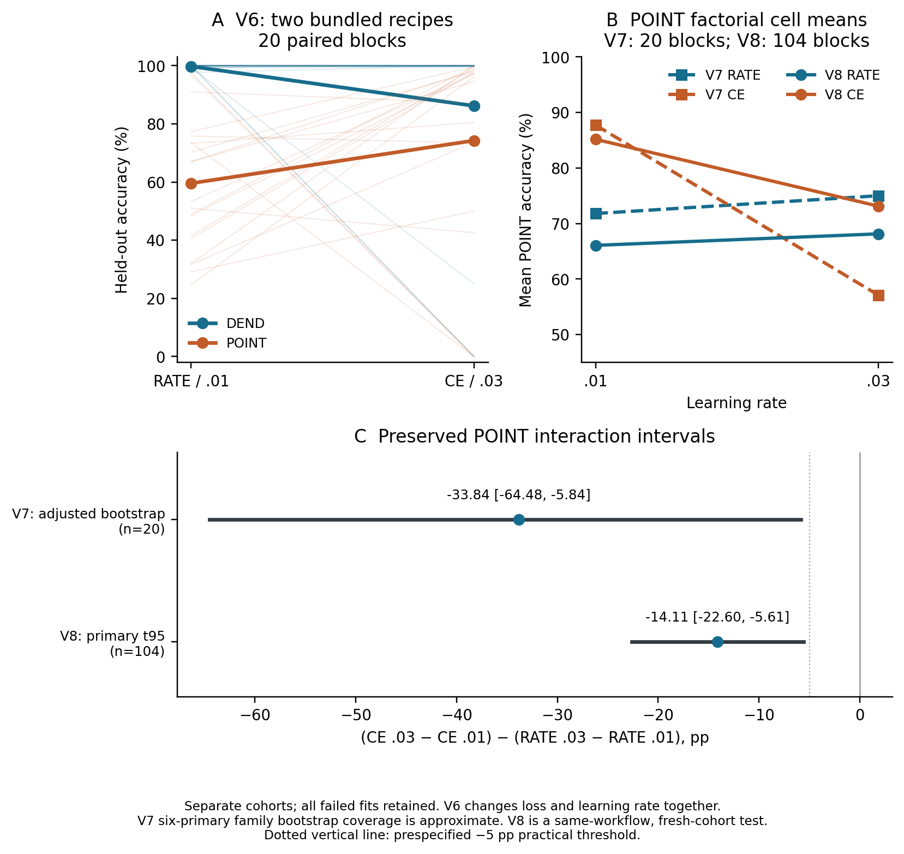
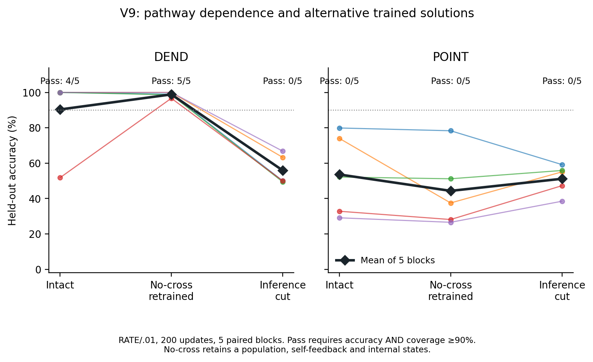
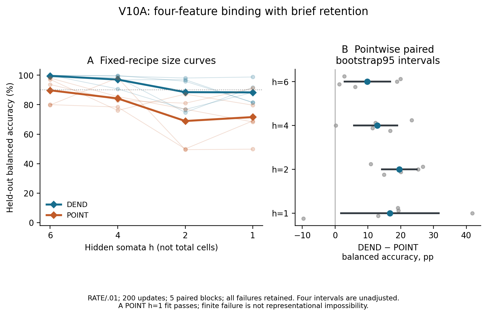

# Abstract

A spiking network's measured performance depends on its representation, learning rule, and permitted output. These dependencies complicate claims that dendritic computation or cross-cell recurrence is necessary for a task. We synthesize five sequential, individually frozen computational studies comparing graded dendritic compartments (DEND) with a strong point-neuron network containing native-spiking branch cells (POINT). The studies retain hard forward spikes, reset, and a count decoder that treats every tie as an error. On delayed XOR, an initial two-recipe comparison was inconclusive for its primary contrast. A subsequent factorial study motivated a fresh-cohort POINT experiment with 104 paired training/data blocks: the prespecified loss-by-learning-rate interaction was −14.11 percentage points, with approximate Student-t 95% interval [−22.60, −5.61]. Its negative direction recurred, while the preceding cohort's crossover of loss-effect point estimates did not. A separate five-block recurrence intervention found that all five DEND populations retrained without cross-cell connections passed the accuracy/coverage gate, with mean accuracy 98.87%, although cutting intact models only at inference reduced their mean from 90.35% to 55.90%. Thus a learned solution's pathway dependence did not establish that pathway's necessity for passing the task. Finally, a five-block feature-binding pilot at four fixed sizes found higher mean balanced accuracy for DEND under RATE/.01 and 200 updates, but one minimum-size POINT network also passed. The complete record contains 716 new fits and 10 derived inference cuts; these are not pooled independent replications. The contribution is a traceable case study separating training interaction, solution dependence, and finite-budget size tradeoffs. It establishes neither a general architecture ranking, a representational impossibility result, nor physical energy efficiency.

# Introduction

Compartmental computation offers a way to organize nonlinear processing before somatic integration. Two-layer abstractions of a detailed pyramidal-cell model [1] and experiments on thin dendrites [2] motivate asking what local nonlinear subunits contribute to computation. Those results do not imply that a particular abstract dendritic network must outperform a point-neuron network with comparable computational resources. A comparison must specify both models, the information available to them, the learning procedure, and the output used to judge success.

This distinction is especially important for native-spike networks. Surrogate-gradient methods permit optimization through discontinuous spike operations by substituting a derivative during learning [3]. Consequently, a failed fit need not identify a representational limit. Conversely, successful task performance does not determine which anatomical or computational pathway was indispensable: cutting a trained pathway and training a model without that pathway answer different questions.

The present work is a synthesis of the V6–V10 population studies in the Temporal Attention Neuron (TAN) research programme. It is separate from the earlier TAN evidence manuscript on history sensitivity, addressing, and recoverable information. The populations studied here are explicit discrete compartmental networks, not the original single-unit temporal-attention equation. The names DEND and POINT identify two implementations of the same network scaffold. POINT already contains nonlinear branch cells and is not a single memoryless affine-threshold comparator.

We organize the evidence around three questions. First, how much do two specified loss functions and learning rates interact under a fixed native-spike learning contract? Second, does dependence of a trained delayed-XOR solution on cross-cell recurrence imply that a population without those connections cannot learn a passing solution? Third, what happens to learned feature binding when the number of hidden somata decreases while each same-size architecture pair retains matched parameters and continuous-state counts?

The five studies were executed sequentially, with later questions informed by earlier results. Each new study fixed its own protocol and scientific sources before generating its scientific data, and locked trained weights before generating held-out data. This paper introduces no additional training or test cohort. It preserves the distinction between an exploratory observation and a later prespecified fresh-cohort test, includes failures in every summary, and limits structural interpretations to what the interventions identify.

# Study record and inferential structure

## Five studies, not one pooled experiment

Table 1 states the scientific units and interventions. Each training run uses 128 episodes and 200 full-batch updates. Each independent seed/data block has 512 fresh held-out episodes, shared across the relevant conditions. All final fits are tested, including those that fail training. The block jointly varies initialization and sampled data; these sources of variation are not separately estimated.

| Study | Task and conditions | Paired blocks | New fits | Final tested models |
|:--|:--|--:|--:|--:|
| V6 | Delayed XOR; DEND/POINT × RATE/.01 or CE/.03 | 20 | 80 | 80 |
| V7 | Delayed XOR; DEND/POINT × RATE/CE × .01/.03 | 20 | 160 | 160 |
| V8 | Delayed XOR; POINT only × RATE/CE × .01/.03 | 104 | 416 | 416 |
| V9 | Delayed XOR; intact and no-cross retraining, plus inference cuts, both architectures | 5 | 20 | 30 |
| V10A | Feature binding; DEND/POINT × hidden-soma counts 6, 4, 2, 1 | 5 | 40 | 40 |

*Table 1. Study inventory. V9 adds ten derived inference-cut checkpoints without new training. There are 716 new fits, 726 tested model conditions, and 371,712 test model-episode evaluations. None of these totals replaces the study-specific number of independent blocks.*

The original research reports, protocols, seed registries, weights, data, gradients, and checks remain unchanged. The [evidence ledger](EVIDENCE.md) links the sources for the paper's numerical claims. Earlier descriptions such as “local only” or “not pushed” describe the status at execution time; subsequent publication does not retroactively alter those records.

V6 also inspected failures already observed in V5. That analysis reused saved trajectories and is explicitly post hoc, not an additional cohort. V5 had separately selected POINT CE/.003 through an equal-budget configuration search. V6–V8 did not include that configuration. Their fixed grids must therefore not be described as independent tuning of each architecture, or as superseding V5's uncertain primary comparison after selection.

## Prespecification and interpretation

V6's primary descriptive contrast compares DEND CE/.03 with RATE/.01, changing two factors together. V7 separates loss and learning rate in a factorial design, with six primary accuracy contrasts: loss main effect, learning-rate main effect, and their interaction within each architecture. V8 selects one question after seeing V7, then tests it in a fresh, larger POINT cohort. V9 and V10A are small exploratory intervention and size studies. A single primary contrast in V8 does not make the other studies confirmatory.

Protocols and source hashes were committed locally before scientific data, rather than deposited in an external trial registry. The pre-test checkpoint commit precedes held-out generation in each study. No training seed was replaced, no final checkpoint was chosen using held-out results, and no failed run was excluded. V6's separately written verifier was added at its checkpoint commit before testing; its thirteen pre-data frozen scientific files remained unchanged. V7–V10 included their independent checkers in the pre-data freeze.

# Models, tasks, and learning contract

## Native equations and the POINT baseline

Let $h$ denote the number of hidden somata, with $2h$ local branch states and two output states. Inputs $x_t\in\mathbb{R}^{6}$ are row vectors. Every episode begins with zero branch, soma, output, previous-spike, and count states. The shared branch candidate is

$$
\widetilde d_t=0.85d_{t-1}+0.25\left(x_tW_{\mathrm{in}}+s_{t-1}W_{\mathrm{rec}}+b_d\right).
$$

DEND stores $d_t=\widetilde d_t$ and passes local values $\ell_t=\max(\widetilde d_t,0)$. POINT emits native branch spikes

$$
z_t=\mathbf 1\{\widetilde d_t>0.5\},\qquad
d_t=\widetilde d_t\odot(1-z_t),\qquad \ell_t=z_t.
$$

For soma $j$, two local values feed a native threshold/reset operation:

$$
\widetilde v_{t,j}=0.65v_{t-1,j}+0.5(\ell_{t,2j}+\ell_{t,2j+1})+b_{v,j},
\qquad s_{t,j}=\mathbf 1\{\widetilde v_{t,j}>0.5\},
$$

$$
v_t=\widetilde v_t\odot(1-s_t).
$$

The output uses **previous-step** hidden spikes:

$$
\widetilde o_t=0.65o_{t-1}+s_{t-1}W_{\mathrm{out}}+b_o,
\qquad r_t=\mathbf 1\{\widetilde o_t>0.5\},\qquad
o_t=\widetilde o_t\odot(1-r_t).
$$

All emitted forward spikes are hard binary during training and inference. A candidate equal to 0.5 does not spike. DEND's graded branch states are internal variables; they are not read by an analog classifier. Dense input access is identical between architectures. POINT therefore retains a two-subunit nonlinear stage for every hidden soma, with its own subthreshold state and reset, rather than being restricted to a single affine threshold.

The parameter shapes are $(6,2h)$, $(h,2h)$, $(2h)$, $(h)$, $(h,2)$, and $(2)$ for input weights, recurrent weights, branch biases, soma biases, output weights, and output biases. Thus

$$P(h)=2h^2+17h+2,\qquad S(h)=3h+2,$$

where $S$ counts continuous states, excluding $h$ previous hidden-spike values and two output-count accumulators. DEND represents $h+2$ spiking cells and $2h$ graded compartments; POINT represents $3h+2$ spiking cells. Matching parameters and state at the same $h$ does not match represented cell count, local nonlinearities, reset derivatives, activation patterns, or physical cost. V6–V9 use $h=6$: 176 stored parameters and 20 continuous states, with 8 versus 20 represented spiking cells.

The models retain the inherited initialization: independent zero-mean normal input, recurrent, and output weights with standard deviations .45, .25, and .5, respectively; branch, soma, and output biases are .15, .05, and .1. Within a study block, architecture/recipe conditions share the sampled vector. In V10A, initialization is paired between architectures separately at each size, since parameter dimensions differ.

## Output and learning

Every episode contains 24 steps, indexed 0–23. The decoder counts native output spikes over steps 16–23:

$$C_k=\sum_{t=16}^{23}r_{t,k}.$$

A unique larger count predicts its class. Every tie, including $0/0$ silence and $8/8$ saturation, abstains and counts as an error. Coverage is the fraction with a unique winner; unconditional accuracy retains all episodes in its denominator. A label-independent forced binary guess has expected 50% accuracy on balanced XOR, but with coverage $c$ its expected unconditional accuracy is $c/2$. A low score with many abstentions is not by itself a representational impossibility certificate.

Learning uses the surrogate slope

$$g(a)=\frac{1}{(1+5|a-0.5|)^2}$$

in backward propagation, including reset paths. This is a specified proxy learning rule, not the exact derivative of the discontinuous native-spike objective [3]. Labels enter losses and evaluation only, never the forward dynamics, readout cue, state initialization, or a separate spike generator.

For batch size $N=128$, CE is cross-entropy of logits $0.5C$. RATE is

$$
L_{\mathrm{RATE}}=\frac{1}{2N}\sum_{i=1}^N\sum_{k=0}^1
\left(C_{ik}/8-T_{ik}\right)^2,
\qquad
T_{ik}=\begin{cases}.75,&k=y_i,\\.125,&k\ne y_i.\end{cases}
$$

Both objectives add $10^{-4}\operatorname{mean}(\theta^2)$. Adam [4] uses $\beta_1=.9$, $\beta_2=.999$, $\epsilon=10^{-8}$, full batches, global gradient-norm clipping at 1, and post-update parameter clipping to $[-2,2]$. Each fit receives exactly 200 updates and uses the final checkpoint. CE/RATE effects include their chosen scaling, targets or logits, surrogate gradients, clipping, Adam, and relative regularization; they are not isolated properties of a loss name. Equal nominal learning rates do not imply equal effective parameter steps.

## Delayed XOR, V6–V9

Each dataset balances the four bit pairs exactly. The first bit selects input channel 0 or 1 and begins at a uniformly sampled step 2–4 for four steps. The second selects channel 2 or 3 and begins at step 10–12 for four steps. Each cue amplitude is independently uniform on [.8,1.2]. Channel 5 has independent uniform [0,.5] nuisance values at steps 7–9; channel 4 carries a common readout cue of 1 at steps 16–23. Independent Gaussian noise with standard deviation .03 is added to all input entries, followed by clipping below zero. The label is XOR of the two bits. Both informative cues end by step 15, before readout.

Episodes reset independently and share no hidden state or batch statistics. Train/test namespaces are distinct, with literal seed lists saved in each study. The checks regenerate datasets, verify their labels and timing, and test native reset and batch independence. They do not turn an empirical control into a formal proof about every possible data-processing error or identify exactly which retained state encodes each bit.

## Recurrence intervention, V9

V9 uses RATE/.01 for both architectures. The intact network is compared with a retrained no-cross network whose recurrent weight from source soma $i$ to target branch $j$ survives only if $i=\lfloor j/2\rfloor$. Of 72 recurrent slots, 60 cross-cell weights are fixed at zero and 12 self-feedback weights remain. The removed slots start at zero and have zero gradients and Adam moments throughout. Raw gradients are projected before global clipping. The regularizer continues to average over the original 176 stored slots, leaving 116 effective trainable parameters.

For every intact fit, a third condition multiplies its final parameter vector by the same mask only for inference. These ten cut models receive no new training. All 30 models share held-out inputs within each of five blocks. The retrained network still contains multiple cells, branch/soma/output state, self-feedback, and population feedforward integration. Masking changes both capacity and optimization geometry. Intact success with retrained failure would therefore support a conditional learning difference under this intervention and budget, not a proof that no no-cross solution exists. A passing retrained model provides an observed alternative solution meeting the finite evaluation gate; it does not prove exact XOR correctness for every allowed input.

## Feature binding and size, V10A

The binding target is defined on four latent bits:

$$y=(b_0\land b_1)\lor(b_2\land b_3).$$

All 16 patterns are equally frequent: 8 examples of each per training set and 32 per test set. Four independently sampled high amplitudes $U[.8,1.2]$ and low amplitudes $U[0,.1]$ encode the bits as currents held on channels 0–3 at steps 8–15. Other feature drive is zero before noise. Nuisance, common readout cue, and clipped Gaussian noise follow the XOR pipeline. Three-high and four-high patterns are positive; cross-pair-only patterns are negative. Pattern balance produces seven positive and nine negative patterns, so the primary metric is balanced accuracy, the mean of the two class recalls with abstentions wrong. Majority-class prediction has 56.25% ordinary accuracy but 50% balanced accuracy.

Earlier V1 controls already examined handwired local nonlinear binding against pooling and a strong POINT network. V10A instead tests learned input allocation and size under the retained equations; it is not the first demonstration of local binding in this programme. Both architectures learn dense input, recurrent, and output weights; DEND receives no privileged wiring of the correct conjunctions. Five blocks share the same data across $h\in\{6,4,2,1\}$, using RATE/.01 and 200 updates without size or checkpoint selection. Input ends before readout, making this binding with brief retention, not a purely static classifier comparison. Held-out examples are new amplitude/noise realizations of the same 16 patterns, not unseen logical combinations.

The static target is not implementable by a single memoryless affine threshold: positive vectors $(1,1,0,0)$ and $(0,0,1,1)$ have the same sum as negative vectors $(1,0,1,0)$ and $(0,1,0,1)$, contradicting the required strict separation of their summed scores. Two ordinary threshold subunits followed by an OR threshold can implement it. This elementary observation motivates local nonlinear decomposition but is not a lower bound for the recurrent, stateful POINT network, its branch cells, or its temporal count decoder. V10A includes no pooling intervention that would isolate the causal necessity of local partitioning.

# Statistical analysis and verification

## Contrasts, intervals, and failures

Let $A_{s,L,\eta}$ be unconditional held-out accuracy in block $s$, loss $L$, and learning rate $\eta$ for a specified architecture. V7 and V8 define the interaction

$$d_s=(A_{s,\mathrm{CE},.03}-A_{s,\mathrm{CE},.01})
-(A_{s,\mathrm{RATE},.03}-A_{s,\mathrm{RATE},.01}).$$

Negative $\bar d$ means that increasing the tested learning rate has a less favorable accuracy effect under CE than under RATE. It does not require a reversal of the CE-minus-RATE difference at the two rates, nor imply that every individual change harms performance.

V6 uses 20,000 percentile-bootstrap resamples of the 20 complete paired blocks. V7 reports pointwise 95% intervals and nominal Bonferroni-level 99.1667% intervals for six primary contrasts. Those family-level intervals have approximate coverage contingent on the small-sample bootstrap and do not convert the exploratory study into confirmation. Secondary comparisons remain unadjusted.

V8 fixes one primary interaction and 104 fresh blocks using the V7 pilot sample SD .5125263. This is the smallest integer $n$ satisfying the plug-in planning target $t_{.975,n-1}s_{\mathrm{pilot}}/\sqrt n\le .10$. It targets approximately a ten-percentage-point half-width, not guaranteed power or precision. Inflating the uncertain pilot SD by 1.5 gives a planned half-width of 14.95 points at the same sample count. The primary interval is

$$\bar d\ \pm\ t_{.975,103}\frac{s_d}{\sqrt{104}},$$

with a prespecified paired-percentile bootstrap interval as sensitivity analysis. Effects need not be Gaussian; Student-t coverage is approximate, justified by independent-block averaging. A primary upper endpoint below −5 percentage points was the frozen practical-magnitude criterion. No observed result changed the sample count or selected an interval method.

V9's two primary descriptive contrasts are intact-minus-retrained accuracy, one per architecture. Including secondary accuracy and failed-run contrasts gives eight pointwise exploratory intervals. V10A has four DEND-minus-POINT balanced-accuracy contrasts, one per size. Both studies use 20,000 paired-bootstrap resamples of five blocks, without family-wide multiplicity protection. Five blocks remain five despite hundreds of episodes or thousands of resamples.

V6–V9 define failure as accuracy below 90% or coverage below 90%; V10A replaces accuracy with balanced accuracy. All failures remain in means and contrasts. Fully silent means every episode has both readout counts zero. Fully abstaining means every episode lacks a unique winner, whether from zero or nonzero ties. Marginal failure proportions receive 95% Wilson intervals. Zero failures in 20 or 5 blocks still have upper endpoints of 16.11% or 43.45%, respectively. Intervals crossing zero are inconclusive, not equivalence; degenerate intervals do not establish population equality or noninferiority.

## Internal numerical checks and activity measures

The archived native/data/optimizer/statistics checkers regenerate inputs and initialization, reconstruct Adam updates from saved clipped gradients, replay saved checkpoints, and compare final native train/test traces. Spikes, counts, and predictions must match exactly; state/candidate tolerance is $10^{-10}$. They independently recompute relevant metrics and contrast statistics. The checks collectively cover 143,200 updates and 6,444 checkpoints. Saved audits report 978,440 assertions and exact spike/count/prediction agreement over all 371,712 test model-episode evaluations. These counts describe engineering coverage, not independent scientific replications.

The gradient audits recompute 2,228 sampled full-batch updates and test 121,806 final-checkpoint scalar derivatives by central differences on a locally anchored differentiable surrogate graph. The largest reported final derivative residual is $7.04\times10^{-10}$; sampled clipped-gradient residuals are zero. Such finite differences test the implemented surrogate chain rule, not the derivative of hard spikes. Replaying stored-gradient Adam does not independently derive every gradient, and native trajectories are replayed at saved checkpoints rather than every unsampled update.

V9/V10A additionally report branch, hidden, and output events, total events, and summed absolute changes in continuous state, including zero initialization. DEND's graded branches have zero discrete branch events by definition but still require computation. These measures are not joules, ATP, hardware energy, or biological metabolic estimates. State variation depends on coordinates and scales.

Decision timing is a retrospective description of cumulative output-count leaders in the eight-step readout. An episode is correctly settled by a prefix only if its unique leader remains correct through every later prefix. All errors and abstentions remain in the denominator. V10A also assigns latency 9 to any episode that never settles correctly. This metric uses future prefixes for scoring; it is not an online stopping rule, a changed decoder, or a biological time in milliseconds.

# Results

## Training failure can precede held-out evaluation

The V6 post hoc inspection of V5 DEND CE/.03 seeds 5, 7, and 9 found final training accuracies of 50%, 0%, and 0%, matching their saved test accuracies. These failures were already present during training, rather than appearing only on held-out data. Output-silent cases retained hidden firing and small nonzero proxy gradients. Sparse saved checkpoints did not determine the exact collapse update, exclude unsampled excursions, establish an absorbing zero-gradient state, or identify its cause. The five V5 development seeds that had selected CE/.03 had all reached 100% validation accuracy; unreliable transfer of a selected recipe to new training seeds is distinct from a within-model train/test gap.

On V6's new delayed-XOR cohort, DEND RATE/.01 achieved mean held-out accuracy 99.75% and passed 20/20 blocks; DEND CE/.03 achieved 86.18% and passed 17/20. The primary CE/.03-minus-RATE/.01 contrast was −13.56 points, with paired-bootstrap 95% interval [−28.75, +0.14], and remained inconclusive. The mean POINT scores were 59.56% and 74.24%, with 3/20 and 11/20 passing, respectively. These results apply to 20 paired blocks, 128 training examples and 200 updates; they do not separate loss from learning rate. Two completely abstaining DEND CE/.03 fits were saturated $8/8$ ties, rather than complete silence. A failed native decoder cannot uniformly be described as a silent network.

## A loss-by-learning-rate interaction recurs, but the crossover does not

V7's 20-block factorial study found a POINT interaction of −33.84 points. The pointwise 95% interval was [−56.33, −12.43], and the nominal six-primary family-level interval was [−64.48, −5.84]. DEND's interaction was −13.72 points, with family-level interval [−36.27, +2.55]. V7's POINT CE-minus-RATE simple-effect estimates were +15.94 points at .01 and −17.90 points at .03, illustrating why its near-zero marginal loss effect did not establish interchangeable objectives. These were exploratory estimates with only 20 blocks and approximate tail coverage.

V8 tested the POINT interaction with 104 fresh blocks and the same four configurations. Table 2 retains all 416 fits, including 251 test failures.

| POINT configuration | Mean accuracy (%) | Mean coverage (%) | Failed / 104 | Fully silent / 104 | Fully abstaining / 104 |
|:--|--:|--:|--:|--:|--:|
| RATE/.01 | 66.06 | 80.50 | 87 | 0 | 1 |
| RATE/.03 | 68.13 | 84.71 | 79 | 0 | 1 |
| CE/.01 | 85.16 | 92.69 | 38 | 2 | 2 |
| CE/.03 | 73.13 | 78.57 | 47 | 5 | 7 |

*Table 2. V8 outcomes on fixed delayed XOR, 200 updates, and 104 paired blocks. Accuracy includes abstentions. Fully silent and fully abstaining counts are not interchangeable.*

The primary interaction was −14.105694 points, with Student-t 95% interval [−22.603812, −5.607576]. The bootstrap sensitivity interval was [−22.562491, −5.842426]. The block-effect SD was 43.697729 points and the realized primary half-width 8.498118 points. The primary interval met the prespecified direction and practical-magnitude rules within this setup, although its upper endpoint was only 0.607576 points beyond the −5-point threshold and coverage remains approximate.

The CE-minus-RATE estimates were +19.10 points at .01 and +5.00 points at .03. Thus the negative interaction recurred, while V7's opposite-sign simple-effect point estimates did not. The smaller V8 interaction point estimate does not by itself establish a between-cohort difference; the studies were not pooled or treated as repeated measurements of one trained network. V8 contains no DEND arm and supplies no new architecture comparison.

The train/test pass classification changed for 13 of 416 V8 fits; 250 failed training and 251 failed testing. This prevents extending V6's identical train/test pass classifications to every new cohort. It also supports reporting both training and held-out behavior instead of presuming all poor test outcomes have one source.

## Dependence of an intact solution does not establish recurrence necessity

Under V9's fixed RATE/.01, 200-update budget and five fresh blocks, the DEND no-cross retraining condition passed in all five blocks. Mean held-out accuracy was 98.87%, with individual accuracies 96.68–100%. Intact DEND passed 4/5 at mean 90.35%; the corresponding inference cuts passed 0/5 at mean 55.90% (Table 3).

| Architecture | Condition | Mean accuracy (%) | Coverage (%) | Passed / 5 |
|:--|:--|--:|--:|--:|
| DEND | Intact | 90.35 | 92.07 | 4 |
| DEND | No-cross retraining | 98.87 | 99.45 | 5 |
| DEND | Inference cut | 55.90 | 92.15 | 0 |
| POINT | Intact | 53.59 | 70.66 | 0 |
| POINT | No-cross retraining | 44.34 | 67.50 | 0 |
| POINT | Inference cut | 51.17 | 80.16 | 0 |

*Table 3. V9 held-out recurrence interventions. Passing requires both accuracy and coverage at least 90%. The masked network remains multicellular and retains 116 effective trainable parameters, self-feedback, and native internal state.*

DEND intact-minus-retrained accuracy was −8.52 points, with exploratory paired 95% interval [−26.76, +0.98]; it does not establish that removing recurrence generally improves training. Intact-minus-inference-cut was +34.45 points [17.70, 47.58]. The latter measures the intervention's effect on those specific learned solutions. The successful retrained models show that alternative populations can pass this finite task without cross-cell recurrence. They do not establish that one cell solves delayed XOR or identify membrane leakage, bias drift, self-feedback, or another retained process as the sufficient mechanism.

POINT's intact-minus-retrained contrast was +9.26 points [1.52, 23.05], but every intact and retrained fit failed the predefined gate. Its intact-minus-cut contrast was +2.42 points [−10.27, +15.12]. This record lacks the premise of reliable intact success needed even for a conditional “intact succeeds, retrained fails” interpretation. Finite failure under one recipe cannot demonstrate physical necessity. All V9 intervals are pointwise, exploratory, and based on five blocks; no architecture-wide ranking is inferred.

## Learned binding changes with size without establishing a representation barrier

On V10A's binding distribution, five paired blocks, fixed RATE/.01 and 200 updates, DEND had higher mean balanced accuracy at each tested size (Table 4). All four pointwise paired-bootstrap intervals lay above zero. They are unadjusted exploratory intervals, not a protected family of confirmatory tests or a comparison after independent optimizer selection.

| $h$ | DEND BA (%) | POINT BA (%) | Passes D/P | $\Delta$BA (pp) | 95% interval (pp) |
|--:|--:|--:|:--|--:|:--|
| 6 | 99.57 | 89.76 | 5 / 3 | +9.82 | [2.87, 16.77] |
| 4 | 97.04 | 84.24 | 5 / 1 | +12.81 | [5.77, 18.91] |
| 2 | 88.50 | 68.92 | 3 / 0 | +19.58 | [14.32, 24.84] |
| 1 | 88.34 | 71.60 | 2 / 1 | +16.74 | [1.85, 31.59] |

*Table 4. V10A. BA is balanced accuracy; $\Delta$BA is DEND minus POINT. Each pass count is out of five; passing requires BA and coverage at least 90%. Intervals are pointwise and exploratory. The size axis counts hidden somata, not all represented cells. Both architectures have 176, 102, 44, and 21 parameters at $h=6,4,2,1$, respectively.*

DEND's observed all-block success held at $h=6$ and $h=4$, but not at $h=2$ or $h=1$. The curve is not forced to be monotonic. POINT's mean score was higher at $h=1$ than at $h=2$, and its $h=1$ seed 0 passed with BA 91.20% and coverage 97.07%, exceeding the paired DEND BA of 81.55%. That POINT model has two branch cells, one hidden soma, and two outputs: five spiking cells, not one. Its passing case prevents interpreting the minimum tested POINT size as unable to meet the task gate. The static affine-threshold argument does not apply to this network.

These results compare complete learning setups. Decreasing size changes state, parameter count, matrix computation, aggregate initialization-drive variance, and the per-coordinate coefficient of the mean-squared-parameter penalty. The per-weight initialization distributions themselves remain fixed. Both architectures have dense access to all features; no learned branch-allocation mechanism was independently identified. Brief retention, local transformations, reset derivatives, and optimizer dynamics can all contribute to the observed curves.

## Computational proxies and cost accounting

At $h=6$ in V10A, mean total native events per episode were 62.60 for DEND and 83.66 for POINT; mean state L1 variation was 48.74 and 61.85. At $h=1$, the corresponding event means were 26.41 and 30.04. These descriptions include all episodes and failed fits, and achieved performance differs between conditions. They do not show matched-performance energy savings. In particular, POINT emits branch events while DEND performs graded branch transfers that do not appear in the event count.

For general $h$, dense matrix multiply-accumulate terms per episode-step are $2h^2+14h$ forward and $4h^2+16h$ backward, excluding input gradients. At $h=6$, these are 156 and 240 for both architectures. Scalar nonlinearities, reset operations, objective evaluation, optimizer work, storage, I/O, and audits are not included. The dense implementation still executes matrix terms with zero recurrent weights in V9, so masking is not measured sparse-hardware savings.

| Study | Updates | Training/artifact time (s) | Held-out/artifact time (s) |
|:--|--:|--:|--:|
| V6 | 16,000 | 72.271 | 12.279 |
| V7 | 32,000 | 146.784 | 24.733 |
| V8 | 83,200 | 398.360 | 77.126 |
| V9 | 4,000 | 18.400 | 4.890 |
| V10A | 8,000 | 32.398 | 3.964 |

*Table 5. Recorded single-thread CPU execution times from separate studies, including each stage's artifact overhead and excluding audits. They are environment-specific observations, not an energy estimate or a hardware benchmark.*

# Discussion

## Three conclusions at different levels

The first result concerns the learning setup. Within POINT, the effect of increasing the tested learning rate depends on the specified objective; the negative interaction selected after V7 recurred in V8's new cohort. Neither the numerical interaction value nor its sign is asserted as a general law of spiking networks. The intervention changes objective scaling and gradient trajectories within Adam and clipping, so it does not identify a cellular cause of collapse. The failure forms also vary: saturation ties, partial output coverage, and silence must remain distinct.

The second result concerns alternative solutions. V9 demonstrates why inference ablation and from-scratch ablation cannot be substituted for one another. A large loss after cutting a trained solution is compatible with successful retraining without the cut pathway. Here, observed no-cross DEND populations meet the specified gate, directly limiting a necessity claim for that finite task contract. At the same time, a no-cross solution is not a single-cell solution, and the intervention does not locate the retained memory or nonlinear-combination mechanism.

The third result concerns finite-budget size tradeoffs. V10A produces a useful descriptive curve with a strong POINT branch-cell comparator and explicitly matched same-size parameter/state counts. It does not construct a task outside the representational reach of that comparator. The successful minimum-size POINT fit is a concrete reason not to infer impossibility from its lower average reliability. A claim about resource savings would additionally require a clear resource definition and a comparison at matched successful performance; counting fewer discrete branch events in DEND is insufficient.

Together, these findings distinguish what a model can represent, what a specified procedure learns, what one learned solution uses, and what a declared decoder exposes. They do not remove optimization from architecture evaluation. Instead, they make the tested procedure part of the claim and retain counterexamples to stronger interpretations.

## Relationship to dendritic computation

The two-layer biological analogy motivates separating local nonlinear transforms from somatic integration [1,2]. DEND's ReLU compartments do not simulate NMDA conductances, morphology, ionic fluxes, or biological learning. POINT's extra branch cells provide a conventional network realization of local nonlinearity, so the comparison asks about two implementations of a small computational scaffold rather than “a complex neuron versus a single linear point neuron.”

An intended long-timescale candidate was not executed in V10A. A separate earlier TAN study used modified dynamics, known timing/keys, analog samples, and an equation-based inverse decoder for a 150 ms/10 ms comparison. Those conditions do not establish a physical timescale for the present count-decoded population models. Both current architectures retain continuous subthreshold states and the same branch/soma retention factors; maintaining a graded state has not been shown to have zero cost.

The present synthesis closes the completed diagnostic and pilot record. It does not launch another loss-by-learning-rate sweep or choose a new architectural search based on these tests. A subsequent mechanistic study would need a distinct intervention and fresh evidence, with the hypothesized information pathway and remaining alternative explanations specified before outcomes.

# What this does not establish

The studies do not establish universal DEND superiority, equivalence when an interval crosses zero, a failure-free population when no sampled run fails, or a general ranking after independently tuning both architectures. V8's POINT-only fresh-cohort result is not new evidence for an architecture contrast. Repeated reporting of the same fits, or extensive numerical checking, is not additional independent scientific replication.

No finite-budget training failure proves a representational impossibility or the physical necessity of a pathway. A successful no-cross population does not prove a one-neuron solution, correctness for every possible input, or a particular retained mechanism. The binding task's static affine-threshold obstruction is not an obstruction for the implemented recurrent POINT baseline. V10A does not isolate causal necessity of local nonlinear partitioning or generalization to unseen Boolean combinations.

No energy, biological-realization, hardware-efficiency, or biological-latency claim follows from event counts, state variation, abstract cell counts, or retrospective prefix settling. The studies contain no external independent replication, peer review, or biological experiment.

# Limitations

The evidence is confined to two small synthetic distributions and inherited equations, initialization, native count decoding, and surrogate slope. V6/V7/V8 examine four or fewer fixed recipes, not the space of possible optimizers; V9/V10A use one recipe. Differences in optimization quality remain part of these comparisons. V5's independently selected POINT CE/.003 condition is outside this fixed grid, and its uncertain primary architecture comparison cannot be replaced by a favorable fixed-recipe result.

The studies are sequentially motivated. Fresh cohorts protect each later study from reuse of its own held-out outcomes, but do not make the programme's question selection independent of prior observations. V6's diagnostic inspection is post hoc. V7 remains exploratory despite nominal family-level intervals. V8 uses a pilot-based sample-size calculation and approximate Student-t coverage for heterogeneous block effects; its practical-threshold margin is small. The five-block V9/V10A intervals have limited tail information and no family-wide protection. Per-episode test precision does not compensate for uncertainty across newly trained networks.

The architectures match selected computational resources, not biological resources. V9 removes trainable capacity and changes clipping geometry along with connectivity. V10A size changes alter multiple resources and aggregate drive statistics, and the two models differ in reset paths and nonlinear activation patterns. All modes share held-out data within a block, so their outcomes are paired rather than independent. Across blocks, initialization and sampled examples change together.

The internal checkers are separately implemented but belong to the same AI-assisted workflow. They use the same specifications and numerical environment, and their reported assertion counts do not measure the probability of scientific correctness. Sampling analytic gradients and checking an anchored surrogate graph does not independently rederive every backward update. Publication preparation verifies retained sources and numerical summaries; it is not a fresh execution of all experiments. Independent reproduction by other researchers, together with explicit alternative-model and task tests, remains unperformed.

# Data, code, and contributions

The repository [Temporal-Attention-Neuron](https://github.com/20171806011/Temporal-Attention-Neuron) contains the complete V6–V10 study directories under `research/dendritic-population-v6` through `research/dendritic-population-v10`. Each directory retains its protocol, seed registry, scientific source, saved data, weights, training gradients, checkpoint histories, held-out native trajectories, numerical checks, tables, and SHA-256 manifest. The [paper evidence ledger](EVIDENCE.md) records source identities and exact numerical extraction; [paper instructions](README.md) describe the build and validation artifacts. The source snapshot for this synthesis is `c75814eac5202e6a265ca42e78805f906d302249`.

The study protocol/checkpoint gates are respectively `26d85e9` / `0cb7d16` (V6), `8ad0b69` / `041693b` (V7), `cd5cd4e` / `3ec9ce1` (V8), `ad1d807` / `d4fde77` (V9), and `4dd3421` / `e77dd95` (V10A). Full identifiers and hashes are preserved in the study reports and ledger. Some checking scripts rewrite their result logs; reproduction should use an isolated checkout and preserve the published outputs. Hash identity establishes file identity, not scientific validity.

Li Zexu proposed the research direction and the requirement to preserve native neuronal firing. Protocol formalization, implementation, execution, numerical verification, evidence organization, and this manuscript draft were AI-assisted. AI systems are not listed as authors. This is an unreviewed research preprint; human scientific and authorship review remains necessary before journal submission.

# References

1. Poirazi P, Brannon T, Mel BW. Pyramidal neuron as two-layer neural network. *Neuron*. 2003;37(6):989–999. [doi:10.1016/S0896-6273(03)00149-1](https://doi.org/10.1016/S0896-6273(03)00149-1). [PubMed record](https://pubmed.ncbi.nlm.nih.gov/12670427/).
2. Polsky A, Mel BW, Schiller J. Computational subunits in thin dendrites of pyramidal cells. *Nature Neuroscience*. 2004;7:621–627. [doi:10.1038/nn1253](https://doi.org/10.1038/nn1253). The reported compartment-specific integration depends on the stimulation and spatial conditions of that study.
3. Neftci EO, Mostafa H, Zenke F. Surrogate gradient learning in spiking neural networks: Bringing the power of gradient-based optimization to spiking neural networks. *IEEE Signal Processing Magazine*. 2019;36(6):51–63. [doi:10.1109/MSP.2019.2931595](https://doi.org/10.1109/MSP.2019.2931595). [Author preprint](https://arxiv.org/abs/1901.09948).
4. Kingma DP, Ba J. Adam: A method for stochastic optimization. *International Conference on Learning Representations*. 2015. [Author preprint](https://arxiv.org/abs/1412.6980).

The cited external literature supplies biological motivation and learning-method context. It is not evidence for the numerical results of the present study. Repository sources for those results are enumerated in the accompanying evidence ledger.
