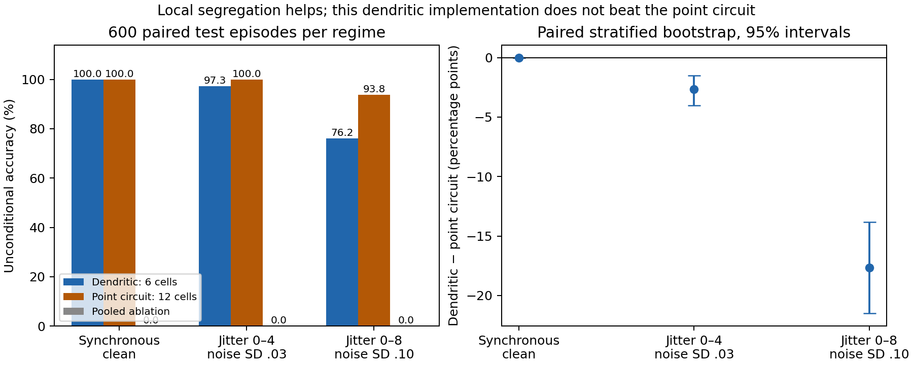

# DEND-POP-1: local dendritic computation in a native-spiking population

## Outcome

A six-cell prototype with separate graded dendritic compartments classifies the fixed spatial-pair task, and preserves neuronal threshold/reset firing without an external output pulse generator. It does **not** outperform the ordinary state-matched spiking circuit. Local separation is useful in this deliberately structured task; this is not a distinctive TAN or biological advantage.

The frozen protocol was committed as `9569271` before input generation and the main run. Exactly one main run completed in approximately 1.38 seconds on CPU. No parameters, wiring, readouts or decision thresholds were changed after seeing results. No classifier was fitted, no model downloaded, and no costly compute was used.

## Test results (600 histories, paired across arms/regimes)

| Regime | Dendritic accuracy | Point-network accuracy | Pooled accuracy | Dendritic minus point (95% paired interval, percentage points) |
|---|---:|---:|---:|---:|
| Synchronous, no noise | 100.00% | 100.00% | 0.00% | 0.00 [0.00,0.00] |
| Jitter0–4, input-noise SD.03 (primary) | 97.33% | 100.00% | 0.00% | −2.67 [−4.00,−1.50] |
| Jitter0–8, input-noise SD.10 (stress) | 76.17% | 93.83% | 0.00% | −17.67 [−21.50,−13.83] |

The primary DEND-minus-POOLED difference is97.33 percentage points, paired interval[96.00,98.50], passing the predeclared >10-point/positive-lower-bound rule. This is a positive mechanism control against a known pooling obstruction, not a difficult general benchmark or proof of broad superiority. Secondary intervals are descriptive, not multiplicity-adjusted confirmatory claims. Zero observed errors or a degenerate bootstrap interval does not prove population perfection.

All covered predictions in this finite sample are correct. The errors are abstentions (silence or tied output counts): DEND16/600 and143/600 in the two noise regimes, versus POINT_NETWORK0/600 and37/600. POOLED abstains on every episode because all three class channels have equal counts. Reporting its0% unconditional accuracy follows the frozen tie-as-abstain rule; it is not a claim that forced random guessing has0% accuracy. Conditional accuracy is undefined for POOLED, not100%.

Development (120) and validation (120) histories are independently generated and separately reported in `results/results.json`. They were not used to select parameters. DEND accuracies on the primary regime are99.17% development,96.67% validation,97.33% test; the strong point circuit scores100% on each. This is a fixed-wiring diagnostic, not evidence of learning or generalization to unseen class definitions.

## Architecture, signals, and learning

Four external sensory channels feed three pairs of dendritic compartments, one hidden neuron per predefined spatial partition. Local graded branch outputs feed the cell's own soma. Native hidden spikes cross a one-update synaptic delay and drive three output neurons, which also fire by native threshold/reset. The decoder sees only the output population's counts over32 updates, never labels, dendritic voltages, raw inputs or stored evaluator trajectories.

The output layer in this first prototype is a one-to-one native relay: .6 input exceeds its .5 threshold, so each hidden spike produces an output spike one step later. It is **not** a recurrent attractor or a learned cooperative decision layer. The class decision is an external unique-count argmax. The population represents different spatial partitions in different channels; no claim of distributed working memory or learned binding follows.

The branch partition and connections are hand-designed from the benchmark definition. There are no trained synapses, no plasticity, no feedback targets and no online weight updates. This avoids attributing an engineered conjunction to learned intelligence. A local-plasticity extension is a distinct next experiment, not something already achieved.

All waveforms are external benchmark inputs. The episode clock never commands a neuronal spike; no Poisson, scheduled, or label-driven output pulse module exists. The original TAN/P1B sources were not edited. The source audit did not identify a distinct extra generator to remove: native threshold/reset dynamics, readout decoders and stimulus generation are different objects. If a separate implementation is meant, its exact path is still needed before a targeted removal.

## Why the control behaves this way

In POOLED, both dendritic traces have the same linear leak. Their sum is the filtered sum of all four inputs, independent of how those inputs were partitioned. Each hidden neuron therefore sees the same current and produces the same output. This symmetry explains the ties; the prototype did not discover a new general impossibility theorem.

DEND applies a nonlinearity before adding branches, preserving which pair is coactivated. The ordinary point network also retains this local nonlinear computation, through native branch-neuron thresholds. Its better performance under jitter/noise is a directly observed counterexample to assuming that a graded dendritic implementation must outperform a small ordinary spiking circuit. The specific cause of that difference has not been isolated by an additional gain-matching or threshold intervention.

## Resource accounting

| Resource | DEND / POOLED | POINT_NETWORK |
|---|---|---|
| Cells | 3 hidden multicompartment +3 output =6 | 6 branch cells +3 hidden +3 output =12 |
| Continuous persistent state | 6 branch +3 hidden soma +3 output soma =12 binary64 scalars | Same12 binary64 scalars |
| Spike delay | 3 hidden spike bits; NumPy bool storage uses3 bytes | Same |
| Logical state payload | 96 bytes of floats plus3 logical bits (99 bytes with NumPy bool array) | Same |
| Sensory contributions | 12 channel-to-branch contributions/update | Same |
| Internal branch-to-hidden links | 6 graded currents | 6 native spike links |
| Hidden-to-output links | 3 one-step spike links | Same |
| Nonlinear computation | 6 branch rectifiers (DEND) or3 pooled rectifiers, plus6 soma threshold/reset decisions | 6 branch threshold/reset decisions plus6 soma threshold/reset decisions |
| Learning budget | Zero parameter-selection trials, zero fitted parameters | Same |

The frozen connectivity indices and scalar coefficients are additional static resources; all models use the same partition assignments and coefficient values. The evaluator's three output count accumulators, episode timing, stimuli and saved diagnostic trajectories are outside the neuronal state and are shared access resources. Each model is granted the same output window. No hidden target labels or original input histories are available at inference.

On the primary test regime, mean native events per delivered episode are:

| Arm | Branch events | Hidden events | Output events | Total |
|---|---:|---:|---:|---:|
| DEND | 0 | 3.6883 | 3.6883 | 7.3767 |
| POINT_NETWORK | 1.8500 | 1.8500 | 1.8500 | 5.5500 |
| POOLED | 0 | 11.9150 | 11.9150 | 23.8300 |

Graded dendritic currents do not count as spikes. Fewer events alone do not establish lower energy because channel dynamics, cell size, synapses, analog integration and hardware are not modeled. Full absolute/squared current sums and state peaks are saved per episode. Equal state/precision is not equal anatomy, computational cost, ATP or joules. The point baseline is neither biologically identical nor intentionally limited to one point neuron.

## Verification and limitations

`verify.py` independently implements scalar recurrence without importing `model.py` or `run.py`. It verifies every saved state, pre-reset candidate and spike, split generation/pairing, readout predictions, confusion tables, coverage, delays, resource accounting, and stratified paired bootstrap values. It passed 42,445 checks across 7,560 model episodes and 2,903,040 scalar state updates; state and candidate residuals were zero, with a maximum cost accumulation residual of 1.71e-13. Its final numerical results are in `results/verification.json`. It is another implementation within the same AI-assisted workflow, not independent human replication.

The initial checker was stopped after about one minute because it repeatedly decompressed lazy NPZ arrays inside the scalar loop. The checker now loads each array once; scientific equations, frozen sources and primary results were unchanged. `VERIFICATION_ATTEMPTS.json` records the change. There was no rerun or retuning of the main experiment.

Biological literature supports active, compartment-specific dendritic processing, but this circuit does not model ion channels, membrane morphology, backpropagating action potentials, plasticity, biophysical time units, or long-term memory. It is a deliberately simple computational analogue. Full-text access to two publisher pages was unavailable; those sources are cited only at the accessible metadata/abstract level, not as detailed validation of this implementation.

The result supports continuing **population-level, locally nonlinear computation with native firing**, while retaining ordinary spiking networks as a strong comparator. It does not support optimizing or advertising a universally superior single TAN cell.
