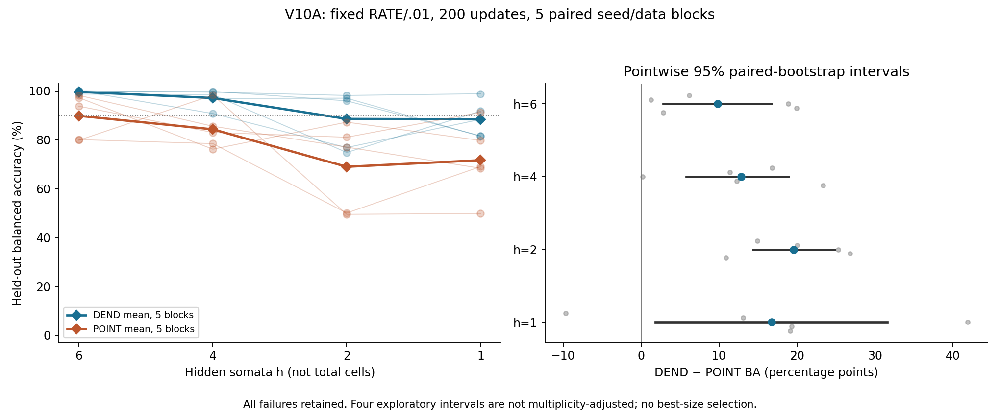
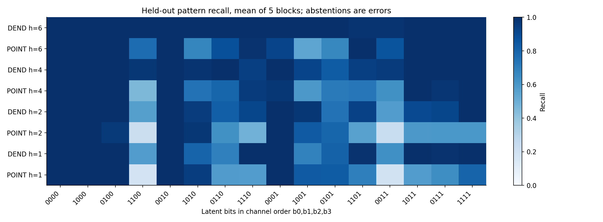
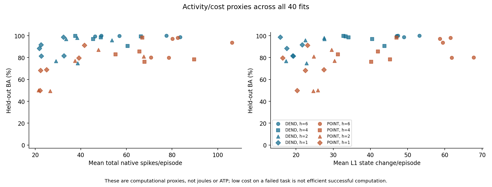
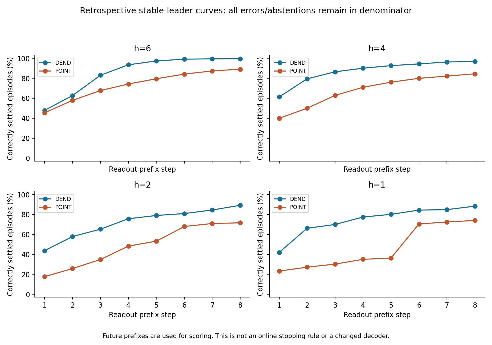

# V10A report: learned feature binding across four fixed network sizes

This exploratory pilot tests DEND and the existing strong POINT branch-cell network on one noisy four-feature binding distribution, using RATE/.01, 200 updates and five independent paired seed/data blocks per size. It retains every fit, including silent, tied and failed outcomes. The input ends before count readout, so this is binding with brief retention, not a purely static classification test.

| h | DEND mean BA % | POINT mean BA % | DEND passes/5 | POINT passes/5 | Paired DEND−POINT BA pp | Pointwise 95% interval pp |
|---:|---:|---:|---:|---:|---:|---|
| 6 | 99.57 | 89.76 | 5 | 3 | 9.82 | [2.87,16.77] |
| 4 | 97.04 | 84.24 | 5 | 1 | 12.81 | [5.77,18.91] |
| 2 | 88.50 | 68.92 | 3 | 0 | 19.58 | [14.32,24.84] |
| 1 | 88.34 | 71.60 | 2 | 1 | 16.74 | [1.85,31.59] |

BA is mean class recall, with abstentions wrong. Pass requires BA>=90% AND coverage>=90%. Intervals resample the five paired training/data blocks, not individual episodes; they are exploratory, pointwise and not multiplicity-adjusted. A zero-crossing interval does not establish equivalence, and a degenerate interval does not establish population equality or noninferiority.

Under this single binding distribution, fixed RATE/.01 recipe, 200-update budget and five paired blocks, 4 of the four pointwise intervals lie above zero. This is evidence about this complete training setup, not an architecture-only effect or a confirmed general ranking. At h=1, POINT passes the frozen BA/coverage gate in seed(s) [0]; that model has two branch cells, one hidden soma and two outputs, so it is a five-cell network, not one point neuron. Its verified passing case prevents interpreting the minimum tested POINT size as inherently unable to meet this task gate.

## Methods

The frozen task samples all 16 latent Boolean patterns equally and labels (b0 AND b1) OR (b2 AND b3). High amplitudes are U[.8,1.2], lows U[0,.1]; features persist on steps 8–15, readout cue on 16–23, a label-independent nuisance on 7–9, and independent Gaussian noise SD .03 is clipped at zero. Each block has 128 training and 512 held-out episodes shared across arms/sizes. Pattern balance gives 7/16 positives; a majority classifier obtains 56.25% ordinary accuracy and 50% BA. Four-high and three-high inputs are positive; cross-pair-only patterns are negative. Held-out examples are new amplitudes/noise on the same 16 patterns, not unseen Boolean combinations.

The h=6 equations and initialization match V8 exactly. At each h, DEND and POINT share dense input/recurrent/output access, parameter count 2h²+17h+2, continuous state count 3h+2 and paired initial parameters. DEND has 2h graded ReLU compartments; POINT has 2h additional native branch cells. Both retain .85 branch and .65 soma/output retention. Hidden/output spikes, and POINT branch spikes, use strict>.5 threshold/reset; the decoder counts only native output spikes in steps 16–23 and requires a unique largest count. No external pulse generator or analog decoder is added.

All 40 fits use 200 full-batch Adam updates at RATE/.01, inherited initialization distributions, norm clipping 1, parameter range [-2,2], fixed final checkpoint and surrogate slope 1/(1+5|candidate−.5|)². This is a proxy learning rule, not the exact derivative of the hard-spike model. No validation selection, tuning, restart, early stopping or best-size choice is made.

## Complete outcomes and computational proxies

Every seed, class recall, coverage, silence and non-silent tie rate appears in [TABLES.md](TABLES.md). All 16 per-seed pattern recalls appear in [the CSV](results/per_seed_pattern_recall.csv). Raw weights, gradients, checkpoints, native trajectories and datasets remain in results/.

| h | Arm | Accuracy % | Coverage % | Failures/5 | Fully silent/5 | Mean spikes | Mean L1 state change | Capped correct-settled step |
|---:|---|---:|---:|---:|---:|---:|---:|---:|
| 6 | DEND | 99.61 | 99.73 | 0 | 0 | 62.603 | 48.735 | 2.170 |
| 6 | POINT | 89.18 | 96.37 | 2 | 0 | 83.664 | 61.849 | 3.143 |
| 4 | DEND | 97.03 | 97.81 | 0 | 0 | 51.683 | 36.887 | 2.020 |
| 4 | POINT | 84.53 | 92.97 | 4 | 0 | 69.077 | 41.149 | 3.532 |
| 2 | DEND | 89.22 | 94.53 | 2 | 0 | 38.676 | 23.584 | 3.236 |
| 2 | POINT | 71.68 | 94.80 | 5 | 0 | 40.167 | 27.047 | 5.093 |
| 1 | DEND | 88.36 | 96.60 | 3 | 0 | 26.409 | 18.679 | 3.065 |
| 1 | POINT | 74.02 | 91.64 | 4 | 0 | 30.035 | 21.958 | 5.307 |

Native branch/hidden/output events are retained separately. DEND has no branch-spike events by definition but performs graded branch updates, so total spike differences do not alone measure total cost. State changes use model coordinates. Correct settling is determined retrospectively from all remaining prefix-count decisions; wrong or abstaining episodes receive capped latency 9 rather than being excluded. These are dimensionless computational proxies, not ATP, joules, milliseconds or a realizable online stopping rule.

## Verification and provenance

Protocol/source commit before scientific data: `4dd342161cee0d2d0f0a8383cec6aba5758d514d`. Final training/checkpoint commit before held-out data: `e77dd9555ce15f94b9f5bcba12650c48aa9ce19d`. Both gates are checked against Git blobs by the execution scripts. The seed registry, source audit and freeze hashes are retained; test evaluation is guarded by TEST_STARTED.json.

Deterministic parity/native-boundary fixtures passed. Before training, 686 anchored finite-difference parameter checks had maximum residual 6.50535e-11. After training, 3430 final-checkpoint parameter checks had maximum residual 8.81483e-11; 200 sampled updates had maximum clipped-gradient residual 0. These finite differences validate the locally anchored surrogate graph, not hard-spike derivatives.

The separately authored native/data/optimizer verifier reports PASS. It checks saved initialization/data, all Adam updates/checkpoints, native final training and test trajectories, exact spikes/counts/predictions, metrics and seed-level statistics. Its JSON records state residuals and complete counts. These remain checks within the same AI-assisted workflow, not external independent replication or peer review.

## Resources and execution

The fixed 40 fits used 8,000 updates: 1,818,624,000 training-forward and 2,678,784,000 training-backward dense matrix MAC terms; diagnostic and test terms are reported separately in [RESOURCE_COST.md](RESOURCE_COST.md). Training/artifact wall time was 32.398s and held-out/artifact wall time 3.964s. No paid compute was used. The h-axis is hidden-soma count; total represented cells differ between architectures.

## What this does not establish

A single static affine threshold cannot implement the four-bit target, as shown by the positive/negative vector-sum contradiction in [DESIGN_REVIEW.md](DESIGN_REVIEW.md). Two ordinary threshold subunits can implement it. The current POINT baseline already has branch cells, recurrence and analog subthreshold state; the static theorem is not an impossibility result for this baseline. Observed finite-budget failures concern this recipe and data distribution. No new pooling intervention is included, so V10 cannot identify causal necessity of local nonlinear partition. It does not establish a universal architecture ranking, energy/hardware efficiency, biological realization, long-delay retention or compositional extrapolation.

The proposed two-timescale experiment was not run. The older 150 ms/10 ms result used a different modified model and analog inverse decoder. It cannot be imported into these native count-decoded population equations, and graded memory has not been shown to be zero energy. Biological motivation is limited to the primary compartmental-model and dendritic-integration studies cited in [DESIGN_REVIEW.md](DESIGN_REVIEW.md).

## Limitations

There are only five independent training/data blocks, four unadjusted exploratory primary intervals, one task distribution, one training recipe and 200 updates. Large episode counts do not remedy low seed-level precision. Dense shared input access avoids privileged DEND wiring but does not force a specific learned anatomical decomposition. Size changes alter state, parameters, matrix cost, aggregate initialization drive variance and the per-coordinate mean-L2 coefficient; the curves describe the full fixed setup rather than pure representational capacity. Nonlinearities, reset derivatives and activation patterns are not matched. Identical nominal optimizer settings do not establish equal optimization quality or effective updates between architectures. The brief retention interval can affect the size results.

Every size and failed fit is retained. Lower activity on an inaccurate fit is not efficient successful computation. An interval containing zero is inconclusive rather than evidence of equivalence; interval degeneration is not a noninferiority bound. Future work requires a distinct justified protocol and new data, not an automatic sweep or retuning of these results.

Research direction and native firing constraints were proposed by Li Zexu. Protocol formalization, implementation, execution, numerical verification and this report draft were AI-assisted. Earlier results remain preserved; this bounded study does not automatically authorize another phase or public submission.
