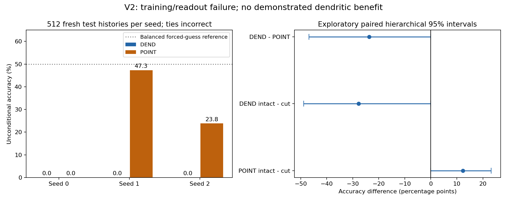

# DEND-POP-2: learnable native-spiking recurrent populations

## Finding

This bounded experiment did not demonstrate a useful dendritic advantage or successful learning of delayed XOR. A recurrent population with learnable input, recurrent and output weights was implemented, but training frequently collapsed to silent or equally saturated outputs. This is a failure of the tested architecture/training/readout combination, not evidence that dendrites or recurrent populations cannot learn.

The study preserves v1 and the original TAN code. Protocol/code were frozen in commit `8f6a06e`; all candidate checkpoints and validation-only choices were committed in `634285f` before test generation. Exactly twelve candidate training runs and one fresh test evaluation were performed. No architecture, threshold, loss or hyperparameter was changed after inspecting validation or test results.

## Test results

Each seed has 512 fresh histories, balanced over four ordered input pairs. Ties count as abstentions and are incorrect. All arms receive the same histories within each seed.

| Seed | DEND intact | POINT intact | DEND cross-links cut | POINT cross-links cut |
|---|---:|---:|---:|---:|
| 0 | 0.00% | 0.00% | 0.00% | 0.00% |
| 1 | 0.00% | 47.27% | 49.02% | 23.24% |
| 2 | 0.00% | 23.83% | 34.18% | 10.94% |
| Mean | 0.00% | 23.70% | 27.73% | 11.39% |

DEND minus POINT is **−23.70 percentage points**, exploratory paired hierarchical bootstrap 95% interval **[−46.88, 0.00]**. The predeclared criterion (>5 points and strictly positive lower endpoint) fails. The interval spans zero and only three paired training seeds were used; do not claim a stable population-level difference from this small run set.

An independent forced random guess on a balanced binary task has expected accuracy 50%. Neither arm demonstrates robust performance beyond that reference. Zero DEND accuracy means every intact prediction abstained, not that every forced binary guess would be wrong. Selecting a tie-breaking class after seeing results would change the frozen endpoint and is not done here.

## What was implemented

The task presents one binary cue, a gap/distractor, then a second binary cue. The target is their XOR. Input channels identify cue values; there is no label channel. The readout cue is identical across classes. Independent jitter, amplitude and noise produce fresh histories; all four logical bindings occur in training, validation and test. Therefore this does not test unseen-binding generalization.

DEND has six hidden cells, each with two graded dendritic compartments, and two native-spiking output cells. Its recurrent hidden-spike connections include cross-cell pathways and self pathways. POINT replaces each compartment with a native-spiking branch cell, retaining the same six hidden and two output cells. Both have 20 continuous states and the same 176 learnable parameters. Native strict-threshold/reset firing is preserved in hidden and output cells; POINT also has native branch firing. There is no external output pulse generator. The unresolved extra-module location from the v1 source audit is unchanged; no existing module was deleted.

At inference, each step receives current input and previous hidden spikes. Output neurons receive previous hidden spikes through learned signed weights. The decoder observes only the two output spike counts in steps 16–23 and never accesses analog states or labels. Unlike v1's fixed one-to-one relay, outputs have learned many-to-many connections and hidden neurons can influence each other through recurrence.

All input, recurrent, output and bias parameter groups changed during training; changes are recorded in `results/diagnostics.json`. Zeroing cross-cell recurrent connections changes hidden spike trajectories in every DEND test episode, and in 78.71%, 100%, 100% of POINT episodes across the three seeds. Thus cross-cell pathways have an observable dynamical effect. This does not establish useful collective computation.

## Training and the bottleneck

Training uses two-sided SPSA with a cross-entropy objective on output spike counts plus a small parameter penalty. This is a numerical supervised optimization experiment, not a biologically plausible plasticity claim. NumPy was available; PyTorch was not, and no dependency installation or paid compute was performed.

Each arm and seed gets two learning-rate candidates, 100 updates each, full-batch 128 training histories, identical initial parameters and paired random perturbations. Selection uses 128 separate validation histories: highest accuracy, then lowest objective, then smaller learning rate. Only the final checkpoint of each candidate is eligible; there is no best-epoch or test-based selection. The total is 1,200 parameter updates and 2,400 perturbed training objective evaluations. All candidate checkpoints and loss/update logs are retained, including failures. Training took about 5.26 seconds on CPU with one BLAS/OpenMP thread; test evaluation and interval calculations took about 4.14 seconds.

In DEND seeds 0 and 1, both output counts are exactly [0,0] on every test history. In seed 2 they are exactly [8,8], meaning both cells fire at every readout step. The selected validation objectives are approximately log(2) plus the parameter penalty. For equal output counts, the classification part of that loss gives the same value to silence and equal saturation. This analytical fact and the observed collapse identify a plausible optimization/readout bottleneck, not a proven complete causal explanation. We have not performed a loss replacement, normalization intervention or a gradient-based comparison.

The trained-minus-initial accuracy differences are −16.67 points for DEND, interval [−50.00,0.00], and +7.75 for POINT, interval [−4.75,29.04]. Training updates alone are not evidence of learned task competence. The finite-difference optimizer and small fixed budget may be inadequate; both are part of the limitation, not grounds for discarding failed runs.

## Interaction intervention

Cutting cross-cell recurrent links retains self connections, all other weights, state dimensions and the readout. It is an inference intervention on the selected checkpoint, not a separately trained, parameter-matched no-interaction baseline.

The intact-minus-cut mean accuracy is −27.73 points for DEND, interval [−48.83,0.00], and +12.30 points for POINT, interval [0.00,23.24]. Two POINT seeds depend on cross-cell pathways for part of their weak performance; the third fails in both conditions. DEND improves when those pathways are removed in two seeds. This does not support the premise that adding recurrence necessarily improves task performance. The intervention can move the circuit outside its trained activation distribution, and no retrained ablation was run.

## Resource accounting and scope

| Resource | DEND | POINT |
|---|---:|---:|
| Biological-style cell count in this abstraction | 8 | 20 |
| Persistent continuous state, float64 | 20 (160 bytes) | 20 (160 bytes) |
| Previous hidden spike values | 6 binary values stored as 48 bytes | same |
| External readout counters | 2 float64 (16 bytes) | same |
| Trainable parameters | 176 (1,408 bytes) | same |
| Dense multiply-accumulate terms per sample/update | 156 | 156 |
| Matrix operations / time steps / training evaluations | matched | matched |
| Branch nonlinearity | 12 rectifiers | 12 threshold/reset operations |
| Hidden/output thresholds | 8 | 8 |

This matches state, parameter, matrix arithmetic, data access and training search budgets; it does not make scalar operations, elapsed time, energy or anatomy identical. Both implementations allocate the same state arrays, but diagnostic recording, initialization, data and optimizer buffers add memory beyond the inference-state count. Signed weights, negative states and unconstrained recurrent matrices are computational abstractions. State precision and parameters are matched, not firing rates or effective gains. Matching initialization values does not guarantee equal optimization difficulty across the two nonlinearities.

Native branch/hidden/output event counts and inference timing are saved per seed/mode. Graded dendritic activity is not counted as a spike. Timing from a single small batch is descriptive and unsuitable for hardware-efficiency claims. Full saved inputs, trajectories and candidate states occupy approximately 37.4 MB before plots and documentation.

## Verification and provenance

The separately written verifier imports none of the model, data, training or evaluation modules. It regenerates datasets, checks frozen and selected hashes, independently implements each cell equation, replays all 9,216 test model episodes (including initial and cut conditions), checks 4,423,680 scalar state updates, validation scores and checkpoint selection, logged SPSA parameter updates, spike counts, coverage and all five uncertainty intervals. It passed 1,473 checks; maximum state/candidate residual was 8.88e-16. All discrete spikes/counts/predictions matched exactly.

The verifier initially omitted the common readout cue in its independent stimulus generator and stopped at the first dataset mismatch. Only the verifier was corrected; frozen source, data, models and outcomes were unchanged. The attempt is recorded in `VERIFICATION_ATTEMPTS.json`. The verifier reconstructs all parameter updates from logged objective values but does not independently recompute every perturbed training objective. This is same-workflow implementation verification, not external independent replication or peer review.

The research direction and native-firing constraint came from the user. The specific task, protocol, software, numerical execution and report are AI-assisted work. This experiment supplies no new biological evidence. Background biological/computational distinctions and source limitations remain as documented in [v1 literature notes](../dendritic-population-v1/LITERATURE.md).

## Next decision

Before testing larger populations or claiming architectural benefits, establish reliable optimization on a development-only sanity task and retain a stronger conventional baseline. Prospectively compare a loss that penalizes nonselective output or a documented surrogate-gradient method, with exactly matched selection budgets and native hard spikes at inference. Diagnose gain and recurrent stability using development data. Any resulting architecture/loss choice requires a new protocol and untouched test seeds: the present v2 test histories are now spent. These interventions were not run in this study, and the v2 negative result remains preserved.
