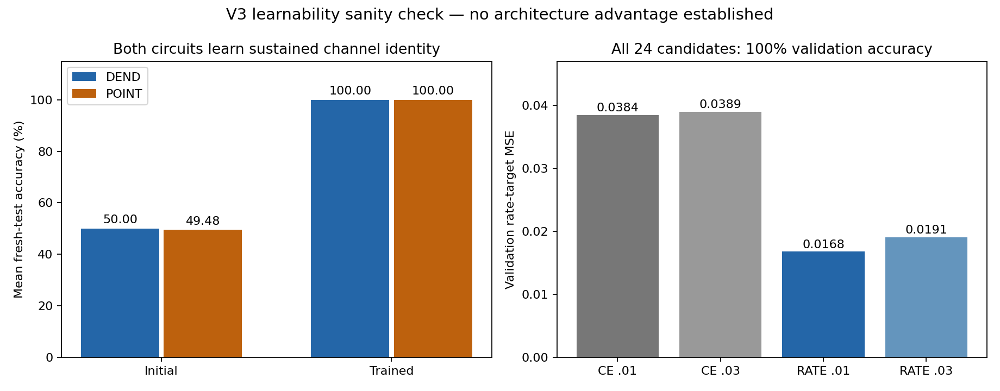

# V3: native-spike learnability and readout controls

## Outcome

Both matched networks can learn a simple sustained-channel identity task while retaining hard native firing. Every selected arm/seed achieved 100% accuracy and coverage on 512 fresh test histories. The result establishes a working training/readout sanity check, not a dendritic advantage, a solution to delayed XOR, or evidence of useful recurrence.

V1 and V2 are unchanged. The V3 protocol and source were committed at `44ca749` before development data generation. The common configuration and all checkpoints were committed at `93a239b` before fresh test generation. Exactly 24 development candidate runs and one test evaluation were executed. There were no failed candidate runs or unreported restarts; the v2 training failures remain in their original directory.

## Results and uncertainty

| Seed | Initial DEND | Trained DEND | Initial POINT | Trained POINT |
|---|---:|---:|---:|---:|
| 0 | 50.00% | 100.00% | 48.44% | 100.00% |
| 1 | 50.00% | 100.00% | 50.00% | 100.00% |
| 2 | 50.00% | 100.00% | 50.00% | 100.00% |

Each seed has 512 histories balanced across two labels, paired between arms. All six trained models have zero abstentions, zero completely silent readouts and zero double-saturated readouts. Initial DEND seed 2 abstained on 9.57% of examples; initial POINT seed 0 abstained on 1.76%. Errors include abstentions rather than applying a post-hoc tie breaker.

The predeclared sanity gate of >=90% accuracy and coverage in every trained arm/seed passes. Mean DEND-minus-POINT is 0 percentage points; the paired hierarchical bootstrap interval is [0,0] because there are no observed disagreements. This degenerate interval does not prove population equivalence, perfect future performance or a non-inferiority bound. There are only three initialization/data seeds and one easy task.

Trained-minus-initial differences are +50.00 points for DEND, exploratory interval [50.00,50.00], and +50.52 points for POINT, interval [50.00,51.63]. Bootstrap draws resample paired seeds and histories within label strata. Numerical uncertainty applies only to the observed task distribution and cannot compensate for its narrowness.

## Task and unchanged native dynamics

The task is to identify which of two channels carries a sustained input. It begins at update 2, 3 or 4 and remains through update 23, with amplitude variation, distractor input and additive noise. A common readout cue starts at update 16. Unlike v2, this is not delayed XOR: the informative input remains present during readout, and successful inference does not require memory or inter-neuron recurrence. Train/validation/test histories are independently generated from the same two-class distribution; they are not unseen logical bindings.

Both arms use exactly the v2 forward equations and initialization distributions. The DEND circuit has six hidden cells with two graded dendritic states each and two output cells. POINT uses twelve native branch cells, six hidden cells and two output cells. Hidden/output firing remains strict >.5 threshold with reset; POINT also retains native branch threshold/reset. Recurrent and output signals are previous hidden spikes. There is no external output pulse generator, label-driven firing schedule or analog decoder. The requested extra module remains unidentified in the audited original implementation, and no existing module was deleted.

Deterministic native-forward parity with the preserved v2 implementation is checked. Only the training method and the diagnostic task changed, with the loss comparison described below. Labels are used in training and evaluation, never passed into forward neuronal dynamics. The decoder counts native output spikes at steps 16–23 and requires a unique winner.

## Development controls and what they establish

All candidate development runs used 128 training and 128 independent validation histories per seed. Two losses and two learning rates were tried for both arms and all three seeds, with identical starting parameters within each seed and a fixed 200-update Adam budget. Only final checkpoints were eligible; validation was used once per candidate at the end, not for early stopping or best-epoch selection.

| Shared candidate | Minimum validation accuracy over six arm/seeds | Mean validation rate-target error |
|---|---:|---:|
| CE, learning rate .01 | 100% | .038442 |
| CE, learning rate .03 | 100% | .038910 |
| RATE, learning rate .01 | 100% | .016764 |
| RATE, learning rate .03 | 100% | .019053 |

CE uses logits equal to .5 times native output counts, as in v2. RATE uses squared error between counts/8 and targets .75 (correct output), .125 (incorrect output). Both have the same small L2 parameter penalty. The predeclared rule selects ONE shared loss/rate configuration by worst accuracy, mean accuracy, mean RATE error, then deterministic ties. Because accuracy tied, RATE/.01 was selected for its lower rate-target error. That secondary metric explicitly measures adherence to RATE's target; this selection is not evidence that RATE is a better classifier. CE was not subsequently evaluated on the test set.

The analytical output-pattern controls explain a limited distinction: CE assigns log(2) to both [0,0] silence and [8,8] equal saturation. RATE assigns .2890625 and .4140625 respectively, and zero to the correct target [6,1]. CE is invariant to an equal shift in the two logits; this does NOT mean its derivatives with respect to unequal logits are zero, or that CE cannot learn. Indeed, every CE development run learned this task. Equal-count invariance alone is therefore not a sufficient explanation of v2 failure.

Replacing all spike surrogate derivatives by zero eliminates the data gradient through this output-spike objective, leaving only the L2 derivative. The enabled surrogate passes the explicit chain-rule checks. This validates a computational training path, not a biological plasticity mechanism.

The v2-to-v3 comparison changes both task difficulty and optimizer (SPSA to surrogate BPTT/Adam), and doubles updates per candidate from 100 to 200. It cannot identify which change fixed v2, and it does not show that the same training method solves v2's delayed XOR. The same-task CE/RATE factorial comparison is controlled; the cross-version comparison is not.

## Gradient semantics and checks

Forward spikes are hard binary values in every candidate training and inference pass. Backward propagation substitutes the derivative `1/(1+5*abs(candidate-.5))^2`, including derivatives through native reset. This is a surrogate learning rule, not the exact derivative of the discontinuous hard-spike model. Surrogate methods and that distinction are discussed by [Neftci, Mostafa and Zenke (2019)](https://arxiv.org/abs/1901.09948) and [Gygax and Zenke (2024)](https://arxiv.org/abs/2404.14964).

Before training, 704 parameter finite-difference checks (176 parameters, two arms, two losses) compared explicit BPTT to a locally anchored differentiable graph. At the anchor each spike retains its hard value and the chosen local slope. This auxiliary graph exists only for derivative verification; it is not used for training forward dynamics or inference. The largest initial discrepancy was 2.38e-10. Separate hard-forward finite differences on the non-boundary fixture returned only the regularizer derivative, confirming that these are different derivative concepts.

After selection, another 1,056 parameter checks at all six selected checkpoints passed, maximum discrepancy 1.89e-11. The checks used development inputs, not test-driven parameter changes. Seventy-two sampled training updates (steps 0, 99 and 199 from each candidate) reproduced saved losses, raw gradient norms, clipped gradients and training accuracy exactly. All 4,800 Adam updates were independently reconstructed from saved clipped gradients and matched final parameters exactly. Not every training gradient was independently recomputed.

## Resource and compute accounting

| Resource | DEND | POINT |
|---|---:|---:|
| Cells in this abstraction | 8 | 20 |
| Continuous neuronal state | 20 float64 =160 bytes | same |
| Previous hidden spikes, stored float64 | 6 values =48 bytes | same |
| External count decoder | 2 float64 =16 bytes | same |
| Learned parameters | 176 float64 =1,408 bytes | same |
| Adam moment vectors | 352 float64 =2,816 bytes | same |
| Candidate training runs | 12 | 12 |
| Full-batch updates | 2,400 | 2,400 |
| Forward matrix MAC terms / sample / update in time | 156 | 156 |
| Backward matrix MAC terms / sample / update in time | 240 | 240 |
| Total candidate training time | 9.35 s | 9.54 s |

Both arms use the same 128-example full batches, 24-update sequences, 200 optimizer steps per candidate, parameter precision, Adam/clipping rules and decoder. Dense matrix work, data access and search budgets are matched. Scalar branch nonlinearities differ: rectification in DEND, native firing/reset in POINT. Reset derivatives and activation patterns also differ. Therefore this is not exact scalar-operation, anatomical or energy equality. Training caches, recorded trajectories, gradients, NumPy temporaries and optimizer buffers are additional resources beyond neuronal state. No automatic differentiation framework, package installation, GPU or paid compute was used.

Whole development execution took about 18.97 seconds on CPU with one BLAS/OpenMP thread; test evaluation and intervals took about 2.70 seconds. Mean measured forward-plus-recording time for a 512-example trained batch was 7.34 ms for DEND and 6.78 ms for POINT. These single tiny measurements are descriptive and not a hardware efficiency benchmark.

Mean native event counts per complete 24-update test history, averaged over the three seeds:

| Arm | Branch events | Hidden events | Output events | Total |
|---|---:|---:|---:|---:|
| DEND | 0 | 60.0033 | 18.2220 | 78.2253 |
| POINT | 35.4642 | 25.3548 | 18.3600 | 79.1790 |

Dendritic graded currents are not spikes; a slightly lower event total does not establish lower energy. No recurrence ablation was added to this test because the frozen endpoint concerns learnability, not necessity of interaction.

## Verification, artifacts and limits

The separate native-equation verifier passed 9,921 checks, replayed 6,144 test model episodes including initial controls, and checked 2,949,120 scalar state updates. All discrete spikes, counts and predictions match exactly; the maximum state/candidate residual is 8.88e-16. Data regeneration, all candidate validation metrics, shared selection ordering, test gate, frozen hashes, Adam update replay and bootstrap calculations pass. These are same-workflow checks, not external independent replication or peer review.

Approximately 43.5 MB of saved data includes all candidate weights and per-update clipped gradients, input datasets, selection records, initial/trained complete test trajectories, reports and plots. The manifest covers deliverables. Original v1/v2 source/results and main remain unchanged. This phase is on a local research branch and has not been pushed to GitHub.

The user supplied the research direction and native-firing constraint. The specific protocol, implementation, execution, numerical verification and report are AI-assisted work. Biological scope and literature limitations remain as recorded in v1; no new biological evidence is offered here.

## Next bottleneck and prospective follow-up

A working simple-task baseline is now available. The next causal comparison should keep the harder task and all other settings fixed while comparing optimization/credit assignment on fresh development data. Add difficulty in separately documented steps (remove the sustained cue, introduce a delay, then conditional binding/XOR) and establish where both arms cease to learn. Any claim about beneficial recurrence needs a retrained no-cross-cell control as well as an inference cut. Freeze a new protocol and use untouched test seeds only after development gates pass. Neither this harder experiment nor a new architecture search was run here; the present fresh test set is now spent.
