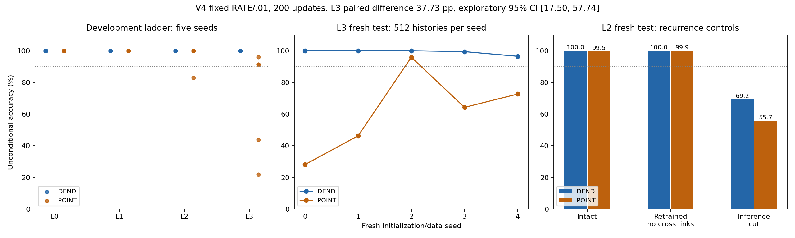

# V4: native-spike learnability boundaries and dendritic/point controls

On **L3 delayed XOR, with the shared RATE/.01 recipe, 200 updates and five fresh initialization/data pairs**, DEND passed the all-seed gate and had higher accuracy than POINT in every paired seed; the prespecified development-direction, new-seed confirmation and interval criteria were met. This is a difference between the tested implementations under one frozen training recipe, not a general ranking of neuron types. On L2 both intact structures passed in the fresh-seed test, and retrained cross-cell-masked networks also passed, so cross-cell recurrence was not required to find successful solutions for that task under this budget.

Phase A nevertheless did not provide a simple 'SPSA alone caused V2 failure' conclusion: the 100-update controls had failures, and selected 200-update results differed by structure and seed. All candidates and failures remain recorded.

## Record correction and provenance

> **Correction of record (2026-11-03).** The extra module previously requested does not exist in the original implementation. The request was a misattribution by the author, Li Zexu, confirmed on 2026-11-03. No code is missing, and no existing module was deleted or altered. This item is closed and places no requirement on V4.

The preserved-original/new-version correction was approved: V3's original manifest-listed files remain unchanged, and [the appended report copy](../dendritic-population-v3/REPORT_WITH_APPENDIX.md) retains all original bytes followed by the correction. V4 is a separate local experimental line, not a merge into the TAN paper.

| Commitment | Git commit |
|---|---|
| Protocol/source freeze before development | `5e12e8f62f25b9d2c301e20abe671f5da2725ec9` |
| Development selection/checkpoints/eligibility | `db125b470d661aecde6313e07f689912e500139d` |
| Fresh-seed replication checkpoints before test | `5b1f6fec13a1095f04efa881713eab0336513a6f` |

Thirty fresh-seed training trajectories were retained before testing; no replication seed was dropped and no configuration was changed after test generation. L0/L1 generated no test histories. L2/L3 each generated five fresh 512-history test sets, shared between paired arms and interventions.

## Protocol, task definitions and decision rules

The approved [protocol](PROTOCOL.md) freezes the V2 native equations and initialization distributions, V3 surrogate derivative, hard binary forward spikes, strict >.5 native threshold/reset, and unique-winner output-count decoder. Every sequence has 24 updates and counts output spikes at zero-based updates 16–23. Ties and full silence are abstentions and count incorrect. Labels supervise the loss/evaluation but do not enter neuronal forward dynamics. No output pulse generator or analog trajectory decoder is used.

Phase A uses the unchanged V2 delayed-XOR generator. CE-only SPSA and surrogate-BPTT/Adam are paired on the same five initialization/data seeds, two fixed learning rates (.01/.03), and 100 updates. The requested Adam CE/RATE search also saves 100- and 200-update endpoints. These are nested checkpoints from the same 200-update trajectory, not independent runs. One common Adam configuration is selected separately at each endpoint by worst validation accuracy, mean accuracy, mean RATE error, smaller learning rate, then RATE before CE. Only the A200 selection is used in B and C, without further configuration search.

Phase B trains from scratch at each executed level, with five paired seeds and 200 updates. Each seed uses 128 training and 128 independent validation histories. L0 preserves V3 sustained-channel identity. L1 uses a four-update informative pulse at 12–15; L2 shifts that pulse to 8–11, leaving informative-input silence at 12–15; L3 preserves V2 delayed XOR. Readout remains 16–23. L1/L2 share nuisance draws, amplitude and noise; the pulse position changes relative to fixed distractor/readout timing. The ladder is a predefined family of tasks, not a strict single-factor decomposition: L0→L1 changes onset/duration, and L2→L3 changes cues, timing and target rule.

A structure passes a level only if every seed has validation accuracy and coverage >=90%. Stop the ladder when both structures fail. At any level where both structures have >=99% accuracy on every seed, apply the ceiling rule and do not generate a test set. Other levels with at least one passing structure are eligible for one-shot paired testing; the author's approved exception retains the frozen failed structure as a comparator without reselection.

Phase C is conditional on at least one intact structure passing L1 or L2; it selects the highest such level. It compares intact, inference-time cross-cell cut, and a separately retrained cross-cell-masked circuit on matched histories/initializations. The mask removes 60 cross-cell weights while retaining self connections. Gradients and Adam moments at those slots are fixed at zero.

## Q1 — paired training-method results

The primary 100-update Adam selection was RATE/.03; the secondary 200-update selection was RATE/.01, which became the fixed B/C configuration. The selected primary endpoint failed the all-seed development gate in both structures; at 200 updates DEND passed and POINT did not. These are development outcomes on five paired seeds, 128 validation histories per seed, the V2 delayed-XOR generator and the stated search budget. They do not by themselves establish a between-structure result on fresh training seeds.

| A endpoint and selected configuration | Arm | Seed 0 | Seed 1 | Seed 2 | Seed 3 | Seed 4 | All-seed accuracy/coverage gate |
|---|---|---:|---:|---:|---:|---:|---|
| 100, RATE/.03 | DEND | 100.00% | 71.88% | 98.44% | 100.00% | 100.00% | Fail |
| 100, RATE/.03 | POINT | 44.53% | 50.78% | 45.31% | 71.09% | 46.09% | Fail |
| 200, RATE/.01 | DEND | 100.00% | 99.22% | 100.00% | 100.00% | 99.22% | Pass |
| 200, RATE/.01 | POINT | 64.06% | 60.94% | 75.00% | 92.19% | 56.25% | Fail |

The controlled CE-only 100-update comparison below holds data, initialization, loss and learning-rate value fixed within each row pair. It compares the complete specified training procedures, including their different gradient estimators, clipping and update rules. Values are validation accuracy for seeds 0–4 in order.

| Method | LR | Arm | Seed accuracies (%) |
|---|---:|---|---|
| SPSA | .01 | DEND | 28.91, 0.00, 33.59, 28.91, 0.00 |
| BPTT/Adam | .01 | DEND | 100.00, 100.00, 100.00, 100.00, 0.00 |
| SPSA | .01 | POINT | 36.72, 10.94, 43.75, 28.12, 49.22 |
| BPTT/Adam | .01 | POINT | 78.91, 75.00, 92.19, 44.53, 2.34 |
| SPSA | .03 | DEND | 0.78, 0.00, 2.34, 34.38, 0.00 |
| BPTT/Adam | .03 | DEND | 100.00, 100.00, 100.00, 100.00, 0.00 |
| SPSA | .03 | POINT | 39.84, 2.34, 10.16, 37.50, 46.88 |
| BPTT/Adam | .03 | POINT | 97.66, 75.78, 94.53, 89.84, 42.97 |

Changing training procedure markedly changes many paired outcomes under these fixed CE conditions, but neither tested CE/100 configuration passes every seed in both structures. Some seed outcomes remain poor or decrease, so the data do not justify attributing historical V2 failure solely to SPSA. A100 and A200 selected different configurations; comparing their selected summaries also changes loss/rate selection and budget. Within-candidate 100/200 results are preserved separately in [the complete tables](TABLES.md). No failed candidate was discarded.

## Q2 — predefined task ladder

With the single A200-selected RATE/.01 configuration, 200 updates and five paired development seeds, both structures passed L0/L1 and reached the all-seed >=99% ceiling. Those levels are labeled **预期达到天花板，未进行测试**. At L2 and L3 DEND passed the all-seed development gate, while POINT failed. All four defined levels were executed; no level had both structures fail, so the stopping rule did not terminate the ladder early.

| Level | Arm | Seed 0 | Seed 1 | Seed 2 | Seed 3 | Seed 4 | Gate | Test eligibility |
|---|---|---:|---:|---:|---:|---:|---|---|
| L0 | DEND | 100.00% | 100.00% | 100.00% | 100.00% | 100.00% | Pass | Skipped: ceiling |
| L0 | POINT | 100.00% | 100.00% | 100.00% | 100.00% | 100.00% | Pass | Skipped: ceiling |
| L1 | DEND | 100.00% | 100.00% | 100.00% | 100.00% | 100.00% | Pass | Skipped: ceiling |
| L1 | POINT | 100.00% | 100.00% | 100.00% | 100.00% | 100.00% | Pass | Skipped: ceiling |
| L2 | DEND | 100.00% | 100.00% | 100.00% | 100.00% | 100.00% | Pass | One-shot fresh-seed test |
| L2 | POINT | 100.00% | 100.00% | 100.00% | 100.00% | 82.81% | Fail | Approved fixed comparator |
| L3 | DEND | 100.00% | 100.00% | 100.00% | 100.00% | 100.00% | Pass | One-shot fresh-seed test |
| L3 | POINT | 43.75% | 91.41% | 21.88% | 91.41% | 96.09% | Fail | Approved fixed comparator |

The full per-seed coverage, abstention and silence columns are in [TABLES.md](TABLES.md). In development, POINT's first failed all-seed gate was L2, caused by seed 4; this is a result of this fixed configuration/budget on these five seeds, not a universal capacity boundary. At L2 four seed pairs tie, so the strict all-seed directional criterion is already unmet. At L3 every development pair favors DEND, but the separate fresh-seed condition must also be assessed before any claim.

## Q3 — cross-cell recurrence controls

Phase C selected L2, the highest memory level passed by at least one intact structure in B. On its five paired development seeds, both retrained masked structures reached 100% accuracy and coverage on every seed under the same RATE/.01 configuration and 200-update budget. Thus the development data already supply task-solving solutions without cross-cell recurrence in both model families. Self connections, dendritic/branch states and soma leaks remain, so this does not show that the task is memory-free.

Inference cuts often reduced performance: DEND accuracies were 50.00%, 50.00%, 100.00%, 50.00%, 87.50%; POINT accuracies were 89.84%, 76.56%, 50.00%, 93.75%, 98.44%. These are paired interventions on the intact L2 checkpoints, not retrained results. The contrast demonstrates why a cut alone cannot establish that a pathway is indispensable: the separately trained masked models solved the same development task. Fresh-seed C results and uncertainty are reported in the test section.

## Fresh-seed testing and uncertainty

The locked shared configuration was trained for 200 updates on five new initialization/training-data pairs at each eligible level. There was no new validation selection or dropping of poorly performing replicas. Each trained replica was evaluated once on 512 new histories. Seed indices below denote these new replication seeds, not the development initializations.

| Level | Arm | Seed 0 accuracy / coverage | Seed 1 | Seed 2 | Seed 3 | Seed 4 | Mean accuracy |
|---|---|---:|---:|---:|---:|---:|---:|
| L2 | DEND | 100.00% / 100.00% | 100.00% / 100.00% | 100.00% / 100.00% | 100.00% / 100.00% | 100.00% / 100.00% | 100.00% |
| L2 | POINT | 100.00% / 100.00% | 100.00% / 100.00% | 100.00% / 100.00% | 97.66% / 99.02% | 100.00% / 100.00% | 99.53% |
| L3 | DEND | 100.00% / 100.00% | 100.00% / 100.00% | 100.00% / 100.00% | 99.41% / 99.61% | 96.48% / 98.44% | 99.18% |
| L3 | POINT | 28.12% / 50.00% | 46.29% / 66.02% | 95.90% / 98.44% | 64.26% / 74.61% | 72.66% / 77.34% | 61.45% |

For **L3 delayed XOR, the common RATE/.01 recipe, 200 updates and these five new training seeds**, DEND mean accuracy was 99.18% and POINT 61.45%; the mean paired difference was +37.73 percentage points, exploratory 95% paired hierarchical interval [17.50,57.74]. DEND exceeded POINT in every development and new-test seed; DEND passed the all-seed gate and POINT failed in both stages. Thus the frozen three-part criterion was met for this specific recipe/task/budget. This does not establish an intrinsic representational difference, asymptotic trainability, biological benefit or the result under separately optimized arm-specific recipes.

At L2 the fresh-seed means were 100.00% and 99.53%; paired difference +0.47 points, interval [0.00,1.48]. Both passed. Four development seed pairs had tied accuracy, and the interval includes zero. The stated difference criteria were not met: 在本任务和本预算下，没有观察到符合预设标准的差异. The POINT development failure at L2 therefore did not reproduce as an all-seed test failure; calling L2 its general failure boundary would be incorrect.

All intervals use 2,000 paired hierarchical bootstrap draws, resampling five seed pairs and examples within label or input-pair strata. They are exploratory and **not adjusted for multiple comparisons across levels and interventions**. Five seed clusters limit uncertainty estimation. An interval endpoint of zero or a degenerate [0,0] interval does not establish equality or a non-inferiority bound.

### L2 recurrence confirmation on the same fresh-seed tests

| Arm | Condition | Seed 0 accuracy | Seed 1 | Seed 2 | Seed 3 | Seed 4 | Mean accuracy |
|---|---|---:|---:|---:|---:|---:|---:|
| DEND | retrained | 100.00% | 100.00% | 100.00% | 100.00% | 100.00% | 100.00% |
| DEND | cut | 50.00% | 50.00% | 82.23% | 100.00% | 63.67% | 69.18% |
| POINT | retrained | 100.00% | 100.00% | 99.41% | 100.00% | 100.00% | 99.88% |
| POINT | cut | 75.00% | 50.00% | 35.55% | 55.66% | 62.30% | 55.70% |

Both retrained masked structures passed every new-seed test gate on **L2 with RATE/.01, 200 updates and five fresh seeds**. Their mean accuracies were 100.00% (DEND) and 99.88% (POINT). The intact-minus-retrained differences were 0.00 points [0.00,0.00] and −0.35 points [−1.45,0.35], respectively. These data provide successful solutions with cross-cell links fixed to zero; they do not show that all recurrence or all internal memory is unnecessary, because self links and persistent states remain.

The inference cuts lowered mean accuracy to 69.18% and 55.70%. Intact-minus-cut differences were +30.82 points [13.43,47.11] for DEND and +43.83 [32.85,55.39] for POINT. These are dependencies of the intact trained solutions, not evidence that no alternative circuit can solve L2. The retrained controls directly demonstrate the distinction. No recurrence intervention was run on L3, so L2 conclusions must not be extended to delayed XOR.

All per-seed accuracy, coverage, abstention, silence and saturation values are in [TABLES.md](TABLES.md), with machine-readable results in [TEST_SUMMARY.json](results/TEST_SUMMARY.json).

## Resources and compute

DEND and POINT have identical 20 continuous float64 states (160 bytes), six stored previous-hidden-spike values (48 bytes in this implementation), two external count accumulators (16 bytes), and 176 intact trainable float64 parameters (1,408 bytes). DEND represents eight cells; POINT represents twenty. Adam adds two 176-element moment vectors (2,816 bytes), in addition to gradients, caches and temporary arrays. Retrained masked circuits each have 116 effective trainable parameters, although storage remains 176 slots. Intact versus masked is not a parameter-count match; the two structures remain matched within each condition.

Forward dense matrix work is 156 MAC terms per example per time update; backward dense matrix work is 240. SPSA evaluates two forwards per parameter update; BPTT/Adam evaluates one forward and one backward. Equal update counts are not equal compute. Scalar nonlinearities, resets, derivative paths, activation patterns, effective gain, cell count, wall time and biological resources are not made equal by this matrix/state matching. Reported matrix work excludes validation, finite-difference audits, test evaluation, data generation and serialization unless explicitly stated. Recorded event counts are not energy measurements.

Development completed 110 distinct trajectories: 40 A Adam trajectories (8,000 updates), 20 A SPSA trajectories (2,000 updates), 40 B Adam trajectories (8,000 updates) and 10 C masked Adam trajectories (2,000 updates). A's 100/200 rows are deduplicated by trace. Total development wall time was 80.60 seconds, including data, validation and writing overhead; summed recorded trajectory times were 32.93 s (A Adam), 7.50 s (A SPSA), 31.08 s (B) and 7.85 s (C). These small CPU timings are descriptive, not a hardware benchmark. Fresh-seed replication added 30 trajectories and 6,000 Adam updates, with 25.47 s overall replication time. Test evaluation, trace saving and intervals took 10.42 s. No budget failure or candidate restart occurred. All work used the CPU with one BLAS/OpenMP thread, no GPU or package installation.

| Matched resource | DEND | POINT |
|---|---:|---:|
| Intact continuous state / previous-spike values / external counters | 20 / 6 / 2 float64 | Same |
| Intact trainable parameters | 176 | 176 |
| Retrained masked effective trainable parameters | 116 | 116 |
| Cells represented | 8 | 20 |
| Full-batch examples / time updates / readout window | 128 / 24 / 16–23 | Same |
| B/C/replication training recipe | RATE/.01, Adam, 200 updates | Same |
| Branch nonlinearity | Graded ReLU | Native hard threshold/reset |

Training-only matrix work below sums both arms, with A100/A200 deduplicated. One pass means a complete 128-example, 24-update batch. MAC figures omit scalar nonlinearities, reset, biases, loss evaluation, clipping, Adam arithmetic, validation and audits.

| Stage / method | Trajectories | Parameter updates | Forward passes | Backward passes | Forward MAC terms | Backward MAC terms | Trajectory seconds |
|---|---:|---:|---:|---:|---:|---:|---:|
| A / ADAM | 40 | 8,000 | 8,000 | 8,000 | 3,833,856,000 | 5,898,240,000 | 32.93 |
| A / SPSA | 20 | 2,000 | 4,000 | 0 | 1,916,928,000 | 0 | 7.50 |
| B / ADAM | 40 | 8,000 | 8,000 | 8,000 | 3,833,856,000 | 5,898,240,000 | 31.08 |
| C / ADAM | 10 | 2,000 | 2,000 | 2,000 | 958,464,000 | 1,474,560,000 | 7.85 |
| R / ADAM | 30 | 6,000 | 6,000 | 6,000 | 2,875,392,000 | 4,423,680,000 | 25.37 |

Total: 140 distinct training trajectories, 26,000 updates (24,000 Adam and 2,000 SPSA), 28,000 training forward passes and 24,000 backward passes. Within each stage/method, both structures receive equal data and update/search budgets. The optimizer comparison is update-matched, not compute-matched. For example, a single 100-update SPSA run uses 95,846,400 forward MAC terms; a 100-update BPTT run uses 47,923,200 forward plus 73,728,000 backward MAC terms, before the unequal scalar work.

Mean native events per complete test history, averaged over the five intact replicas:

| Level | Arm | Branch | Hidden | Output |
|---|---|---:|---:|---:|
| L2 | DEND | 0.0000 | 44.4141 | 17.2754 |
| L2 | POINT | 30.1148 | 21.9945 | 16.9227 |
| L3 | DEND | 0.0000 | 51.9867 | 15.8387 |
| L3 | POINT | 13.3559 | 12.9629 | 19.3562 |

Graded dendritic currents are not counted as spikes. Fewer events in a layer do not imply lower total energy. Full per-neuron event counts and timing are saved; tiny batch timings are not hardware-efficiency evidence.

## Verification

The independent [numerical verifier](results/verification.json) passed 57,138 checks, replaying all 20,480 test model episodes and 9,830,400 scalar state updates. All spikes, counts and predictions match exactly; maximum state/candidate residual was 1.33e-15. The verifier regenerates data, checks all candidate validation metrics, selection/gates/ceilings, masks, test claims and paired intervals, reconstructs every stored-gradient Adam update and probe-derived SPSA update, and independently checks 160 first-step training objective values. It does not independently recompute every gradient or perturbed objective at every step.

Before training, 704 parameter derivative checks passed, maximum residual 2.38e-10. The [selected-checkpoint audit](results/gradient_audit.json) checked 100 checkpoints and 16,400 active parameter derivatives, maximum residual 4.33e-11; masked checkpoints check 116 active parameters. It also recomputed 420 sampled training updates with zero gradient residual. These sampled gradient calculations use the frozen analytic code, while native forward/update reconstruction uses the separate verifier. Numerical verification took 13.71 s and the selected gradient audit 41.92 s. Native parity checks passed at the start of A, B, C and fresh-seed replication. The substituted derivative is `1/(1+5*abs(candidate-.5))^2`. Local finite-difference checks validate its explicit chain rule in an anchored differentiable graph, not the exact derivative of the hard-spike model or a global differentiable loss. The auxiliary graph is never used for training forward simulation or inference.

## What this does not establish

This experiment does not establish a universal ranking of dendritic and point neurons, biological learning, anatomical feasibility, energy savings, hardware efficiency, or generalization outside the prescribed task distributions. Passing or failing a finite optimization budget does not prove representational capacity or impossibility. A recurrence-cut deficit shows dependence of a particular trained solution. Even a failed retrained masked control does not prove mathematical necessity: a different initialization or training method might find another solution.

Phase A compares complete specified training procedures, including gradient estimator, optimizer and clipping conventions; it does not isolate Adam's moment formula. Its fresh paired data do not reproduce all historical V2 conditions. CE/RATE search results must remain separate from the CE-only method comparison. Phase A alone cannot establish that historical V2 failure had a single cause.

## Limitations

There are five initialization/data pairs per stage, synthetic low-dimensional tasks, one preselected resource budget and a small hyperparameter grid. Same-seed pairing improves comparison precision but does not expand task diversity. The B configuration is selected for A's delayed-XOR development objective, so failure on a lower level can reflect transfer of an unsuitable training configuration, not a monotonic capacity threshold. Once both structures fail, higher B levels are unmeasured rather than proven impossible.

Ceiling-limited levels deliberately receive no new test. A failure comparator is admitted only by the explicitly approved, prespecified exception. Bootstrap intervals with five seed clusters remain exploratory. A degenerate interval does not prove population equality or provide a non-inferiority bound. Neither same-workflow numerical agreement nor local derivative agreement is outside independent replication or peer review.

## Attribution and follow-up

Research direction and native-firing constraints were proposed by Li Zexu. Protocol preparation, implementation, execution, numerical verification and this first report draft were AI-assisted. Same-workflow agents reviewed the scientific code and implemented a separate numerical verifier; this is not external replication.

The next empirical bottleneck is whether L3's conditional difference persists under additional independent seed blocks and prespecified training recipes with comparable search budgets, and whether its source is optimization, branch dynamics or the common recipe. A future L3 recurrence experiment needs both inference cuts and retrained controls; V4's C result is confined to L2. Any such extension requires a new protocol and untouched seeds. There was no post-test parameter adjustment in V4, and neither the old V1–V3 test sets nor the newly observed V4 tests may serve as fresh confirmation data again.
