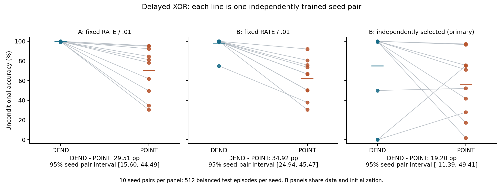

# V5：delayed XOR 差异复验与等预算配置搜索

**已完成；仅保存在本地研究分支。** V4 固定 RATE／0.01 配置下的差异，在两组新种子上重复出现；但各结构独立选择配置后，预注册的主要比较区间跨过零，没有满足“在两种训练设置下都稳定”的判据。这也不表示两种结构等价。

| 比较（各 10 对独立训练种子、每个种子 512 条测试） | DEND 平均准确率 | POINT 平均准确率 | 配对差值及 95% 种子级区间 |
|---|---:|---:|---:|
| A：固定 RATE／0.01 | 99.88% | 70.37% | +29.51 个百分点 [15.60, 44.49] |
| B：同种子的固定配置对照 | 97.38% | 62.46% | +34.92 个百分点 [24.94, 45.47] |
| B：各自选配置，主要比较 | 74.88% | 55.68% | +19.20 个百分点 [-11.39, 49.41] |

选择规则在看数据之前冻结。DEND 选中 CE／0.03，POINT 选中 CE／0.003；二者各用六个候选、五对开发种子。B 中固定与所选配置共享训练数据、初始化与测试数据。所选配置相对固定配置的平均表现均下降；差距缩小量的区间也跨过零，不能把差距归因于某一配置因素，或说独立搜索“救活了”POINT。损失与学习率同时改变，因此不能单独归因于 CE。

全部原生硬脉冲、reset、176 个参数和计数解码器保持不变。全部 120 次训练及失败记录均保留，没有剔除失败种子或查看测试后重选配置。本轮未执行结构消融，也未启动下一阶段。



- [完整报告](REPORT.md)：结果、计算量、验证与适用范围。
- [全部候选及逐种子结果](TABLES.md)、[机器可读结果](results/per_seed_metrics.csv)。
- [冻结协议](PROTOCOL.md)、[数据与源代码审计](SOURCE_AUDIT.md)。
- [计算量记录](results/COST.json)、[独立方程及更新重放](results/verification.json)、[代理梯度检查](results/gradient_audit.json)。
- [提交来源](PROVENANCE.json)、[历史文件保全检查](PRESERVATION.json)、[完整文件与 SHA-256 清单](MANIFEST.json)。

## 已保存的执行顺序

1. `5b3fb7c6e3b5c2c58883725ed5d23292a1cc2300`：冻结协议、源代码与确定性检查，随后才生成 V5 训练／开发数据。
2. `ba2a098f82c3762da4e3f22a6d039bdecca2b589`：锁定 A 权重、全部搜索候选和配置选择。
3. `b155ff98b95a62bb2d5449263e2028c20a691ea6`：锁定 B 全部最终权重，随后一次性生成并评估未使用过的测试数据。

现有目录保存了已完成的单次测试。训练器和评估器含防重复执行门禁，不应直接在这里重新运行。重新核验可从仓库根目录运行：

```bash
OPENBLAS_NUM_THREADS=1 OMP_NUM_THREADS=1 python3 research/dendritic-population-v5/verify.py
OPENBLAS_NUM_THREADS=1 OMP_NUM_THREADS=1 python3 research/dendritic-population-v5/audit_gradients.py
```

上述脚本会更新自己的验证输出及耗时，因而重跑后当前清单中的对应哈希会变化；审阅现成输出不需重跑。独立复验应使用另一个工作目录，保留这里的原始工件，并记录软件版本和新执行过程。`summarize.py` 只读取结果生成统计表与图，不训练或评价模型。

这些核验属于同一 AI 辅助工作流内的数值一致性检查，不是外部独立复现或同行评议。研究方向与原生发放约束由李则徐提出；协议、实现、执行、核验及报告初稿由 AI 辅助完成。结论仅涉及本 delayed XOR 分布、200 次更新和有限配置网格，不支持能耗、生物实现或一般结构排序。
