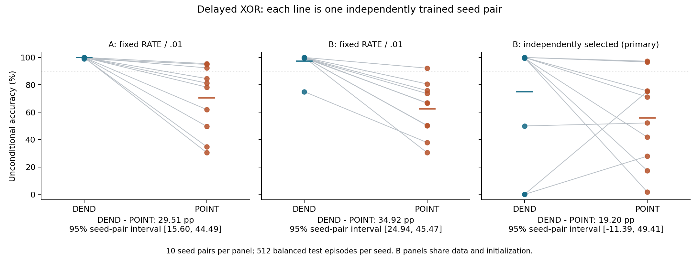
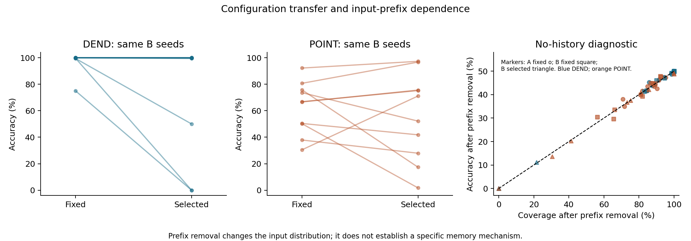

# V5: delayed-XOR replication and equal training-configuration search

Date: 2026-11-03. Local research branch; no public release authorized for V5.

**The prespecified stability criterion was not met.** On delayed XOR with 200 updates and ten new paired training seeds, the independently selected recipes gave a mean DEND-minus-POINT accuracy difference of **+19.20 percentage points**, with a seed-pair 95% interval of **[−11.39, +49.41]**. Seven pairs favored DEND and three favored POINT. This primary result does not establish a consistent direction or equivalence. The fixed RATE/.01 condition reproduced a positive difference on both measured ten-seed cohorts, but that finding did not remain statistically resolved after the equal configuration search.

## Question and scope

V5 asks whether the V4 delayed-XOR difference repeats under its fixed RATE/.01 recipe, and how it changes after each structure receives the same small training-configuration search. It studies one synthetic task distribution at a fixed resource and update budget. It does not search for a new architecture or change the native forward equations.

The [pre-data source audit](SOURCE_AUDIT.md) identified a reason to separate these questions: V4 selected a shared configuration using the worst validation accuracy across both structures, whereas different CE settings sometimes worked better for POINT. V5 therefore includes both a fresh fixed-recipe replication and independently selected recipes. A fixed-recipe control on the same final B seeds permits a paired estimate of the configuration-associated change; simply subtracting results from different A and B cohorts would confound that change with training-seed variation.

The earlier request to remove an extra pulse module is closed. The author confirmed that such a module did not exist in the original implementation; no code is missing and no module was deleted for V5.

## Frozen design and execution gates

The [protocol](PROTOCOL.md), source and deterministic pre-data checks were committed as `5b3fb7c6e3b5c2c58883725ed5d23292a1cc2300`. Stage A weights, all search candidates and selections were locked at `ba2a098f82c3762da4e3f22a6d039bdecca2b589`. All final B checkpoints were then committed at `b155ff98b95a62bb2d5449263e2028c20a691ea6`. Every gate preceded final test generation. [TEST_STARTED.json](results/TEST_STARTED.json) and [TEST_SUMMARY.json](results/TEST_SUMMARY.json) bind the one-shot evaluation to its checkpoint locks; no test result was used to choose or revise a configuration.

| Component | Paired training seeds | Recipes per structure | Training episodes / seed | Validation episodes / seed | Updates / trajectory | Unique trajectories |
|---|---:|---:|---:|---:|---:|---:|
| A fixed replication | 10 | RATE/.01 | 128 | None | 200 | 20 |
| B development search | 5 | CE/RATE × {.003,.01,.03} | 128 | 128 | 200 | 60 |
| B final fixed control | 10 new | RATE/.01 | 128 | None | 200 | 20 |
| B final selected | Same 10 B seeds | One independently selected recipe / structure | Same 128 as fixed control | None | 200 | 20 |

All 120 trajectories completed, totaling 24,000 parameter updates. Both selected recipes differ from RATE/.01, so no trajectory was reused. Final evaluation used 512 fresh balanced episodes for each of the ten A and ten B seeds, with the B fixed and selected models evaluated on the same test histories. A and B tests were generated in one invocation only after all training, so A test results could not influence B selection. Every final trained seed remains in the analysis; there was no validation-based exclusion, best-epoch selection or replacement of failed seeds.

The frozen protocol's phrase “24updates” in its training-settings paragraph denotes **24 simulation time steps per sequence**. Each trajectory has 200 parameter updates, as specified elsewhere in that protocol and implemented in the frozen runner. This clarification does not change the protocol or code.

## Task, native dynamics and learning

Each 24-step input has six channels. The first bit appears on channel 0 or 1, begins at step 2, 3 or 4, lasts four steps, and ends by step 7. The second bit appears on channel 2 or 3, begins at step 10, 11 or 12, lasts four steps, and ends by step 15. Cue amplitudes are uniform on [.8,1.2]; onset jitters are independently sampled. The common readout cue occupies channel 4 at steps 16–23; channel 5 contains a distractor at steps 7–9. Gaussian noise of standard deviation .03 is added before clipping inputs below zero. Every dataset is exactly balanced over the four bit pairs; the target is their XOR. Informative cues end before the count window.

The model and generator are byte-identical copies of their V4 counterparts. Each forward call initializes all episode states to zero; batch rows share weights but do not exchange state or statistics. Labels enter the loss and evaluation only. DEND uses 12 graded dendritic compartments feeding six spiking somata and two spiking outputs. POINT replaces those compartments with 12 native spiking branch cells, while retaining the six somata and two outputs. Stored previous soma spikes drive recurrent and output connections. Hidden and output spikes, and POINT branch spikes, use strict `candidate > .5` thresholds and reset; every emitted spike in training and inference is binary.

The decoder counts native output spikes at steps 16–23. A unique largest count selects a class. Equal counts, including full silence, abstain and count as incorrect. There is no analog decoder, label-conditioned timing signal, post hoc tie-break or external output pulse generator.

Training uses full-batch surrogate BPTT and Adam with beta1=.9, beta2=.999, epsilon=1e-8, global gradient-norm clipping at 1, and parameter bounds [-2,2]. Both losses include .0001 times the mean squared parameters. CE uses .5 times the two output counts as logits. RATE compares count/8 with .75 for the target output and .125 for the other output. The surrogate derivative is `1/(1+5*abs(candidate-.5))^2`, including reset paths. It is an explicit proxy learning rule, not the exact derivative of the hard-spike model.

## Search outcome

The same five development seeds and six recipes were used for both structures. Selection first maximized worst-seed validation accuracy, then mean accuracy, minimized mean RATE error, favored lower learning rate, and finally favored RATE over CE. All final checkpoints and failures were retained.

| Structure | Selected recipe | Minimum validation accuracy | Mean validation accuracy | Mean RATE error |
|---|---|---:|---:|---:|
| DEND | CE/.03 | 100.0000% | 100.0000% | .0386962891 |
| POINT | CE/.003 | 82.0313% | 86.4063% | .0890136719 |

DEND reached 100% validation accuracy on all five development seeds under CE/.03 and the 200-update budget. POINT's selected recipe did not meet the 90% validation-accuracy criterion on every seed. Selection of that recipe means it ranked first under the frozen rule; it does not turn its failures into successes. POINT CE/.01 had higher mean validation accuracy (88.4375%) but a lower minimum (71.0938%), so it was not selected. [TABLES.md](TABLES.md) reports all 60 candidate rows, both class recalls and confusion matrices.

## Final test outcomes

The sole primary comparison is B selected DEND minus POINT. The table below concerns the delayed-XOR distribution, 200 updates, ten fresh training seeds and 512 balanced test episodes per seed in each cohort. Accuracy and class recall count abstentions as errors. Failure means accuracy <90% or coverage <90% for a seed.

| Cohort / recipe | Structure | Mean accuracy | Mean coverage | Abstentions / 5,120 | Mean recall 0 | Mean recall 1 | Failed seeds / 10 |
|---|---|---:|---:|---:|---:|---:|---:|
| A fixed RATE/.01 | DEND | 99.88% | 99.94% | 3 | 99.80% | 99.96% | 0 |
| A fixed RATE/.01 | POINT | 70.37% | 88.79% | 574 | 69.10% | 71.64% | 7 |
| B fixed RATE/.01 | DEND | 97.38% | 99.88% | 6 | 99.77% | 95.00% | 1 |
| B fixed RATE/.01 | POINT | 62.46% | 80.33% | 1,007 | 51.17% | 73.75% | 9 |
| B selected CE/.03 | DEND | 74.88% | 74.98% | 1,281 | 69.84% | 79.92% | 3 |
| B selected CE/.003 | POINT | 55.68% | 68.81% | 1,597 | 53.95% | 57.42% | 8 |

| Paired comparison | Mean difference (percentage points) | 95% seed-pair interval | Status |
|---|---:|---|---|
| B selected DEND minus POINT | +19.20 | [−11.39, +49.41] | **Primary; uncertain direction** |
| A fixed DEND minus POINT | +29.51 | [+15.60, +44.49] | Secondary |
| B fixed DEND minus POINT | +34.92 | [+24.94, +45.47] | Secondary |
| B DEND selected minus fixed | −22.50 | [−47.34, −0.23] | Secondary |
| B POINT selected minus fixed | −6.78 | [−24.94, +10.16] | Secondary |
| B paired gap attenuation | +15.72 | [−12.42, +45.49] | Secondary |

Intervals use 20,000 percentile-bootstrap resamples of the ten independently trained seed pairs, with equal weight per pair; episodes are not treated as independent training replications. The primary interval includes zero and values below the prespecified practical threshold of +5 percentage points. Therefore neither a stable positive direction across fixed and selected conditions nor a stable practically meaningful difference is established. Secondary intervals are exploratory and unadjusted for multiplicity.

The fixed RATE/.01 comparison was positive in all ten A pairs and all ten B pairs under this task, update budget and sampled seed distribution. The primary selected comparison was positive in seven B pairs and negative in three. Its heterogeneity is substantive: selected DEND scored 50%, 0% and 0% on seeds 5, 7 and 9 despite 100% validation accuracy on all five development seeds. Seeds 7 and 9 were entirely silent in the readout window; seed 5 abstained on every class-0 episode and correctly classified every class-1 episode. Selected POINT ranged from 1.76% to 97.27% accuracy and failed the 90% gate on eight of ten fresh seeds. Its seed 6 abstained on 500/512 episodes, with 65.82% full silence. These are native-readout/training failures under the prescribed recipe and budget, not proofs of representational impossibility. The strongest development minimum did not transfer reliably to the final cohort.

On identical B training data and initial parameters, switching to the independently selected recipe lowered observed mean accuracy by 22.50 points for DEND and 6.78 for POINT. The observed gap narrowed by 15.72 points, but that paired attenuation interval includes zero. These results do not show that the search rescued POINT or that the shared V4 recipe explains a stable structural difference. They reveal a reproducible fixed-recipe contrast alongside an unstable transfer of the development-selected recipes. The raw A-to-B change is not used as a configuration-effect estimate because those cohorts have different training/data seeds.

[TABLES.md](TABLES.md) provides every final seed, both class recalls, coverage, abstention and silence rates, confusion counts, all paired differences and all diagnostic intervals. No failed final seed was removed. Because the frozen stability condition failed, no recurrence ablation or subsequent study was executed, and no contingent follow-up protocol was activated.

The plotted lines join paired structures evaluated on the same training/test seed; they do not join different cohorts. The B-selected interval is the prespecified primary result.

## No-history diagnostic

The frozen diagnostic sets all six channels at steps 0–7 to zero while preserving weights, equations, sequence length and count decoder. At the start of step 8, each model's state is identical across episodes and contains no first-bit information. Remaining inputs provide the second bit and independent nuisance. In the balanced-XOR population, the target is independent of this suffix, so expected unconditional accuracy is coverage/2, at most 50%. Finite test draws can exceed 50% by chance.

This intervention also removes prefix noise and the first distractor step, and shifts the inference input distribution. It tests dependence of the trained solution on the input prefix. It does not isolate the mechanism that stores memory, establish representational limits after retraining, or show whether cross-cell recurrence is necessary.

| Cohort / recipe | Structure | No-history mean accuracy | No-history mean coverage | Intact minus no-history (pp) | 95% seed-pair interval (pp) |
|---|---|---:|---:|---:|---|
| A fixed | DEND | 47.52% | 94.59% | +52.36 | [+51.02, +53.81] |
| A fixed | POINT | 42.11% | 84.43% | +28.26 | [+14.94, +40.57] |
| B fixed | DEND | 47.54% | 95.04% | +49.84 | [+43.65, +54.14] |
| B fixed | POINT | 40.31% | 79.96% | +22.15 | [+11.84, +32.27] |
| B selected | DEND | 36.09% | 72.09% | +38.79 | [+24.90, +49.75] |
| B selected | POINT | 33.36% | 67.52% | +22.32 | [+11.74, +33.20] |

Under the same ten-seed/200-update delayed-XOR conditions, mean intact-minus-erased differences were positive in all six condition summaries. Some individual failed models did not benefit from the intact prefix. No-history accuracy was close to half of coverage, as expected when first-bit information is unavailable; lower raw accuracy reflects abstention as well as mistakes. The largest no-history individual score was 50.1953%, a one-episode excess above 50% on 512 episodes, not evidence by itself of label leakage. The diagnostic intervals are secondary and do not establish recurrence necessity.

The paired configuration panel uses only the same B seed cohort. The no-history reference line represents the population expectation of coverage/2, not an exact constraint on each finite sample.

## Resources and compute

| Resource | DEND | POINT |
|---|---:|---:|
| Trainable float64 parameters | 176 (1,408 bytes) | 176 (1,408 bytes) |
| Continuous float64 states / episode | 20 (160 bytes) | 20 (160 bytes) |
| Stored previous soma spikes / episode | 6 (48 bytes) | 6 (48 bytes) |
| Native output count accumulators / episode | 2 (16 bytes) | 2 (16 bytes) |
| Adam moment storage | 352 float64 values (2,816 bytes) | 352 float64 values (2,816 bytes) |
| Represented cells | 8 | 20 |
| Compartment / branch transformation | Graded ReLU | Native hard threshold and reset |
| Dense forward MAC terms / sample / time step | 156 | 156 |
| Dense backward MAC terms / sample / time step | 240 | 240 |
| Search trajectories | 30 | 30 |
| Total training trajectories | 60 | 60 |

Each parameter update uses one complete forward and backward pass over 128 sequences of 24 steps. Across all 120 trajectories, training accounts for 11,501,568,000 forward and 17,694,720,000 backward matrix MAC terms, totaling 29,196,288,000. This accounting excludes scalar nonlinearities, resets, biases, loss, clipping, Adam, validation, diagnostics, audits, I/O and data generation. Matching these quantities does not match activation patterns, reset-derivative paths, scalar costs, cell count, wall time, energy or biological resources. Stored spike/event counts are not energy measurements.

The two training phases took 67.72 s and 33.44 s including phase overhead, totaling 101.16 s against the prespecified 600 s training cap. Final testing and artifact creation took 15.64 s against its 300 s cap. There were 120 unique model/dataset evaluations of 512 episodes each, totaling 61,440 episode evaluations over 10,240 unique underlying test histories; repeated evaluation by different models or prefix erasure does not increase the number of independent training seeds. Execution used CPU NumPy and one BLAS/OpenMP thread. PyTorch was not substituted for the frozen implementation. Verification cost is reported below.

[COST.json](results/COST.json) separates training by arm, phase and recipe role. Validation adds 60 forward batches and 28,753,920 matrix MAC terms. Final inference adds 230,031,360 forward matrix MAC terms; measured inference alone took .77 s, with compression and other artifact work accounting for much of the 15.64 s evaluation phase. These observations are implementation timings, not matched wall-clock budgets or hardware-efficiency evidence.

## Numerical verification

Pre-data native-equation parity, strict-threshold/reset, binary-spike, batch permutation/splitting and prefix-erasure state checks passed. Initial finite differences checked 704 parameter derivatives; the largest surrogate chain-rule residual was 2.3737e-10. These differences are evaluated on a locally anchored differentiable graph that represents the specified surrogate chain rule. They do not differentiate the discontinuous native spike-count objective.

The separate [native/optimizer verifier](results/verification.json) passed 43,533 checks. It independently regenerated inputs, checked all validation metrics and selection, recomputed seed-pair intervals, reconstructed all 24,000 Adam updates from saved clipped gradients, and independently evaluated 120 initial training objectives. It replayed all 61,440 final model-episodes, including prefix-erased inputs, with exact spikes, counts and predictions. The largest state/candidate residual was 1.3323e-15 over 29,491,200 scalar state updates. It checked all 60 no-history prefix states and found no exact cross-split history duplicates among the 14,080 distinct development/training/test histories. This uniqueness check complements the seed-namespace audit; uniqueness alone does not prove statistical independence.

The [checkpoint gradient audit](results/gradient_audit.json) recomputed 360 sampled training updates with zero gradient residual. It checked all 176 local parameter derivatives at 70 unique selected/final checkpoints, totaling 12,320 checks, with maximum chain-rule residual 3.9489e-10. Sampled gradients use the frozen analytic implementation; native-equation and optimizer reconstruction use the separate verifier. The workflow did not independently rederive every gradient at every one of the 24,000 updates. Native/optimizer verification took 7.92 s and the gradient audit 33.03 s, totaling 40.95 s within the 300 s verification budget.

These checks are internal to this AI-assisted workflow. A separate implementation within the same workflow is not external independent replication or peer review, and its successful checks do not turn the uncertain primary comparison into a directional result.

## What this does not establish

This study does not establish a universal ordering of dendritic and point neurons, biological learning or anatomical feasibility, energy savings, hardware efficiency, or generalization beyond the prescribed delayed-XOR distribution. Learning failures under a finite configuration grid and update budget do not prove that a structure cannot represent the task. Successes are conditional on the task, initialization/data distribution, budget and measured seed count.

A configuration effect can arise through optimization and interaction with activation/reset dynamics; it does not separate representational capacity from trainability. The no-history diagnostic does not prove recurrence necessity. No architectural ablation, additional task or subsequent phase was run in V5.

## Limitations

There are ten independently trained seed pairs per final cohort, five development seed pairs, one synthetic task and a six-recipe grid. The principal 95% intervals resample ten trained seed pairs, not thousands of episodes. They are conditional on the one completed configuration search and do not resample that selection procedure. Twenty thousand bootstrap draws do not create additional independent training replications, and ten pairs limit tail estimation.

Secondary and diagnostic intervals are exploratory and have no multiplicity adjustment. An interval crossing zero means uncertainty, not equivalence. A degenerate interval would not establish population equality or a non-inferiority bound. Pairing controls input histories and initial parameter vectors within each cohort, but A-to-B comparisons still involve different random training/data draws. The paired B configuration control supports a narrower comparison than attributing the entire historical V4 gap to one optimizer setting.

The search prioritizes minimum validation accuracy and uses RATE error as a later tie-break; another declared selection objective could choose another recipe. The selected recipes change both loss and learning rate relative to RATE/.01, so their effects cannot be attributed to CE alone. Equal parameter/state/matrix-work budgets leave substantive differences in branch transformations, cell count and derivative paths. No-history erasure changes prefix nuisance as well as informative history. Numerical verification checks consistency of this implementation and workflow; it cannot remove these design limits.

## Attribution and artifacts

Li Zexu proposed the research direction and native-firing constraint. Protocol development, implementation, execution, numerical verification and this first report draft were AI-assisted. [PROTOCOL.md](PROTOCOL.md), [SOURCE_AUDIT.md](SOURCE_AUDIT.md), [TABLES.md](TABLES.md), frozen sources and the result archives preserve configurations, all candidate/final weights, every clipped-gradient trace and the actual data/seeds. [README.md](README.md) indexes the complete deliverable set, figures and machine-readable summaries; the inventory and SHA-256 manifest provide integrity checks. [PROVENANCE.json](PROVENANCE.json) records execution gates. [PRESERVATION.json](PRESERVATION.json) confirms all 801 historical-manifest file checks and all nine V5 frozen-source checks, with no repository changes outside V5. V1–V4 and the cached main reference remain unchanged. V5 remains on the local research branch and has not been pushed, merged into the main paper or opened as a public PR.
