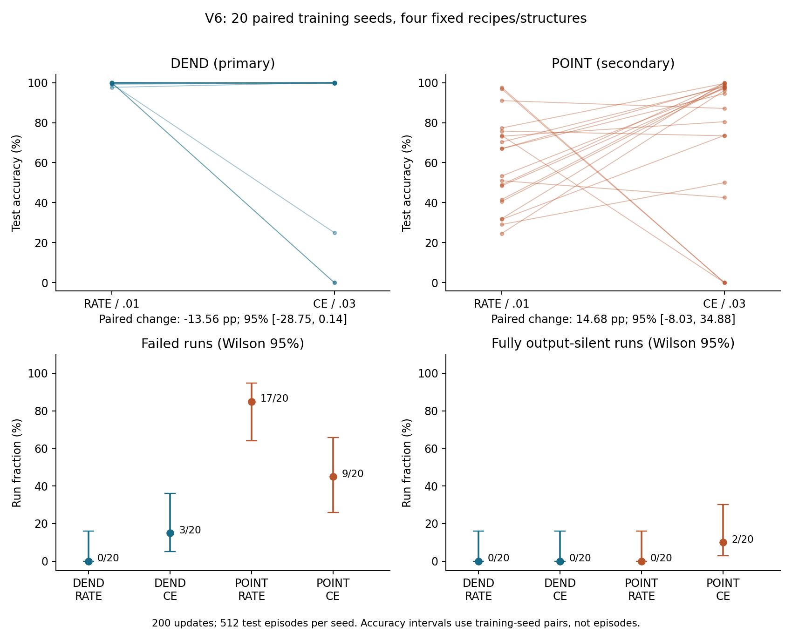

# V6：固定训练配置的稳定性检查

**已完成 20 对新种子、四个固定条件、共 80 次训练；本轮保存在本地分支。** 原生模型方程、delayed XOR 生成器、发放与 reset、计数解码器均保持 V5 原样，没有额外脉冲发生器，没有新配置搜索。

先对 V5 做事后检查：DEND CE／0.03 的失败种子 5、7、9 在训练集上就分别只有 50%、0%、0% 准确率，与测试结果一致；失败并非只在测试数据上出现。这是旧数据的描述性重放，不是因果证明，也不增加独立样本数。

V6 每个条件均为 20 个独立训练种子、128 条训练、200 次 Adam 更新；每个种子使用 512 条未见过的测试历史。四条件共享配对数据和初始化。弃权一律算错；失败定义为准确率或覆盖率低于 90%。

| 结构／固定配置 | 平均测试准确率 | 失败次数 | 全部测试输出静默的次数 | 全部测试弃权的次数 |
|---|---:|---:|---:|---:|
| DEND RATE／0.01 | 99.75% | 0/20 | 0/20 | 0/20 |
| DEND CE／0.03 | 86.18% | 3/20 | 0/20 | 2/20 |
| POINT RATE／0.01 | 59.56% | 17/20 | 0/20 | 0/20 |
| POINT CE／0.03 | 74.24% | 9/20 | 2/20 | 2/20 |

预先指定的主要比较是 **DEND 的 CE／0.03 减 RATE／0.01**：平均 **−13.56 个百分点**，95% 种子配对 bootstrap 区间 **[−28.75，+0.14]**。区间仍跨零，不能据此确认该均值差异的方向，也不能宣称两配置等价。20 次未观察到失败的 RATE 条件，其失败率的双侧 95% Wilson 上限仍为 **16.11%**，不等于保证失败率为零。

V6 的 DEND CE 零分种子 16、17 都是两路输出在 8 步读出窗口内每步发放、计数均为 8，因平票全部弃权；不是全静默。种子 0 有 75% 测试回合静默、准确率 25%。POINT CE 则出现两个全静默种子和一个近乎全静默种子。所有 80 个模型的训练／测试通过或失败分类一致。原生读出失败有不同表现，不能统一称为“神经元不发放”。

V6 比较固定配置；它不是 V5 各自调参后 DEND CE／0.03 对 POINT CE／0.003 的重复。损失和学习率同时变化，不能单独归因于 CE 或学习率。结构对比、失败率对比及交互均为探索性次要分析。



## 交付物

- [完整报告](REPORT.md)、[全部训练／测试逐种子表](TABLES.md)、[CSV](results/per_seed_metrics.csv)。
- [冻结协议](PROTOCOL.md)、[20 对种子清单](SEEDS.json)、[提交来源](PROVENANCE.json)。
- [V5 事后分析](POSTHOC_V5.md)、[其完整数值记录](posthoc_v5.json)。
- [原生方程／更新核验](results/verification.json)、[代理梯度检查](results/gradient_audit.json)。
- [计算量记录](results/COST.json)、[后续精度规划](results/PRECISION_PLAN.json)。
- [历史文件保全检查](PRESERVATION.json)、[全部文件哈希](MANIFEST.json)。

`results/` 保存全部初始／最终权重、逐步裁剪后梯度、全部训练计数、九个训练检查点、实际训练／测试输入，以及最终原生状态、候选值、脉冲、计数和预测。全量审计通过：16,000 次 Adam 更新完整重建，40,960 个模型测试回合逐项重放；另核验 720 个训练检查点及 14,080 个最终权重局部代理导数。这是同一工作流内的核验，不是外部独立复现。

## 后续判断

值得设计一个独立执行、单一主要问题的 DEND 配置可靠性确认研究。以本轮配对准确率差的样本标准差作普通近似，目标 95% 区间半宽 ±5 个百分点约需 177 对；把标准差放大 1.5 倍作敏感性规划则约需 398 对。±10 个百分点对应约 45／100 对。它们不是功效保证，不能在本轮数据上补样直至得到有利结论。若主要问题改为失败概率，需要另行冻结事件定义和精度目标。**本轮没有执行后续确认研究或新一轮扫描。**

## 核验与复验

冻结协议／执行源码提交：`26d85e9d6176f7b0d335d55527cd0c8049f55a75`；训练数据随后生成。

全部训练权重及独立检查器提交：`0cb7d16aad5fe897406110fc5c79fd483347aab3`；测试数据随后一次性生成和评估。

现成核验输出已保存，不必再次运行。若复验，请复制到独立工作目录；下面的脚本会改写自己的输出 JSON 与耗时，改变当前清单的对应哈希：

```bash
OPENBLAS_NUM_THREADS=1 OMP_NUM_THREADS=1 python3 research/dendritic-population-v6/verify.py
OPENBLAS_NUM_THREADS=1 OMP_NUM_THREADS=1 python3 research/dendritic-population-v6/audit_gradients.py
```

训练／测试脚本有防重跑门禁。新确认研究必须使用另一个冻结协议与未使用过的数据。研究方向与原生发放约束由李则徐提出；协议、实现、执行、数值核验和报告初稿由 AI 辅助完成。
