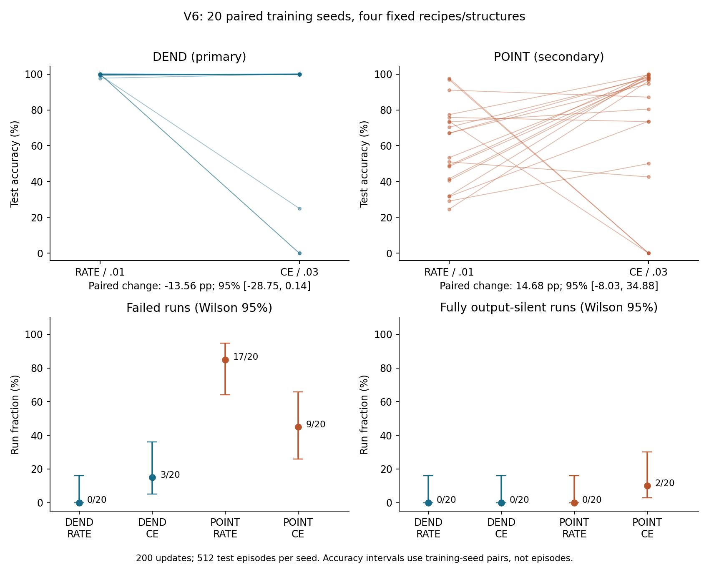
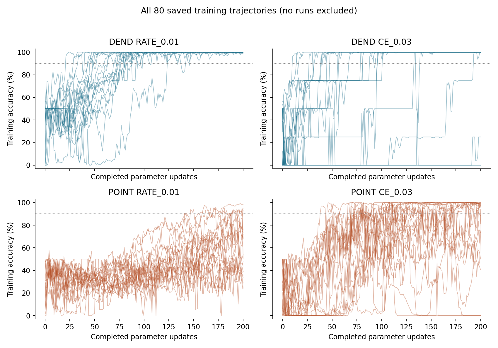

# V6: stability of two fixed native-spike training recipes

**The V5 CE/.03 failures were already present on training data. V6 shows recurrent native-readout failure, with different failure forms across fresh seeds, but its primary accuracy contrast remains uncertain.** On delayed XOR, 200 updates and 20 fresh paired training seeds, DEND CE/.03 minus RATE/.01 averaged **−13.56 percentage points**, with a 95% seed-pair interval **[−28.75,+0.14]**. The interval includes zero. DEND RATE/.01 passed the 90% accuracy/coverage gate on 20/20 seeds, while DEND CE/.03 passed 17/20; zero observed RATE failures is not a guarantee of zero population risk.

## Question and scope

V6 examines training stability on the same delayed-XOR task, native hard-spike dynamics and output-count readout as V5. It first inspects the already observed V5 failures, then runs a new bounded comparison of DEND and POINT under two fixed recipes: RATE/.01 and CE/.03. It does not search for a new architecture, retune a recipe, or test the independently selected POINT CE/.003 configuration from V5. Twenty training-seed pairs are an exploratory sample, not an a priori power guarantee.

The starting publication is `438a9fba4e6249510e4540618c359ba41ac22b00`, including V5 result commit `73c1bff6eebf0cb98502f19f8b08d15e2a261182`. Earlier data, reports and frozen files remain preserved. V6 remains a separate local study; publication and a subsequent phase are not part of this execution. The earlier extra-pulse-module request is closed as an author-confirmed misattribution: no such module existed, and no separate pulse generator is added or removed.

## V5 post hoc diagnosis

[POSTHOC_V5.md](POSTHOC_V5.md) and [posthoc_v5.json](posthoc_v5.json) inspect all ten final B DEND seed pairs. Twenty Adam trajectories reconstructed from saved clipped gradients match their final weights exactly. Saved training inputs were replayed at updates 0, 1, 5, 10, 20, 50, 100, 150 and 200; final test outputs were reused from existing files. No new data or training was introduced by this inspection.

For DEND CE/.03 seeds 5, 7 and 9, final training accuracy was 50%, 0% and 0%, respectively, exactly matching held-out accuracy. These failures already occurred on the training examples; they were not failures appearing only on held-out data. The other seven CE/.03 runs fitted all training examples and scored 99.4141–100% on their saved tests. Across the corresponding fixed RATE/.01 controls, seeds 5 and 9 largely fitted the task, while seed 7 still scored 75% on both training and test examples.

Seed 7 was fully readout-silent by the sampled checkpoint after five updates, and seed 9 by checkpoint ten. Both remained silent at all later sampled checkpoints. Seed 5 was silent at checkpoints 10–100, then partially recovered to 25% training accuracy at 150 and 50% at 200. Hidden neurons continued firing in the silent-output runs. At the final checkpoint, seeds 7/9 had maximum readout output-candidate margins of −0.6067/−2.0798 relative to the .5 threshold on training data. Their last-20-update median data-surrogate gradient norms were approximately 9.13e-6/5.08e-5, small but nonzero. These observations do not prove an absorbing zero-gradient state or identify the mechanism that caused failure.

The five development seeds that selected DEND CE/.03 in V5 had all achieved 100% validation accuracy. Failure of that selected recipe on independently retrained seeds is distinct from a within-model train/test generalization gap. Both loss and learning rate differ between RATE/.01 and CE/.03, and the post hoc trajectory comparison is not a causal intervention. Sparse activity checkpoints do not locate the exact collapse update or exclude unsampled excursions. Full loss and gradient/update norms exist for every V5 training update; intermediate held-out trajectories were not saved and were not reconstructed here.

## Frozen V6 design and execution gates

The [protocol](PROTOCOL.md), literal [seed registry](SEEDS.json) and executable scientific sources were frozen at `26d85e9d6176f7b0d335d55527cd0c8049f55a75` before V6 training data generation. All 80 final weights and their lock were then committed at `0cb7d16aad5fe897406110fc5c79fd483347aab3` before test generation. The registry specifies 20 fresh independent training/data pairs, each shared across all four conditions.

| Condition | Training-seed pairs | Episodes per training batch | Parameter updates per run | Fresh held-out episodes per pair | Runs |
|---|---:|---:|---:|---:|---:|
| DEND RATE/.01 | 20 | 128 | 200 | 512 | 20 |
| DEND CE/.03 | Same 20 | Same 128 | 200 | Same 512 | 20 |
| POINT RATE/.01 | Same 20 | Same 128 | 200 | Same 512 | 20 |
| POINT CE/.03 | Same 20 | Same 128 | 200 | Same 512 | 20 |

All four conditions share each pair's input arrays and initial parameter vector. There is no validation search, best-epoch selection, early stopping or replacement of a failed seed. Final checkpoints are used, and every run is evaluated once on the held-out test set, including runs that fail training. A failed, silent or tied output remains in the unconditional accuracy denominator.

Both commit gates completed in the required order. The single guarded held-out invocation generated test data only after the trained-weight commit. Checkpoint diagnostics did not change training or select a model. The count histories, all clipped gradients and nine exact parameter checkpoints are retained. The independent native/data/statistics verifier was added at the checkpoint commit before test generation; all 13 scientific files in the pre-data freeze remain unchanged.

## Task, native dynamics and learning

V6 copies the V5 model and delayed-XOR generator byte-for-byte. Each input has six channels and 24 simulation steps. The first bit starts at step 2, 3 or 4 and lasts four steps; the second starts at step 10, 11 or 12 and lasts four steps. Amplitudes are uniform on [.8,1.2]. A distractor occupies channel 5 at steps 7–9, a common readout cue channel 4 at 16–23, and Gaussian noise with standard deviation .03 is added before clipping inputs below zero. Each dataset balances all four bit pairs exactly; the label is XOR. Informative cues end before the count window at steps 16–23.

Every forward call starts independent episodes at zero state. Labels enter supervised losses and metrics, not forward dynamics, inputs or output timing. DEND uses twelve graded dendritic compartments, six spiking somata and two outputs. POINT uses twelve native-spiking branch cells in place of those compartments, with the same somata and outputs. Hidden/output cells and POINT branch cells fire at strict `candidate > .5` and reset. All emitted spikes are hard binary values in both training and inference. There is no analog decoder: a unique largest output spike count selects a class; all ties, including complete silence, abstain and count as errors.

Both recipes use full-batch Adam for 200 updates, beta1=.9, beta2=.999, epsilon=1e-8, global gradient-norm clipping at 1, and parameter bounds [−2,2]. CE takes .5 times the two counts as logits; RATE compares count/8 with .75 for the correct output and .125 for the other. Both include .0001 times mean squared parameters. The surrogate slope `1/(1+5*abs(candidate-.5))^2`, including reset paths, is a specified proxy learning rule; it is not the exact derivative of the discontinuous native spike objective.

## Outcomes and uncertainty

The prespecified primary descriptive comparison is **DEND CE/.03 minus RATE/.01 held-out unconditional accuracy**. The unit is an independently trained seed/data pair (n=20), not 10,240 independently trained models. The 95% percentile bootstrap resamples the 20 paired indices 20,000 times with a frozen analysis RNG. A five-percentage-point difference is a practical planning threshold; the study does not assert adequate power to resolve it.

Secondary comparisons include the POINT recipe difference, DEND-minus-POINT at each fixed recipe, the recipe-by-architecture interaction, corresponding paired failed-run risk differences, and test-minus-train accuracy per cell. Positive accuracy differences and positive failed-run risk differences have opposite desirability. All intervals are pointwise exploratory, with no multiplicity-adjusted confirmatory declarations. An interval crossing zero means uncertainty, not equivalence; a degenerate [0,0] interval would not prove equality or a noninferiority bound.

A failed run has accuracy <90% or coverage <90%. A fully silent run has both output counts zero on every evaluation episode; a fully abstaining run has coverage zero. These are not the same as the mean fraction of silent or tied episodes across runs. Failed-run, fully-silent-run and fully-abstaining-run marginal proportions use 95% Wilson intervals, retaining nonzero upper uncertainty when no events are observed. Per-class recalls count abstentions as wrong, and each confusion matrix has true classes 0/1 and predicted columns 0/1/abstain. Signed count margins are correct count minus other count; complete histograms over −8…8 are saved.

## V6 results

All 80 runs completed 200 updates and one final held-out evaluation, with no seed replacement or checkpoint selection. The following results concern the fixed delayed-XOR distribution, 128 training episodes, 512 held-out episodes per pair, and 20 paired training seeds. Accuracy counts abstention as error.

| Fixed cell | Mean train accuracy | Mean test accuracy | Mean test coverage | Failed runs /20 | 95% Wilson failure interval | Fully silent runs /20 | Fully abstaining runs /20 |
|---|---:|---:|---:|---:|---|---:|---:|
| DEND RATE_0.01 | 99.77% | 99.75% | 99.79% | 0 | [0.00%, 16.11%] | 0 | 0 |
| DEND CE_0.03 | 86.25% | 86.18% | 86.23% | 3 | [5.24%, 36.04%] | 0 | 2 |
| POINT RATE_0.01 | 59.34% | 59.56% | 79.33% | 17 | [63.96%, 94.76%] | 0 | 0 |
| POINT CE_0.03 | 74.26% | 74.24% | 79.49% | 9 | [25.82%, 65.79%] | 2 | 2 |

The primary DEND CE-minus-RATE mean difference is −13.56 percentage points [−28.75,+0.14]. The point estimate and three large negative pair differences motivate a reliability question, but the interval does not resolve the direction or establish a 5-point difference. The corresponding paired failure-risk difference is +15 points [0,+30]; its lower endpoint is zero. These are exploratory pointwise intervals, not confirmatory significance declarations.

| Accuracy contrast | Mean difference (pp) | 95% seed-pair interval (pp) | Role |
|---|---:|---|---|
| DEND CE−RATE | -13.56 | [-28.75, +0.14] | Primary descriptive |
| POINT CE−RATE | +14.68 | [-8.03, +34.88] | Secondary exploratory |
| RATE DEND−POINT | +40.19 | [+30.43, +49.88] | Secondary exploratory |
| CE DEND−POINT | +11.94 | [-12.13, +35.26] | Secondary exploratory |
| Recipe-by-architecture interaction | -28.24 | [-56.68, +0.92] | Secondary exploratory |

DEND CE/.03 failed on seeds 0, 16 and 17, and these were training failures as well as test failures. Seed 0 scored 25% accuracy/coverage with 75% silent episodes. Seeds 16/17 had zero accuracy and coverage because **both outputs fired at every readout step**, producing equal counts 8/8 on every episode. They were fully abstaining but not silent. Their readout output-candidate margins were positive; this differs from the negative-margin silent-output failures in V5. The new result therefore supports a broader description of unreliable training/native count readout under this recipe, not the claim that the identical silent-state failure always repeats.

POINT CE/.03 had nine failed runs, including fully silent seeds 11/13 and nearly silent seed 12 (99.6094% silent episodes, zero accuracy). POINT RATE/.01 had 17 failed runs but no fully silent or fully abstaining runs. Mean episode-level silence/abstention was 0%/0.21% for DEND RATE, 3.75%/13.77% for DEND CE, 0%/20.67% for POINT RATE, and 18.89%/20.51% for POINT CE. Failure counts alone do not describe these different output modes.

All 80 models had the same final train/test pass classification: 20/20 DEND RATE passed both; 17/20 DEND CE passed both; 3/20 POINT RATE passed both; 11/20 POINT CE passed both. There were no train-pass/test-fail or train-fail/test-pass transitions under the 90% gate in this cohort. Small within-fit train/test differences remain, but the large failed-run outcomes were already present on training data. This observation does not prove future generalization or a causal explanation of optimization.

POINT's CE recipe had fewer failed runs than RATE in this sample: paired failure-risk difference −40 points [−70,−5]. Its mean accuracy difference was +14.68 points [−8.03,+34.88], still uncertain. The failed-run interaction was +55 points [+15,+95], while the accuracy interaction interval included zero. Both are secondary exploratory statistics; the binary 90% failure gate and unconditional mean accuracy answer different questions. Neither replaces the prespecified primary outcome.

At fixed RATE/.01, DEND-minus-POINT accuracy was +40.19 points [+30.43,+49.88] for this task, budget and 20 new pairs. At fixed CE/.03, it was +11.94 points [−12.13,+35.26]. This condition dependence does not support a general architecture ranking. In particular, CE/.03 was not POINT's independently selected V5 recipe, and V6 cannot overturn or substitute for V5's independent-search comparison.

[TABLES.md](TABLES.md) contains every one of the 80 final training and 80 held-out rows, class recalls, confusion matrices, all paired differences, 14 intervals, Wilson run risks, seed registry and activity/margin summaries. All silent, tied and failed runs remain included. No test result altered training or selected a configuration.

Each accuracy line joins the two fixed recipes for one independently trained seed/data pair. Run-level intervals retain uncertainty when zero events are observed.

Every training trajectory is shown; the curves are diagnostics and did not select checkpoints or exclude runs.

## Resources, costs and verification

| Resource | DEND | POINT |
|---|---:|---:|
| Float64 trainable parameters | 176 | 176 |
| Continuous state values per episode | 20 | 20 |
| Stored previous hidden-spike values | 6 | 6 |
| Native output-count accumulators | 2 | 2 |
| Represented cells | 8 | 20 |
| Branch transformation | Graded ReLU | Hard threshold and reset |
| Dense forward MAC terms per sample/time step | 156 | 156 |
| Dense backward MAC terms per sample/time step | 240 | 240 |
| Fixed recipes | 2 | 2 |
| Completed training runs | 40 | 40 |

Parameter, state-storage, matrix-work, data and update budgets match. Scalar nonlinearities, reset derivatives, activation patterns, cell count, wall time and energy do not. Activity counts are descriptive and cannot establish energy savings. Each learning update has one full forward and backward pass; checkpoint diagnostic passes are separately accounted for. Training plus diagnostics, test plus artifact generation, and audits each have a 300-second cap. The bounded V5 post hoc reconstruction took 7.66 seconds, with 180 training-batch forward replays over 23,040 episodes and 20 saved final-test arrays inspected.

The completed 80 trajectories contain 16,000 parameter updates. Each of the four cells uses 1,916,928,000 dense forward MAC terms and 2,949,120,000 backward terms for learning. Across all four cells, learning totals 7,667,712,000 forward plus 11,796,480,000 backward terms, or 19,464,192,000. The 720 checkpoint diagnostic forward batches add 345,047,040 terms; final held-out inference adds 153,354,240. These counts exclude scalar nonlinearities, reset operations, loss/clipping/Adam, data generation, compression, audits and the post hoc analysis. [COST.json](results/COST.json) records each cell separately.

Training and diagnostic artifact generation took 72.27 seconds; held-out evaluation and artifact creation took 12.28 seconds, of which .52 seconds was measured model inference. Execution used Python 3.12.14, NumPy 2.3.5, CPU and a single BLAS/OpenMP thread. There were 10,240 unique held-out input histories and 40,960 model-test episode evaluations. Four evaluations of one history do not become four independent training replications.

Pre-data deterministic fixtures passed native parity against V5, binary threshold/reset checks, batch permutation/splitting, label-free forward signature and identical erased-prefix states. The 704 initial parameter finite differences have maximum local surrogate-chain-rule residual 2.3737e-10. They check a locally anchored differentiable surrogate graph, not the true hard-spike derivative.

The separate [native/data/optimizer/statistics verifier](results/verification.json) passed 107,001 checks. It independently regenerated all data and initial parameters, reconstructed all 16,000 Adam updates and all 720 saved parameter checkpoints, checked all stored count-derived training losses/metrics, and recomputed all 14 seed-level intervals and 12 Wilson run-risk intervals. Native equations were replayed for 92,160 training-checkpoint episodes. Intermediate-checkpoint checks compared saved metrics and available count histories; complete intermediate spike/state trajectories were not stored. Full saved-trajectory comparisons covered the 10,240 final-training model-episodes and every one of the 40,960 held-out model-episodes. For those full saved trajectories, spikes, counts and predictions matched exactly; maximum state/candidate residual was 1.7764e-15. All 12,800 distinct training/test histories were unique across splits; this complements the RNG and episode-state audit rather than proving independence by uniqueness alone.

The [surrogate gradient audit](results/gradient_audit.json) recomputed 240 sampled updates with zero gradient residual and checked 176 local derivatives at each of 80 final checkpoints, totaling 14,080 checks with maximum chain-rule residual 5.8394e-10. Sampled gradients use the frozen analytic backward implementation. The native/data/optimizer/statistics verifier is separately written; it does not independently rederive every gradient or replay native dynamics at every unsampled training update. Native verification took 20.98 seconds and gradient checks 36.80 seconds, a sum of 57.78 seconds within the audit cap.

No scientific run was restarted, no seed was replaced, no cap was exceeded, and no plan deviation required changing the frozen implementation. The pre-data post hoc record, all 13 frozen scientific files and all 1,363 V1–V5 manifest entries remain unchanged. Publication was not performed and no next phase was started.

All checks are internal to this AI-assisted workflow. A separately written checker in the same workflow is not external independent replication or peer review, and numerical agreement does not resolve the primary statistical uncertainty.

## Focused follow-up assessment, without execution

A focused confirmatory question is justified **about DEND recipe reliability on this exact task**, because the observed failures are large and already appear during training, the primary mean interval remains wide, and the failure form changes across cohorts. This does not justify an architecture search or a claim that CE alone is causal. A clean next question would be: on a new seed/data distribution draw with the same frozen model and budget, what is the mean paired CE/.03-minus-RATE/.01 held-out accuracy, and is its interval entirely below −5 percentage points? Failure risk and output mode should remain prespecified secondary outcomes. This would be a new study, not a further look at V6 test data.

The 20 V6 primary paired differences have sample SD 0.3392279 (33.92 percentage points). The prespecified planning formula `n = ceil((1.96*s_delta/h)^2)` gives:

| Target mean-accuracy interval half-width | Using pilot SD | With 1.5× pilot SD |
|---|---:|---:|
| ±5 percentage points | 177 new pairs | 398 new pairs |
| ±10 percentage points | 45 new pairs | 100 new pairs |

[PRECISION_PLAN.json](results/PRECISION_PLAN.json) records the calculation. These are normal-approximation precision illustrations, not guaranteed power or proven required sample sizes. The 1.5× multiplier is a sensitivity analysis, not an upper confidence bound for the unknown variance. Only 20 pilot pairs and a mixture of near-perfect and collapsed fits make the variance estimate uncertain. An implementation and protocol review independent of the original execution should precede any confirmatory run; an external replication claim additionally needs an external team.

If a separate study is authorized with ±5-point precision as its objective, a rounded 400 new DEND seed pairs (800 runs across the two fixed recipes) would be one transparent conservative planning choice relative to this sensitivity analysis. It would require its own fixed seed list, 200-update budget, training/test commit gates, one primary estimand, no interim tuning, and a separate resource authorization. The actual interval could still be wider. Neither those runs nor a large search was performed here. A lower-budget 100-pair plan targets only approximately ±10-point precision under the inflated-SD illustration and should not be described as equivalently precise.

For a single failure proportion, worst-case normal-approximation precision ±.10 or ±.05 requires roughly 97 or 385 independent seeds. A paired risk-difference plan additionally needs assumptions about discordant outcomes, so these single-proportion counts cannot be reused as a justified paired sample size. DEND RATE's zero failures in 20 runs yields a one-sided 95% exact upper bound of 13.91%, distinct from the two-sided Wilson upper bound of 16.11%. If a different follow-up question were solely whether failure risk is below 5%, 59 entirely fresh zero-failure runs would produce a one-sided 95% upper bound of 4.95%, conditional on observing zero and the specified distribution. It would not demonstrate a between-recipe or between-architecture difference.

No subsequent phase was executed. The proposed focus is intentionally about finite-budget training reliability and the fixed output contract, not general representational capacity or biological mechanisms.

## What this does not establish

V6 does not establish universal architecture superiority, equivalence from an inconclusive interval, biological realization, hardware efficiency, energy savings, or generalization beyond this delayed-XOR distribution. Failure under a prescribed recipe and finite budget does not prove representational impossibility. Fixed-recipe comparisons are distinct from V5's independently tuned comparison; POINT CE/.03 must not be described as the best configuration selected for POINT.

The post hoc V5 diagnosis cannot establish causality. Even the paired V6 recipe contrast changes loss and learning rate together and cannot identify the separate contribution of either factor or prove a particular cellular mechanism. Native input/output rules and initialization are shared, but substantial structural and derivative-path differences remain.

## Limitations

The study has twenty independent training/data pairs, one task, two fixed recipes, 128 training and 512 test episodes per seed, and 200 updates per run. It is deliberately exploratory. The 20,000 bootstrap draws do not create more training replications. Seed-level pointwise intervals and Wilson intervals have finite-sample limits, and no multiplicity correction supports a family-wide confirmatory claim.

There is no independent recipe-selection phase in V6. These recipes were chosen after earlier research and a user request, so this study addresses their stability on fresh seeds rather than unbiased comparison over all possible recipes. The source and test gates prevent new test-based selection but do not remove that historical choice. Count ties and silence are part of the fixed output contract, not outcomes repaired by a later decoder.

Pre-update counts are logged at every V6 step, but detailed candidate/activity summaries are available at nine parameter checkpoints. The V5 audit has the same sparse activity sampling and cannot locate exact unobserved transitions. Statistical planning based on the observed V6 variance remains conditional on this pilot and distribution. Preservation and consistency checks cannot remove these inferential limits.

## Attribution and artifacts

Li Zexu proposed the research direction and native-firing requirement. Protocol, implementation, execution, numerical verification and this report draft were AI-assisted. [PROTOCOL.md](PROTOCOL.md), [SEEDS.json](SEEDS.json), [POSTHOC_V5.md](POSTHOC_V5.md), source code and saved artifacts document the workflow. [TABLES.md](TABLES.md), [COST.json](results/COST.json), [PRECISION_PLAN.json](results/PRECISION_PLAN.json), saved native arrays and gradient/checkpoint archives retain the full outcomes, including failures. [README.md](README.md) provides navigation; [PROVENANCE.json](PROVENANCE.json), [PRESERVATION.json](PRESERVATION.json) and [MANIFEST.json](MANIFEST.json) record commit gates and file integrity. The final delivery commit is reported alongside the handoff; it is not embedded in a self-hashed manifest.
