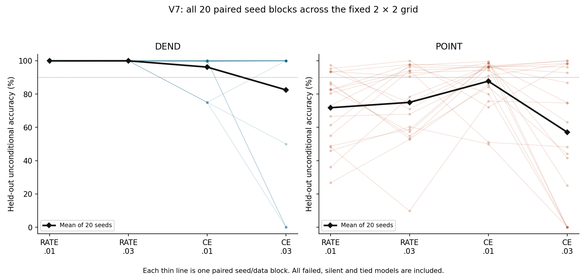
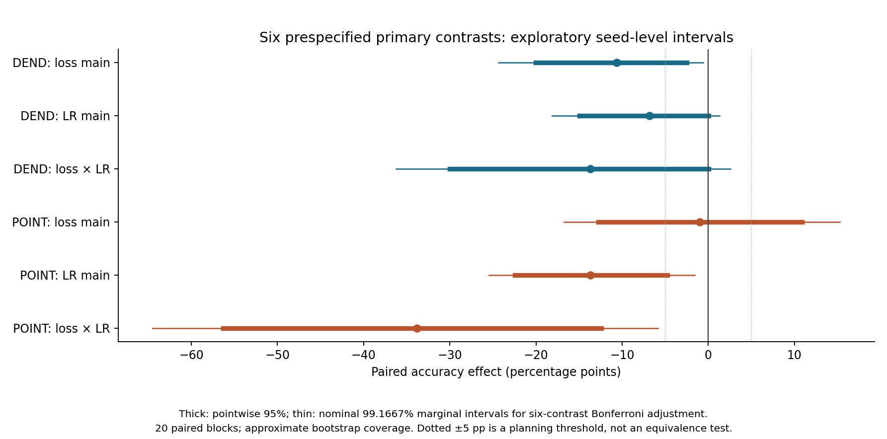

# V7：把损失与学习率分开检查

已完成20个全新配对训练种子、两种结构×两种损失×两档学习率，共160次训练及一次性留出测试。每次训练200次更新，128条训练样本；每个种子另有512条全新测试样本。原生硬脉冲、reset、delayed XOR生成器、初始化与计数读出均沿用V6，模型和任务源码逐字节一致。

## 本次观察

| 结构 | RATE/.01 | RATE/.03 | CE/.01 | CE/.03 |
|---|---:|---:|---:|---:|
| DEND平均测试准确率 | 99.94% | 99.96% | 96.19% | 82.49% |
| DEND失败次数（每格20次） | 0 | 0 | 3 | 4 |
| POINT平均测试准确率 | 71.80% | 75.00% | 87.73% | 57.10% |
| POINT失败次数（每格20次） | 15 | 11 | 7 | 13 |

失败标准是准确率<90%或覆盖率<90%；平票和全静默计错，所有失败保留。表中结论只适用于本任务、固定200次更新预算与这20个配对种子。DEND的两个RATE格均未观察到失败，但各格0/20的双侧95% Wilson失败率区间上界仍为16.11%，不能推出总体零失败。

POINT的损失×学习率交互估计为−33.84个百分点：提高学习率对CE与RATE的影响不同。它的六项主要对比Bonferroni调整用名义99.1667%边际区间为[−64.48,−5.84]个百分点。这是近似bootstrap覆盖下的探索性证据，不是确认性结论。六项主要对比中，DEND的损失主效应、POINT的学习率主效应和POINT的交互区间未跨0；其余跨0，不能据此宣称等价。次要简单效应和结构比较没有多重校正。

这次试验拆开了先前捆绑的两个训练因素，但损失因素仍包含固定的损失缩放、梯度、裁剪和Adam交互。不能据此断言细胞机制、表征能力边界、一般性的结构优越性、能耗或硬件效率。

## 阅读入口

- [完整报告](REPORT.md)：方法、六项主要结果、失败类型、限制和后续建议。
- [完整结果表](TABLES.md)：每个种子、全部50个区间、活动与混淆矩阵。
- [冻结协议](PROTOCOL.md)、[种子](SEEDS.json)、[对比系数](CONTRASTS.json)、[冻结哈希](FREEZE.json)。
- [资源与计算量](RESOURCE_COST.md)、[原生与统计核验](results/verification.json)、[代理梯度审计](results/gradient_audit.json)。
- [提交顺序与来源](PROVENANCE.md)、[历史保存检查](PRESERVATION.json)、[全部文件哈希](MANIFEST.json)。

## 保存与复查

本分支为本地`research/dendritic-population-v7`，没有推送或合并；V1–V6及main保持原样。`results/`包含所有数据、初始/最终权重、每步裁剪后梯度、九个固定检查点与原生轨迹。CSV方便重新分析，PNG/SVG方便阅读和导出。

复查请使用另一个完整检出或副本：核验脚本会写入带新耗时的输出，直接在交付目录重跑会改变文件哈希。新的训练重现应从前数据提交`8ad0b69e65074563929dff905acc0067837e3778`创建独立检出，固定CPU单线程环境，遵守协议中的权重提交与测试生成顺序；已有结果目录和测试开始标记会阻止覆盖或重复测试。

下一步只提出一个候选：用独立新样本确认POINT的四格交互，预先锁定单一主要问题及样本量。尚未执行；本次探索不能自动充当确认性研究。研究方向和原生发放约束由李则徐提出，协议、实现、执行、数值核验和报告初稿由AI辅助完成；全部核验属于同一工作流内部检查，不是外部独立复现或同行评议。
