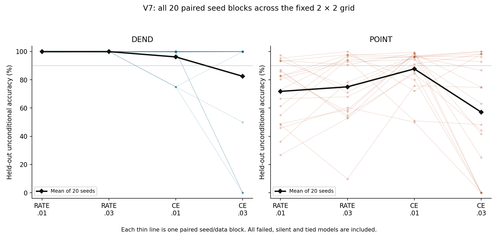
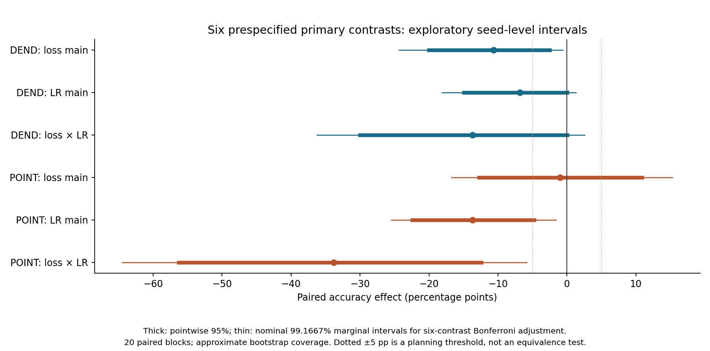
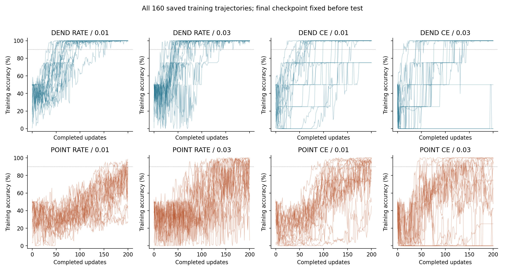

# V7: loss and learning-rate effects in two native-spike networks

**Loss and learning rate interact within this fixed native-spike training setup.** On delayed XOR with 200 updates and twenty fresh paired seeds, POINT's loss-by-learning-rate interaction was **−33.84 percentage points**, with a nominal Bonferroni-level interval **[−64.48,−5.84]**. Its nearly zero marginal CE-minus-RATE estimate averages opposing simple-effect estimates across the two learning rates; it is not evidence that the losses are interchangeable.

Three of six prespecified primary accuracy intervals excluded zero after the nominal adjustment: DEND's loss main effect, POINT's learning-rate main effect, and POINT's interaction. All remain exploratory, with approximate bootstrap coverage and only twenty seed blocks. All 160 planned runs, including 53 held-out failures, were retained. Native equations, hard firing/reset, task and spike-count readout were unchanged.

## Question and scope

V6 compared RATE/.01 with CE/.03, changing loss and learning rate together. V7 separates those two factors in a bounded factorial comparison: RATE versus CE crossed with learning rates .01 versus .03, within both DEND and POINT. Twenty fresh paired training/data seeds give eight fixed conditions and 160 training runs. This is a study of finite-budget learning and the specified native output contract on delayed XOR, not an architecture search or confirmatory trial.

V6's final record is commit `75a595f3c0c5aa3f50d7700b8c142906aca442b0`. Its DEND CE/.03 failures included nonsilent saturated count ties as well as partially silent outputs; a failure cannot automatically be described as silence. V7 does not modify those records or pool their test outcomes with the new cohort. The former extra-pulse-module request remains closed as an author-confirmed misattribution: no such module existed, and no separate pulse generator is added or removed.

## Protocol and execution gates

The [protocol](PROTOCOL.md), literal [seed registry](SEEDS.json), [contrast coefficients](CONTRASTS.json), scientific source and independent checker were frozen before any scientific data were generated. The final pre-data commit is `8ad0b69e65074563929dff905acc0067837e3778`; [FREEZE.json](FREEZE.json) hashes thirteen files. A verifier trailing blank line was normalized before this gate, without a behavior change. All 160 completed trajectories, final weights and the independent verifier were committed at `041693b7297b888ed31ac78f8d5677408669f1fe` before any held-out generation.

Training RNGs are `2070000000+10*s`, held-out RNGs `2070010000+10*s`, initialization RNGs `2070020000+s`, for s=0…19; analysis RNG is `2070030001`. The study completed its checkpoint gate, then generated and evaluated held-out data in one guarded invocation. Failed training runs were evaluated too. No model was ranked or selected, no seed was replaced, and no test outcome changed training.

## Task, native dynamics and learning

The delayed-XOR generator and model equations are inherited unchanged from V6. Inputs have six channels and 24 time steps. The first-bit cue starts at step 2, 3 or 4 for four steps, and the second-bit cue starts at 10, 11 or 12 for four steps, with independent amplitudes uniform on [.8,1.2]. A distractor occupies channel 5 at steps 7–9; a common readout cue occupies channel 4 at 16–23. Gaussian noise of standard deviation .03 is added before clipping below zero. All four bit pairs are balanced and the target is XOR. Informative cues end by step 15, before output counting at steps 16–23.

Every forward call starts independent episodes from zero state. Labels enter supervised losses and metrics, not input signals, dynamics or output timing. DEND has twelve graded dendritic compartments, six native-spiking hidden somata and two outputs. POINT replaces those compartments with twelve native-spiking branch cells, retaining the same hidden and output populations. Hidden/output cells and POINT branch cells fire only when the candidate is strictly greater than .5 and reset. Emitted spikes remain hard binary in training and inference. The decoder requires a unique largest output spike count; every tie, including complete silence, abstains and counts as an error.

The unchanged initialization uses input/recurrent/output weight standard deviations .45/.25/.5 and branch/hidden/output biases .15/.05/.1. These distributions and the sampled initial vector are shared within each eight-condition block.

Every condition uses 128 training episodes, 200 full-batch Adam updates, beta1=.9, beta2=.999, epsilon=1e-8, global gradient-norm clipping at 1, parameter bounds [−2,2], and the final checkpoint. CE uses .5 times the two output counts as logits. RATE compares count/8 with .75 for the correct output and .125 for the other. Both include .0001 times mean squared parameters. The surrogate slope `1/(1+5*abs(candidate-.5))^2`, including reset derivatives, is an explicitly chosen proxy learning rule; it is not the exact derivative of the discontinuous hard-spike objective.

Each seed block shares the same training inputs, held-out inputs and initial parameter vector across all eight conditions. The test set contains 512 fresh balanced episodes per block. There is no validation selection, early stopping, test-based repair or seed exclusion. This fixed grid is not a new independently tuned comparison and does not test the POINT CE/.003 recipe selected in V5.

## Outcomes and statistical interpretation

The principal unit is a paired training/data block, n=20. The eight runs within a block are dependent comparisons; 160 runs are not 160 independent replications of a contrast. Held-out episodes measure each trained model and do not replace independent training seeds.

Within each architecture, the three primary accuracy contrasts are:

1. Loss main effect: the equal-weight CE-minus-RATE difference averaged over learning rates .01 and .03.
2. Learning-rate main effect: the .03-minus-.01 difference averaged equally over RATE and CE.
3. Loss-by-learning-rate interaction: `(CE/.03 − CE/.01) − (RATE/.03 − RATE/.01)`.

A positive interaction means increasing the learning rate has a more favorable accuracy effect under CE than under RATE within this grid; it does not alone mean either change improves accuracy. Marginal main effects average over exactly two selected levels and can conceal opposite simple effects. The loss comparison includes the specified objective scaling and its interaction with surrogate gradients, clipping and Adam. Equal nominal learning rates do not imply equal effective parameter steps.

All six primary effects receive pointwise 95% seed-pair percentile intervals and Bonferroni-level 99.1667% intervals. The latter target nominal approximate 95% family coverage only if the individual bootstrap intervals have adequate coverage. With twenty seed blocks, limited tail information and mixture-like failures, neither interval construction converts this exploratory experiment into confirmation. Twenty thousand resamples of the paired seed indices do not increase the scientific sample size.

Secondary intervals cover loss effects at each learning rate, learning-rate effects at each loss, DEND-minus-POINT at each fixed cell, between-architecture differences in factorial effects, corresponding failed-run contrasts, and mean test-minus-train accuracy. They are unadjusted pointwise exploratory intervals. An interval crossing zero is uncertainty, not equivalence. A degenerate [0,0] interval does not establish population equality, zero failure risk or a noninferiority bound. The five-percentage-point practical threshold is a planning target, not a power guarantee.

A run fails when accuracy or coverage is below 90%. Fully silent means every episode has both counts zero; fully abstaining means no episode has a unique winner. Nonsilent ties and both-saturated 8/8 counts are logged separately. Run-event risks use two-sided 95% Wilson intervals, so zero failures among twenty runs still have a 16.11% upper endpoint. Per-class recalls include abstentions as wrong. Count margins are correct-output count minus other-output count; candidate margins are relative to the .5 threshold and are descriptive, never an alternative decoder.

## Results

All 160 runs completed 200 updates and one final held-out evaluation. The following results concern the fixed delayed-XOR distribution, 128 training episodes, 512 held-out episodes per block, and twenty paired training seeds. Accuracy includes every abstention as an error.

| Fixed cell | Mean train acc | Mean test acc | Mean test coverage | Failed /20 | 95% Wilson failure interval | Fully silent /20 | Fully abstaining /20 |
| --- | --- | --- | --- | --- | --- | --- | --- |
| DEND RATE_0.01 | 99.96% | 99.94% | 99.97% | 0 | [0.00%, 16.11%] | 0 | 0 |
| DEND RATE_0.03 | 100.00% | 99.96% | 99.96% | 0 | [0.00%, 16.11%] | 0 | 0 |
| DEND CE_0.01 | 96.25% | 96.19% | 96.22% | 3 | [5.24%, 36.04%] | 0 | 0 |
| DEND CE_0.03 | 82.50% | 82.49% | 82.49% | 4 | [8.07%, 41.60%] | 2 | 3 |
| POINT RATE_0.01 | 71.64% | 71.80% | 86.61% | 15 | [53.13%, 88.81%] | 0 | 0 |
| POINT RATE_0.03 | 74.96% | 75.00% | 88.14% | 11 | [34.21%, 74.18%] | 0 | 0 |
| POINT CE_0.01 | 87.38% | 87.73% | 95.93% | 7 | [18.12%, 56.71%] | 0 | 0 |
| POINT CE_0.03 | 57.03% | 57.10% | 60.73% | 13 | [43.29%, 81.88%] | 5 | 5 |

DEND RATE passed the 90% accuracy/coverage gate at both learning rates on all twenty seeds. This is a narrow finite-budget result; each 0/20 failure count still has a 16.11% two-sided Wilson upper endpoint. DEND CE failed on three seeds at .01 and four at .03. POINT failed on fifteen RATE/.01, eleven RATE/.03, seven CE/.01 and thirteen CE/.03 seeds. These counts describe this cohort, not a universal ranking or a search for each architecture's best recipe.

### Primary factorial estimates

| Primary accuracy contrast | Mean (pp) | Pointwise 95% interval (pp) | Nominal 99.1667% interval (pp) |
| --- | --- | --- | --- |
| DEND: loss main | -10.61 | [-20.03, -2.50] | [-24.34, -0.58] |
| DEND: LR main | -6.84 | [-14.98, +0.01] | [-18.11, +1.30] |
| DEND: loss × LR | -13.72 | [-29.99, +0.01] | [-36.27, +2.55] |
| POINT: loss main | -0.98 | [-12.76, +10.90] | [-16.73, +15.28] |
| POINT: LR main | -13.72 | [-22.47, -4.75] | [-25.43, -1.57] |
| POINT: loss × LR | -33.84 | [-56.33, -12.43] | [-64.48, -5.84] |

The DEND CE-minus-RATE main effect was −10.61 points averaged equally over the two learning rates; its nominal adjusted interval was [−24.34,−0.58]. POINT's .03-minus-.01 main effect was −13.72 points averaged over losses, with adjusted interval [−25.43,−1.57]. POINT's loss-by-LR interaction was −33.84 points [−64.48,−5.84]. The remaining three adjusted intervals crossed zero. These are descriptive exploratory results under the prespecified approximate interval procedure, not a protected confirmatory claim. Only the POINT interaction interval lies entirely below the prespecified −5-point planning threshold under that nominal procedure; this does not supply a power guarantee or external confirmation.

DEND's LR main effect and interaction had negative point estimates but intervals spanning zero. The data do not isolate a reliably estimated difference between the two LR effects in DEND at the adjusted level. POINT's loss main effect was −0.98 points [−16.73,+15.28] after adjustment. Its near-zero marginal estimate should not be interpreted without its interaction and simple effects.

### Simple effects and architecture comparisons

The following simple-effect intervals are **secondary, unadjusted and pointwise**. They expose how the two-level averages arise without being promoted into new primary results.

| Secondary simple accuracy effect | Mean (pp) | Pointwise 95% interval (pp) |
| --- | --- | --- |
| DEND_loss_at_0.01 | -3.75 | [-7.58, -0.03] |
| DEND_loss_at_0.03 | -17.47 | [-34.98, -2.51] |
| DEND_lr_at_RATE | +0.02 | [-0.11, +0.16] |
| DEND_lr_at_CE | -13.70 | [-29.97, +0.04] |
| POINT_loss_at_0.01 | +15.94 | [+6.88, +25.64] |
| POINT_loss_at_0.03 | -17.90 | [-38.95, +2.73] |
| POINT_lr_at_RATE | +3.20 | [-7.36, +13.64] |
| POINT_lr_at_CE | -30.63 | [-47.95, -14.15] |

For POINT, CE-minus-RATE averaged +15.94 points at .01 and −17.90 points at .03. Increasing LR from .01 to .03 averaged +3.20 points under RATE but −30.63 under CE. This pattern explains the negative interaction and cancellation in the marginal loss estimate. The CE-minus-RATE interval at .03 itself crosses zero, so the observed crossover of point estimates is not a separately confirmed opposite-direction claim at each LR. For DEND, RATE remained near the task ceiling at both LRs, while the CE LR contrast was −13.70 points with a pointwise interval including zero. Changing the nominal LR has a loss-dependent measured effect within this implementation; the result does not establish a cellular mechanism.

| Fixed recipe: DEND−POINT | Mean (pp) | Pointwise 95% interval (pp) |
| --- | --- | --- |
| RATE_0.01 | +28.14 | [+19.30, +37.67] |
| RATE_0.03 | +24.96 | [+15.50, +35.61] |
| CE_0.01 | +8.46 | [+2.21, +15.69] |
| CE_0.03 | +25.39 | [+5.97, +45.51] |

All four DEND-minus-POINT pointwise accuracy intervals were positive in this cohort. These architecture contrasts are secondary and do not have the primary family's multiplicity protection. They concern one task, four fixed recipes, twenty seed blocks and 200 updates. The independently tuned V5 comparison used a different POINT configuration, CE/.003, which is absent here. Nor is an architecture difference in interactions resolved: the DEND-minus-POINT interaction estimate was +20.12 points with unadjusted interval [−3.25,+44.22].

### Failure modes and training versus held-out data

DEND CE/.01 failed on seeds 3, 6 and 11, each with 75% accuracy and coverage. Seed 3 had saturated ties on a quarter of episodes; seeds 6/11 had silent outputs on a quarter. At CE/.03, seed 3 scored 50% with saturated ties on half its episodes, seeds 9/11 were fully silent, and seed 15 was fully abstaining because both outputs fired at every readout step, giving 8/8 ties. Seed 15 was not silent. All these DEND failures were also failures on the training data. This final-state description is observational; it does not identify why training entered those states.

POINT CE/.03 had five fully silent seeds, 4/7/11/12/14, plus eight other failed runs. Across its twenty seeds, silent episodes averaged 36.12% and nonsilent tied episodes 3.14%, giving 39.27% total abstention. POINT RATE/.01 and RATE/.03 had no silent episodes, while mean nonsilent tie fractions were 13.39% and 11.86%. Native-readout failure includes silence, saturation, other ties and wrong unique winners; those outcomes must not be collapsed into a single silence explanation.

Across all cells, 56 final-training runs and 53 held-out runs failed the 90% gate. Of 160 models, 52 failed both, 103 passed both, four moved from train-fail to test-pass and one from train-pass to test-fail. POINT RATE/.01 had two fail-to-pass transitions and one pass-to-fail; POINT RATE/.03 and CE/.01 each had one fail-to-pass. All other classifications agreed. Thus most failures were already present on training examples, but unlike V6, not every train/test classification matched. The thresholded classification and unconditional accuracy are different summaries; small within-fit differences can change a borderline gate result.

V6 and V7 use different seed cohorts. For example, POINT CE/.03 mean test accuracy was 74.24% in V6 and 57.10% here. This between-cohort change is not an intervention or a longitudinal trend. V7's paired factorial estimates use only V7's twenty fresh blocks, without pooling, selecting seeds, or fitting a cross-phase story to the new tests.

[TABLES.md](TABLES.md) retains all 160 final-training and 160 held-out outcomes, class recalls, confusion matrices, fifty seed-level intervals and their paired inputs, twenty-four Wilson event intervals, activity and margin summaries, and the literal seed registry. All failed, silent and tied models remain included.

Lines and points preserve seed pairing. The spread across training seeds, not the total episode count, governs the reported paired uncertainty.

Pointwise and nominal Bonferroni-level intervals are shown for the six primary accuracy estimates. Their coverage is approximate; secondary contrasts have no family adjustment.

The trajectories are diagnostics. They did not select checkpoints or remove failed fits.

## Resources, costs and verification

| Resource | DEND | POINT |
|---|---:|---:|
| Float64 trainable parameters | 176 | 176 |
| Continuous state values per episode | 20 | 20 |
| Stored previous hidden-spike values | 6 | 6 |
| Native output-count accumulators | 2 | 2 |
| Represented cells | 8 | 20 |
| Branch transformation | Graded ReLU | Hard threshold/reset |
| Dense forward MAC terms per episode/time step | 156 | 156 |
| Dense backward MAC terms per episode/time step | 240 | 240 |
| Fixed loss/LR cells | 4 | 4 |
| Training runs | 80 | 80 |

Parameter storage, state storage, matrix work, data and update counts match. Scalar nonlinearities, reset derivative paths, activation patterns, represented-cell counts, wall time and energy do not. DEND's zero branch-event array is a placeholder for graded compartments, not zero branch activity. Activity measurements cannot establish energy savings. Each learning update performs one forward and one backward pass; diagnostics and verification are additional work.

The completed study contains 32,000 parameter updates. Learning uses 15,335,424,000 dense forward MAC terms and 23,592,960,000 backward terms, totaling 38,928,384,000. The 1,440 checkpoint diagnostic batches add 690,094,080 forward terms; held-out inference adds 306,708,480. These counts exclude scalar nonlinearities, resets, loss/clipping/Adam, data generation, compression and numerical audits. [RESOURCE_COST.md](RESOURCE_COST.md) and [RESOURCE_COST.json](RESOURCE_COST.json) separate the eight cells and measured execution categories.

Training plus saved diagnostics took 146.78 seconds; held-out evaluation plus artifact generation took 24.73 seconds, of which 1.04 seconds was measured native model inference. Execution used Python 3.12.14, NumPy 2.3.5, CPU and a single BLAS/OpenMP thread. There were 2,560 unique training histories and 10,240 unique held-out histories. Evaluation over eight conditions produced 20,480 final-training and 81,920 held-out model-episodes; eight uses of one history do not become eight independent seed replications.

Pre-data contract fixtures passed exact native parity with V6, batch permutation/split/reset checks, label-free forward signature, and strict threshold/reset/binary checks. The erased-first-prefix fixture verifies identical states before the second cue; it is not a new no-history accuracy experiment and does not prove the performance of a restricted-memory classifier. The initial 704 locally anchored finite differences had maximum surrogate-chain-rule residual 2.3737e-10. They validate the chosen differentiable proxy graph, not the discontinuous hard-spike derivative.

The separately written [native/data/optimizer/statistics verifier](results/verification.json) passed 202,055 checks. It independently regenerated inputs and initialization, reconstructed all 32,000 saved-gradient Adam updates and all 1,440 checkpoint vectors, and checked every stored count-derived training history row. Native replay covered 184,320 training-checkpoint model-episodes. Intermediate-checkpoint comparisons checked saved metrics and available count histories; complete intermediate spike/state arrays were not stored. Full saved-trajectory comparisons covered all 20,480 final-training and 81,920 held-out model-episodes, with exact spikes, counts and predictions. Maximum state/candidate residuals were 1.7764e-15 on training and 3.5527e-15 on held-out data, below the 1e-10 tolerance.

The same checker independently recomputed all fifty paired intervals, six nominal family-adjusted endpoints and twenty-four Wilson event intervals. It found 12,800 distinct training/test histories across splits. Unique arrays and separate RNG streams complement the episode-reset and source audit; uniqueness alone does not prove statistical independence.

The [surrogate gradient audit](results/gradient_audit.json) recomputed 480 sampled updates, with zero gradient residual. It checked 176 local parameter derivatives at each of 160 final checkpoints, totaling 28,160 derivatives with maximum residual 3.7175e-10. Sampled gradient checks reuse the frozen analytic backward implementation; the native/data/Adam/statistics checker is separately written. Neither re-evaluates full native trajectories at every unsampled training update nor independently derives all proxy gradients.

Native verification took 40.29 seconds and gradient auditing 73.71 seconds, each below its 300-second cap. No scientific run or test invocation was restarted, no seed was replaced, and the grid and frozen scientific sources were not changed after outcomes. The pre-data source audit verified all 2,002 V1–V6 manifest entries. Final preservation and provenance records document unchanged prior artifacts and the thirteen-file freeze.

All checks are internal to this AI-assisted workflow. A separately written checker in the same workflow is not external independent replication or peer review, and numerical agreement does not remove statistical uncertainty. No publication or subsequent phase was performed.

## Follow-up assessment

A focused follow-up is warranted on **POINT's loss-by-learning-rate interaction on this exact task and update budget**, because the interaction is the clearest measured reason that V6's bundled recipe contrast could not be attributed to a single factor. This question is chosen after inspecting V7 and must be labeled exploratory selection. It does not justify an architecture search, extra grid levels, or a claim of a cellular mechanism.

A new study could retain the four POINT cells and make `(CE/.03−CE/.01)−(RATE/.03−RATE/.01)` unconditional held-out accuracy its single primary estimand, with a fresh independently trained seed cohort, frozen data/initialization pairing and the same two commit gates. It should preregister how an interval relative to zero and the −5-percentage-point practical threshold will be interpreted. Run failure, silence and simple effects would remain prespecified secondary outcomes. This would test the new question on new data; it would not retroactively confirm V7.

The twenty V7 POINT interaction values have sample SD 0.5125263, or 51.25 percentage points. A transparent normal-approximation precision illustration is `n = ceil((1.96*s_delta/h)^2)`, where h is a desired half-width for a single primary mean interval:

| Desired interval half-width | Using pilot SD: fresh blocks | Four-cell runs | With 1.5× pilot SD: fresh blocks | Four-cell runs |
|---|---:|---:|---:|---:|
| ±10 percentage points | 101 | 404 | 228 | 912 |
| ±5 percentage points | 404 | 1,616 | 909 | 3,636 |

These are planning illustrations, not guaranteed power, a required sample count or a new execution authorization. Only twenty pilot blocks and a mixture of successful, partially learned and collapsed runs make the SD estimate uncertain; 1.5× SD is sensitivity analysis, not a confidence bound. Any final precision target, interval method, resource cap and sample count must be chosen before new outcomes. An implementation/protocol review outside the original execution would strengthen the design; external replication additionally requires an external team.

DEND's loss comparison remains a separate possible reliability question, but adding it after selecting the POINT question would introduce another primary comparison and require a new multiplicity plan or separate study. Zero observed DEND RATE failures does not establish negligible population risk. No proposed follow-up, larger sweep, new architecture or next phase was executed.

## What this does not establish

V7 does not establish general architecture superiority, task-independent representational ability, biological realization, hardware efficiency, energy savings, or equality from inconclusive intervals. Failure of a finite-budget optimizer under one prescribed recipe does not prove the task is unrepresentable. A controlled contrast of loss or nominal learning rate within this implementation does not by itself identify a cellular or optimization mechanism.

## Limitations

The design has twenty independent paired training/data blocks, one delayed-XOR distribution, two losses, two learning rates, 128 training and 512 held-out episodes per seed, and 200 updates per model. The loss and learning-rate levels were motivated by previous results, although the new data and seeds are untouched before the execution gates. Main effects are averages over this narrow grid. Secondary contrasts and failure-mode descriptions have multiplicity and cannot replace the primary accuracy family.

Native output ties and silence remain part of the required readout rather than outcomes repaired after seeing the data. Detailed activity/candidate summaries are available at nine checkpoints; full intermediate spike trajectories are not stored at every update. Internal consistency and preservation checks cannot remove these statistical and scope limits.

## Attribution and artifacts

Li Zexu proposed the research direction and native-firing requirement. Protocol, implementation, execution, numerical verification and report drafting are AI-assisted. [PROTOCOL.md](PROTOCOL.md), [SEEDS.json](SEEDS.json), [CONTRASTS.json](CONTRASTS.json), scientific source and raw archives document the complete study. [TABLES.md](TABLES.md), figures, [RESOURCE_COST.json](RESOURCE_COST.json) and saved native/gradient/checkpoint files retain outcomes including failures. [README.md](README.md) provides navigation; [PROVENANCE.md](PROVENANCE.md), [PRESERVATION.json](PRESERVATION.json) and [MANIFEST.json](MANIFEST.json) record commit gates and integrity. The final delivery commit is reported in the handoff rather than embedded in its own hash manifest.
