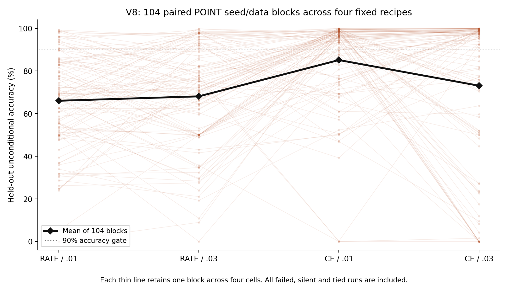

# V8：POINT 损失×学习率交互的全新样本检验

本轮固定104个配对训练/数据区组，共416次训练。每组四种POINT配置共用初始化及数据；每次200次更新、128条训练样本，再用每组512条全新留出样本测试一次。任务、原生硬脉冲/reset、计数读出与V7完全一致。V7样本未加入V8统计。

## 本轮主要结果

唯一主要对比为`(CE/.03−CE/.01)−(RATE/.03−RATE/.01)`的留出准确率差，统计单位为104个完整配对区组。

- 平均交互：**−14.11个百分点**。
- 预先指定的配对均值Student-t 95%区间：**[−22.60,−5.61]个百分点**。
- 预先指定的bootstrap敏感性区间：[−22.56,−5.84]个百分点，方向一致。
- 实际区间半宽8.50个百分点；种子间交互SD43.70个百分点。

在本任务、200次更新及规定的近似区间方法下，负方向再次出现。区间上端仅比−5个百分点的预设实际意义阈值低0.61个百分点，不能把这一边界结果扩大为一般稳健性结论。当前是同一实现和工作流内的新数据检验，不是外部独立复现或同行评议。

| POINT配置 | 平均测试准确率 | 失败次数/104 | 完全静默/104 |
|---|---:|---:|---:|
| RATE/.01 | 66.06% | 87 | 0 |
| RATE/.03 | 68.13% | 79 | 0 |
| CE/.01 | 85.16% | 38 | 2 |
| CE/.03 | 73.13% | 47 | 5 |

失败定义为准确率<90%或覆盖率<90%。所有失败均保留；平票和静默计错。完全弃权与完全静默不同，完整表单独列出。

V7的交互点估计为−33.84个百分点，本轮为−14.11，幅度更小；没有预先规定的跨批次差异检验。本轮CE−RATE的点估计在两档学习率下均为正（.01时+19.10，.03时+5.00个百分点），所以V7中一正一负的点估计排序没有原样重现。这里复现的是负交互方向；它不要求两档学习率下都出现相反排序。.03处简单效应的次要区间仍跨0，不能把点估计当成已确认的提升。

## 为什么是104个区组

由V7交互SD估算，104是使单一主要Student-t区间计划半宽不超过10个百分点的最小整数样本数。计划半宽为9.97个百分点；若真实SD为试点值的1.5倍，则同样样本量的计划半宽约14.95个百分点。这不是功效保证或真实方差的置信界。样本数在任何V8数据生成之前冻结，没有根据结果扩大或停止。

## 文件入口

- [完整报告](REPORT.md)：结果、解释、限制与暂停后的思考问题。
- [全部逐区组结果及区间](TABLES.md)，[CSV](results/per_seed_metrics.csv)。
- [冻结协议](PROTOCOL.md)、[样本量计算](PLANNING.json)、[种子](SEEDS.json)、[对比定义](CONTRASTS.json)。
- [原生/优化器/统计核验](results/verification.json)、[代理梯度审计](results/gradient_audit.json)。
- [资源与计算量](RESOURCE_COST.md)、[环境](ENVIRONMENT.json)、[复查与重现说明](REPRODUCE.md)。
- [提交与来源](PROVENANCE.md)、[历史保存检查](PRESERVATION.json)、[完整文件哈希](MANIFEST.json)。

## 当前停止点

按李则徐的最新要求，本轮在完成核验、报告和本地提交后暂停，不追加实验或启动下一阶段。需要沉淀的是训练配置如何共同影响稳定性，以及当前控制实验能说明什么、尚不能说明什么。

本轮只训练POINT，没有重新比较DEND，不能推出结构优越性、能耗或生物学机制。V1–V7完整保留，工作在本地`research/dendritic-population-v8`分支，没有推送或合并。研究方向与原生发放约束由李则徐提出；协议、实现、执行、核验、图表与报告初稿由AI辅助完成。
