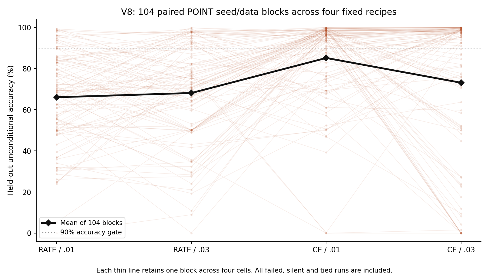
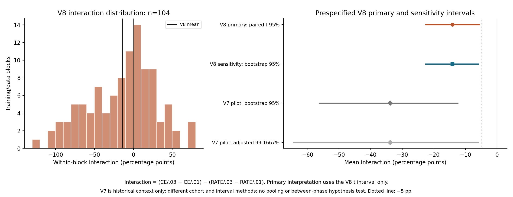
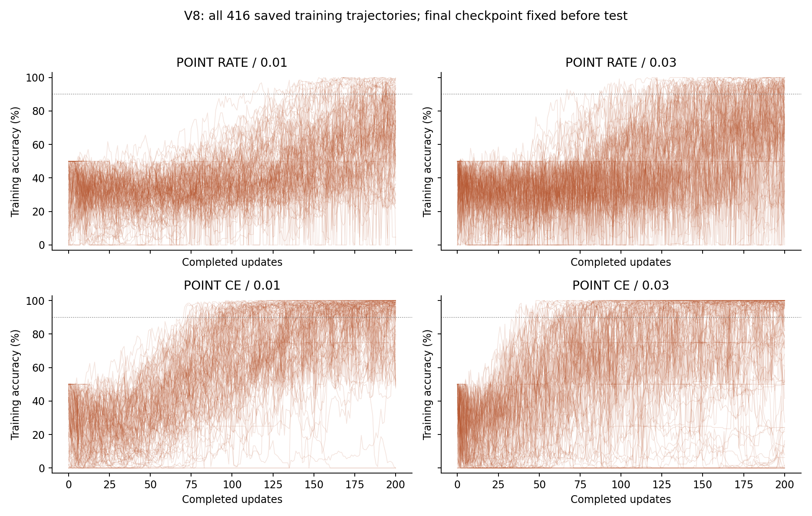

# V8: a fresh-seed test of the POINT loss-by-learning-rate interaction

**The prespecified negative POINT interaction recurred on the fresh cohort under the primary interval rule.** On delayed XOR with 200 updates and 104 new paired training/data blocks, the interaction was **−14.11 percentage points**, with primary Student-t95 interval **[−22.60,−5.61]**. The prespecified bootstrap sensitivity interval was [−22.56,−5.84]. Both support the negative direction; the primary interval governs the conclusion.

The frozen rule for magnitude exceeding 5 points is also met, but the primary upper endpoint is only 0.61 points beyond the −5-point threshold, and coverage is approximate. The measured interaction is less negative than V7's exploratory point estimate of −33.84 points. V7's opposite-direction CE-minus-RATE point estimates across the two learning rates did **not** recur: in V8 those estimates are positive at both rates. These are different features of the factorial result, not interchangeable claims of replication.

All 416 planned training runs and their single held-out evaluations were retained, including 251 held-out failures. Both the separately written native/data/optimizer/statistics checker and the final proxy-gradient audit passed. These are internal consistency checks, not external independent replication.

## Question and scope

V7 identified an exploratory negative loss-by-learning-rate interaction within POINT on delayed XOR. Its twenty seed-block interaction values had a sample standard deviation of 0.5125263075, making a small repeated cohort inadequate for a precise estimate. V8 therefore fixes a larger fresh cohort and one primary question: does `(CE/.03−CE/.01)−(RATE/.03−RATE/.01)` remain negative under the same native-spike task and 200-update training budget?

This question was selected after V7. V8 uses new data and training seeds; it does not pool V7 outcomes with the new cohort or retroactively convert V7 into confirmation. The same implementation and AI-assisted workflow are retained, so this is a new-data internal replication, not external independent replication or peer review. There is no DEND arm, architecture search, independently tuned comparison or claim about structural superiority.

## Fixed sample size and inference plan

There are 104 independent paired seed/data blocks, each containing the four fixed POINT configurations RATE/.01, RATE/.03, CE/.01 and CE/.03: 416 training runs. A block shares training examples, held-out examples and initialization across its four configurations. The inferential unit is the block; four trained models or many episodes within one block do not increase the number of independent blocks.

The V7 pilot interaction SD is 0.5125263075142555. For candidate n, the planning half-width is `t(.975,n−1) * s_pilot / sqrt(n)`. At n=103 it is slightly above 10 percentage points; n=104 is the smallest integer giving no more than 10 points under this plug-in calculation. With t(.975,103)=1.9832641447734565, the planned half-width is 9.9674 points. Multiplying the uncertain pilot SD by 1.5 gives a 14.9510-point planning half-width at the same n. The latter is sensitivity analysis, not a confidence bound on variance. Neither calculation guarantees precision or power, especially with successful and failed-fit mixtures and only twenty pilot blocks.

Sample count is fixed before new outcomes. No optional stopping, seed replacement, adaptive extension or interval-method selection is allowed. A 5-percentage-point interaction magnitude is the prespecified practical threshold; the study is not claimed to estimate a 5-point effect precisely.

For each block s, form the complete paired accuracy contrast `d_s = C3_s − C1_s − R3_s + R1_s`, where R/C identify loss and 1/3 identify learning rate .01/.03. The single primary interval is `mean(d) ± t(.975,103) * sd(d)/sqrt(104)`, using sample SD with 103 degrees of freedom. Paired effects need not be normally distributed: Student-t coverage is approximate here, with an independent-block central-limit rationale rather than an assertion of exact normality.

Interpretation is frozen against the primary interval: an upper endpoint below −.05 supports a negative interaction larger than 5 points within this setup; an upper endpoint below 0 but not below −.05 supports the direction without establishing that magnitude; an interval including 0 is inconclusive rather than equivalence; a lower endpoint above 0 supports the opposite direction. A degenerate interval does not establish population certainty or noninferiority.

A 20,000-resample percentile bootstrap of complete paired block indices provides a prespecified 95% sensitivity interval. It does not replace the primary Student-t interval if the results disagree. The same fixed analysis RNG indices are used across all secondary contrasts. There is one primary estimand and no primary-family multiplicity adjustment; the remaining loss/LR main effects, simple effects, failed-run contrasts and train/test differences remain unadjusted secondary descriptions. They are not alternate success criteria.

## Native task, model and learning

POINT retains twelve native-spiking branch cells, six hidden somata and two output cells, 176 float64 trainable parameters, twenty continuous state variables, six stored previous hidden spikes and two output-count accumulators. Branch, hidden and output firing all use strict `candidate > .5` thresholds and reset. Every emitted forward spike remains hard binary. No separate pulse generator, label-conditioned timing or analog decoder is introduced. The original extra-module request was an author-confirmed misattribution and remains closed.

The model and delayed-XOR generator are inherited unchanged from V7. Inputs have six channels and 24 time steps. Four-step bit cues begin at steps 2–4 and 10–12; their amplitudes are uniform [.8,1.2]. Distractor channel 5 occupies 7–9, common readout cue channel 4 occupies 16–23, and Gaussian .03 noise is added before clipping below zero. All four bit pairs are balanced. Informative cues end by 15, before output counting at 16–23. A unique largest native output count predicts a class. Ties, including complete silence, abstain and count as errors.

Episodes begin at zero state and do not share state or batch statistics. Labels enter the loss and evaluation, never the forward dynamics or timing. Input/recurrent/output weights retain initialization SD .45/.25/.5, with branch/hidden/output biases .15/.05/.1. Each block shares its sampled initial vector across all four configurations.

Each configuration uses 128 balanced training episodes and 200 full-batch Adam updates, beta1=.9, beta2=.999, epsilon=1e-8, global gradient norm clipping at 1 and parameter bounds [−2,2]. CE uses .5 times output counts as logits; RATE compares count/8 with target .75 for the correct output and .125 for the other. Both add .0001 mean squared parameters. The surrogate slope `1/(1+5*abs(candidate-.5))^2`, including reset derivatives, is a proxy learning rule rather than the exact derivative of the discontinuous hard-spike objective.

The final checkpoint is fixed. There is no validation selection, ranking, early stopping, test-based repair or exclusion of failed training runs. Each block receives 512 fresh balanced held-out episodes after the checkpoint commit. Loss effects include the specified scaling, target/logit conventions, gradients, clipping, Adam and regularizer interactions. Matching nominal learning rates does not match effective step sizes or isolate a cellular mechanism.

## Execution gates and outcomes

The protocol, planning calculation, literal seed list, contrast coefficients, scientific code and independent checker were committed before scientific data generation at `cd5cd4ef1cc65fd098b3a73d36d68e7a49307d17`. FREEZE.json locks fifteen files. All 416 completed trajectories, final weights and the independent checker were committed at `3ec9ce117ad3ce1a20d6e5ef4f2395916f120821` before held-out generation. Training and saved diagnostics took 398.3604 seconds; all 250 failed final-training fits were retained. Test evaluation is one guarded invocation; partial or numerical failures are retained, never silently dropped or reseeded.

The registry fixes train seeds `2080000000+10*s`, held-out seeds `2080010000+10*s`, and initialization seeds `2080020000+s`, for s=0…103; analysis seed is 2080030001. The pre-data source audit verified all 3,205 V1–V7 manifest entries and the 313 registered train/test/initialization/analysis integers. An initial substring scan also matched decimal digits inside old floating-point outputs; the pre-data check was corrected to match complete integer tokens. No seeds, model equations or scientific design changed. All earlier results remain unchanged.

A run fails if unconditional accuracy or coverage is below 90%. Fully silent means both readout counts are zero on every episode; fully abstaining means coverage 0 and can also result from nonzero ties. Nonsilent ties and both outputs saturated at 8 spikes are separate outcomes. The report retains all runs, both class recalls, the 2×3 confusion matrix (prediction0/1/abstention), signed count margins, activity and candidate-threshold summaries. Failed, fully silent and fully abstaining run risks receive marginal two-sided 95% Wilson intervals with n=104. Mean episode silence is not the same quantity as fully silent run risk.

Save every initial/final vector, clipped gradient, pre-update count history and loss/gradient/update norm. Nine fixed checkpoints at updates 0,1,5,10,20,50,100,150,200 supply training diagnostics; they do not select a checkpoint. Complete final-training and held-out native spikes, counts, predictions, states and candidates are retained. Train/test pass/fail transitions are reported rather than assuming that all failures or successes transfer identically.

## Results

All 416 planned models completed 200 updates and one held-out evaluation. These results concern the unchanged delayed-XOR distribution, 128 training and 512 held-out episodes per block, and the fixed 104-block cohort. Every abstention counts as an error.

| Fixed POINT cell | Mean train accuracy | Mean test accuracy | Mean coverage | Failed /104 | 95% Wilson failure interval | Fully silent /104 | Fully abstaining /104 |
| --- | --- | --- | --- | --- | --- | --- | --- |
| RATE_0.01 | 66.89% | 66.06% | 80.50% | 87 | [75.37%, 89.54%] | 0 | 1 |
| RATE_0.03 | 68.55% | 68.13% | 84.71% | 79 | [66.92%, 83.15%] | 0 | 1 |
| CE_0.01 | 85.85% | 85.16% | 92.69% | 38 | [27.92%, 46.12%] | 2 | 2 |
| CE_0.03 | 73.54% | 73.13% | 78.57% | 47 | [35.97%, 54.76%] | 5 | 7 |

The 90% accuracy/coverage gate was passed by 17, 25, 66 and 57 of 104 models at RATE/.01, RATE/.03, CE/.01 and CE/.03 respectively. These are fixed-cell descriptions, not a selected optimum or a comparison against DEND. A high or low average accuracy is different from the probability that a trained run passes the gate.

### Single primary interaction and realized precision

| Quantity | Observed value |
| --- | --- |
| Paired interaction mean (pp) | -14.11 |
| Sample SD of block effects (pp) | 43.697729 |
| Standard error (pp) | 4.284915 |
| Primary Student-t95 interval (pp) | [-22.60, -5.61] |
| Realized primary half-width (pp) | 8.498118 |
| Bootstrap95 sensitivity interval (pp) | [-22.56, -5.84] |
| Independent paired blocks / df | 104 / 103 |

The primary interval lies below zero and below −5 percentage points, meeting both prespecified interpretation rules for this task and fixed budget. Its upper endpoint is −5.6076 points, only 0.6076 points beyond the practical threshold. Reported precision is approximate; the cutoff should not be treated as a sharp boundary of scientific certainty. The sensitivity interval agrees in direction, without changing the primary decision method.

The realized block-effect SD was 43.70 points, below the V7 pilot SD of 51.25 points. The realized half-width was 8.50 points, compared with the pre-data plug-in target of 9.97 points. That observed width follows the fixed 104-block run; it was not obtained by stopping when a desired interval appeared. No additional seeds were added after seeing the estimate.

A negative interaction means increasing the learning rate from .01 to .03 has a less favorable accuracy effect under CE than under RATE. It does not require CE to be worse than RATE at either learning rate, nor require both learning-rate effects to be negative.

### Simple effects and the relationship to V7

The following intervals are secondary, unadjusted and pointwise. They explain the factorial estimate without replacing the primary result.

| Secondary simple accuracy contrast | Mean (pp) | Pointwise bootstrap95 interval (pp) |
| --- | --- | --- |
| loss_at_0.01 | +19.10 | [+13.76, +24.40] |
| loss_at_0.03 | +5.00 | [-3.02, +12.92] |
| lr_at_RATE | +2.07 | [-2.48, +6.56] |
| lr_at_CE | -12.03 | [-19.56, -4.82] |

CE-minus-RATE was +19.10 points at .01 and +5.00 points at .03. Increasing LR averaged +2.07 points under RATE and −12.03 points under CE; their difference is the −14.11-point interaction. The CE-minus-RATE estimate at .03 has a secondary interval spanning zero. V8 thus reproduces a negative interaction direction under the primary rule, while V7's crossover of CE-minus-RATE point estimates (+15.94 at .01 and −17.90 at .03) does not reappear. An interaction and a crossover are not the same claim.

V7's interaction estimate was −33.84 points in twenty blocks; V8's is −14.11 in a separate 104-block cohort. The point estimate is less negative here, but no formal between-cohort contrast was prespecified or performed. The studies are not pooled, neither cohort is discarded, and V8 does not establish that the effect has a stable numerical magnitude across cohorts.

The failed-run interaction was +16.35 points, with secondary bootstrap95 interval [−0.96,+32.69]. This thresholded risk summary remains inconclusive about its interaction direction despite the primary unconditional-accuracy result. All eighteen paired contrast records, including the other main effects and train/test accuracy differences, appear in [TABLES.md](TABLES.md).

### Failure modes and training versus held-out data

RATE/.01 and RATE/.03 had no silent episodes, yet each had one fully abstaining model. RATE/.01 seed 68 produced 2/2 ties on 52 held-out episodes and 3/3 ties on 460; RATE/.03 seed 40 produced 4/4 ties on every held-out episode. These are neither silence nor 8/8 saturation. Mean nonsilent-tie fractions were 19.50% and 15.29%, respectively.

CE/.01 had two fully silent models, seeds 15 and 19. CE/.03 had five fully silent models, seeds 15, 29, 47, 54 and 84, and two additional fully abstaining models, seeds 23 and 90, with 8/8 saturated ties throughout. Across CE/.03's 104 models, episode silence averaged 13.85%, nonsilent ties 7.59%, and total abstention 21.43%. These outcomes are kept distinct; failure does not automatically mean silence, and a final-state phenotype does not identify why training entered it.

| Fixed cell | Train fail/test fail | Train fail/test pass | Train pass/test fail | Train pass/test pass |
| --- | --- | --- | --- | --- |
| RATE_0.01 | 85 | 2 | 2 | 15 |
| RATE_0.03 | 78 | 2 | 1 | 23 |
| CE_0.01 | 35 | 1 | 3 | 65 |
| CE_0.03 | 46 | 1 | 1 | 56 |

There were 250 failed final-training fits and 251 failed held-out fits. Of 416 models, 244 failed both, 159 passed both, six changed from train-fail to test-pass and seven from train-pass to test-fail. Most failed fits were already below the gate on training examples, but thirteen classifications changed across the two sample sets. Small accuracy or coverage shifts around the fixed 90% cutoff can change this binary label; the report retains both continuous performance and thresholded events.

The four conditions share a block's data and initialization. Lines preserve that pairing; they do not represent 416 independent blocks.

The Student-t interval is primary. The bootstrap interval is sensitivity only; both use the paired block contrast. V7 rows are historical, unpooled context and use different interval procedures; the figure is not a formal between-cohort comparison.

Training histories were retained as diagnostics and did not select checkpoints or remove failed fits. [TABLES.md](TABLES.md) preserves all 832 final-training/held-out outcome rows and their activity summaries, class recalls, confusion matrices, all paired inputs and the literal seeds.

## Resources and verification

Execution is bounded by 900 seconds for training plus diagnostics, 600 seconds for held-out evaluation/artifacts, and 900 seconds per audit. CPU-only execution retains one BLAS/OpenMP thread and the existing NumPy model implementation. SciPy was already installed and is used for planning and independent Student-t quantile verification; no installation or paid compute is required. Training and saved diagnostics took 398.36 seconds; held-out evaluation plus artifact generation took 77.13 seconds. The native test calls themselves totaled 3.25 seconds, with the rest including metrics, compression and I/O. Native verification took 107.83 seconds and proxy-gradient auditing 191.86 seconds. Each stage stayed within its cap. The audit jobs overlapped, so their wall times must not be summed as total elapsed workflow time. Python 3.12.14 and NumPy 2.3.5 ran on CPU; SciPy 1.17.0 supported planning/quantile checks and Matplotlib 3.10.8 supported reporting, all already installed.

| Resource per POINT model | Fixed value |
|---|---:|
| Float64 trainable parameters | 176 |
| Continuous state values | 20 |
| Stored previous hidden spikes / output counters | 6 / 2 |
| Branch / hidden / output cells | 12 / 6 / 2 |
| Batch / time steps / updates | 128 / 24 / 200 |
| Dense forward / backward MAC terms per episode-step | 156 / 240 |

Across the completed 416 trajectories, 83,200 learning updates imply 39,872,102,400 dense forward MAC terms and 61,341,696,000 backward terms. The 3,744 fixed checkpoint diagnostic batches add 1,794,244,608 forward terms, and held-out model calls add 797,442,048. These counts exclude scalar nonlinearities, reset operations, loss/clipping/Adam, data generation, compression, I/O and numerical audits. Equal matrix-work counts do not establish equal wall time, effective updates, energy or hardware cost.

Pre-data contract checks passed exact native parity with V7, batch splitting/permutation/reset, label-free forward signature, and strict threshold/reset/binary checks. The erased-prefix fixture checks identical state before the second cue; it is not an accuracy experiment for a restricted-memory classifier. The initial 704 locally anchored finite differences had maximum surrogate-chain-rule residual 2.3736503686e-10. The inherited deterministic fixture tests both branches of the model implementation; DEND is not scientifically trained or compared in V8.

The separately written [native/data/optimizer/statistics verifier](results/verification.json) passed 555,877 checks. It independently regenerated inputs and initialization, reconstructed all 83,200 Adam updates from saved clipped gradients and all 3,744 checkpoint vectors, and checked every stored count-derived history row. Native replay covered 479,232 training-checkpoint model-episodes. Intermediate checkpoints compare saved metrics and available count histories; complete intermediate spike/state arrays were not stored. Full final-training trajectory comparison covered 53,248 model-episodes and held-out comparison covered 212,992, with exact spikes, counts and predictions. Maximum state/candidate residual was 3.5527e-15 on both training and held-out data, below the 1e-10 tolerance.

The same checker independently recomputed the eighteen paired contrast records, primary Student-t interval and decision flags, bootstrap sensitivity, and twelve Wilson event intervals. It verified 66,560 distinct histories: 13,312 training and 53,248 held-out, reused across four models within each paired block. Dataset uniqueness and separate RNG streams complement the reset/source checks; uniqueness alone does not prove statistical independence.

The [proxy-gradient audit](results/gradient_audit.json) replayed 1,248 sampled training updates on each full 128-episode training batch, with zero clipped-gradient residual. At each of 416 final checkpoints it checked all 176 locally anchored parameter derivatives using the first two saved training episodes, totaling 73,216 scalar derivatives with maximum error 7.0411e-10. These final finite differences do not cover every training episode. These finite differences validate the chosen differentiable proxy graph, not the exact hard-spike derivative. Sampled gradient replay reuses the frozen analytic backward implementation. The native/data/Adam/statistics checker is separately written, but it does not independently derive every proxy gradient or replay full native trajectories at every unsampled training update.

No scientific run was restarted, no seed was replaced, and no outcome changed the frozen design, source or sample count. All 416 runs were included. Earlier V1–V7 records were preserved; final provenance and manifest checks record the 3,205 historical entries. All verification is internal to the same AI-assisted workflow, not external independent replication or peer review. Numerical consistency does not remove the statistical uncertainty of the estimate.

## Interpretation and unresolved questions

Within the unchanged POINT dynamics, the fresh cohort supports a negative interaction between these two loss definitions and two learning rates under the prespecified primary procedure. The implication is conditional: describing CE or learning rate without the other setting loses information about training outcomes on this task. It does not justify calling a loss universally better or a higher learning rate universally harmful.

Passing native-readout fits occurred in every fixed cell, alongside substantial failure rates. That observation establishes attainability of the 90% gate for some runs of this exact procedure, while leaving reliability across training seeds as a separate issue. It does not establish task-general representational capacity or compare neuronal structures.

The mechanism producing the measured interaction remains unresolved. Fixed loss scaling, surrogate gradients, clipping, Adam, reset dynamics and different activity patterns coexist in the learning process. The retained diagnostic phenotypes describe silence and ties; they do not causally apportion responsibility among those mechanisms. The difference between V7's and V8's point estimates also cautions against treating a small exploratory cohort as a stable effect-size estimate.

The requested V8 execution ends with this report and its verification record. Work is paused for reflection: no new experiment, additional run, architecture change or subsequent phase is proposed for automatic execution.

## What this does not establish

A POINT-only experiment cannot compare architectures or establish structural superiority. It does not establish task-independent representational ability, biological realization, hardware efficiency, energy savings, or equivalence from inconclusive intervals. Success or failure under one finite training budget does not prove general representational capacity or impossibility. A computational loss/LR interaction does not by itself identify the mechanism that produced collapsed or successful training.

## Limitations

The study retains one delayed-XOR distribution, two loss definitions, two learning rates, 128 training and 512 held-out episodes per block and 200 updates. The question was selected from an exploratory prior study, although the new data and seeds are held out from that selection. Both primary Student-t and sensitivity bootstrap coverage are approximate for mixture-like seed outcomes. Realized variability and interval width must be reported; the planning target is not guaranteed.

All four configurations are fixed, not independently optimized. Secondary contrasts have multiplicity and cannot replace the single primary question. Native silence and ties remain outcomes of the required decoder. Internal consistency checks do not remove statistical, implementation or scope uncertainty.

## Attribution and artifacts

Li Zexu proposed the research direction and native-firing requirement. Protocol, implementation, execution, numerical verification and report drafting are AI-assisted. [PROTOCOL.md](PROTOCOL.md), [PLANNING.json](PLANNING.json), [SEEDS.json](SEEDS.json), [CONTRASTS.json](CONTRASTS.json) and the frozen source record document the design. [TABLES.md](TABLES.md), figures and complete result archives retain all outcomes. [RESOURCE_COST.md](RESOURCE_COST.md) separates computational costs; [PROVENANCE.md](PROVENANCE.md), [PRESERVATION.json](PRESERVATION.json), [REPRODUCE.md](REPRODUCE.md) and [MANIFEST.json](MANIFEST.json) document commit gates, preservation, reproduction and integrity. The final commit hash is reported in the handoff rather than embedded in its own manifest. No publication or subsequent experimental phase was executed.
