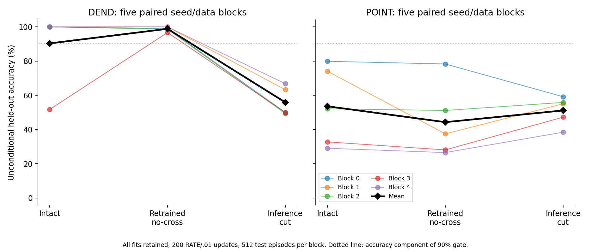
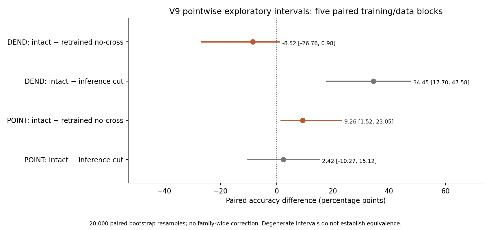
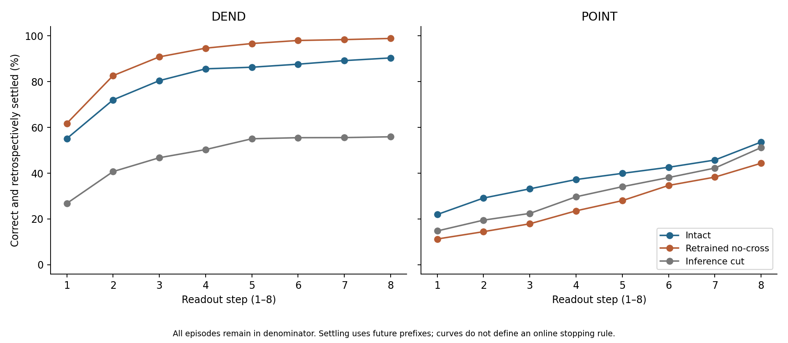

# V9: Cross-cell recurrence controls on native-spike delayed XOR

Date: 2026-11-04. Status: completed bounded experiment; internal checks passed. This report resumes the research under the new blueprint while preserving all V1–V8 artifacts and the historical V8 pause.

## Finding

The experiment tests learned solutions under one fixed RATE/.01 recipe, 200 updates, five paired seed/data blocks, 128 training and 512 fresh held-out episodes per block. It compares intact training, training with cross-cell recurrence fixed to zero, and cutting an intact model only at inference.

**DEND:** intact passes 4/5; retrained no-cross passes 5/5; inference cut passes 0/5. Mean held-out accuracies are 90.35%, 98.87%, and 55.90%, respectively. The intact-minus-retrained difference is -8.52 percentage points, pointwise exploratory 95% paired-bootstrap interval [-26.76, 0.98], in these five blocks and this fixed budget.
The 5 passing no-cross DEND fits demonstrate observed solutions that meet this finite task's accuracy/coverage gate without cross-cell recurrence. This result concerns a population with retained self-feedback and state; it does not show that one cell solves every possible delayed-XOR input.

**POINT:** intact passes 0/5; retrained no-cross passes 0/5; inference cut passes 0/5. Mean held-out accuracies are 53.59%, 44.34%, and 51.17%, respectively. The intact-minus-retrained difference is 9.26 percentage points, pointwise exploratory 95% paired-bootstrap interval [1.52, 23.05], in these five blocks and this fixed budget.
No retrained no-cross fit passed this gate. Five failures under this recipe and budget do not prove physical necessity, representational impossibility, or failure under other learning rules.

Inference cutting tests dependence of a particular learned solution; it does not test whether alternative no-cross solutions can be trained. These two controls must be interpreted separately. No claim of a general DEND-versus-POINT ordering is made.

## Frozen design and provenance

- Preserved V8 starting commit: `9cddbbad7f1722d8a116c0a8245fc40d3a5e97ca`.
- Protocol/source/seed commit, before scientific data: `ad1d807b1d48be559fd67d4f6d196b8693b4da90`.
- Training data, all 20 fits and 10 derived cuts committed before test generation: `d4fde77eb49e21c00950cb93050819ab72032e90`.
- Freeze SHA-256: `d402df8ab41e934b83ffdb5d1bda8a6126f3719040386689cfd0da0a7adf7ed9`.
- Training-lock SHA-256: `5a86b32efc0a7623e65f4228548384bdd39c12e617f69a32b874d9191201a122`.
- [Protocol](PROTOCOL.md), [seed registry](SEEDS.json), [all per-seed tables](TABLES.md), [resource accounting](RESOURCE_COST.md), and [audit outputs](results/verification.json) retain the details.

The forward equations, initialization distribution and task generator are preserved from V8/V2. Both architectures use native hard spikes with strict candidate > 0.5 and reset at hidden/output layers; POINT branches also spike/reset, while DEND branches remain graded. There is no external pulse generator, label-conditioned forward signal, analog decoder or altered tie rule. Each episode resets its state independently. The labels are used only in the loss and evaluation.

Each 24-step history presents two independently balanced bit cues; the informative second cue ends by step 15. The common readout occupies steps 16–23. The target is their XOR. Native output spike counts over those eight steps predict only when the winner is unique; ties and silence abstain and count as errors. Frozen RATE targets are .75/.125 of the eight-count scale; Adam uses learning rate .01, standard .9/.999 moments, global gradient-norm clip 1 and parameter clipping to [−2,2]. The learning slope 1/(1+5|candidate−.5|)^2 is a surrogate, not the derivative of the hard-spike function.

The retrained intervention zeros the 60 recurrent weights from a soma to branches of other cells before training. Twelve within-cell feedback weights survive. Gradients are masked before global clipping; parameters and moments remain zero on the removed slots. Intact and retrained initialization agree on retained coordinates. Retrained capacity is 116 effective parameters versus 176 intact, although storage and the unchanged regularizer denominator remain 176. Derived cut vectors equal the intact final weights multiplied by this same mask, and receive no optimization.

No validation selection, checkpoint selection, hyperparameter search, seed replacement or test-driven refinement was performed. All 20 fixed fits and 30 final model evaluations are retained. Pre-data deterministic fixtures check state reset and batch independence; no additional held-out no-history ablation was performed. The recurrence controls therefore do not identify the detailed mechanism that stores either bit.

## Results and uncertainty

| Arm | Condition | Mean accuracy (%) | Mean coverage (%) | Failures / 5 | Failure risk Wilson 95% (%) | Fully silent / 5 |
|---|---|---:|---:|---:|---|---:|
| DEND | intact | 90.35 | 92.07 | 1 | [3.62, 62.45] | 0 |
| DEND | retrained | 98.87 | 99.45 | 0 | [0.00, 43.45] | 0 |
| DEND | cut | 55.90 | 92.15 | 5 | [56.55, 100.00] | 0 |
| POINT | intact | 53.59 | 70.66 | 5 | [56.55, 100.00] | 0 |
| POINT | retrained | 44.34 | 67.50 | 5 | [56.55, 100.00] | 0 |
| POINT | cut | 51.17 | 80.16 | 5 | [56.55, 100.00] | 0 |

A failure is accuracy < 90% or coverage < 90%; means alone do not determine a pass. Class recalls, balanced accuracy, confusion matrices, silence and nonzero ties appear for every block in [TABLES.md](TABLES.md) and [the 50-row training/test CSV](results/per_seed_metrics.csv). All labels are balanced, so balanced and ordinary accuracy agree; both are recorded. Label-independent binary guessing with coverage c has expected unconditional accuracy c/2, not a universal 50% baseline when abstention occurs.

| Paired accuracy contrast | Mean (pp) | Pointwise exploratory 95% interval (pp) |
|---|---:|---|
| DEND: intact − retrained | -8.52 | [-26.76, 0.98] |
| DEND: intact − cut | 34.45 | [17.70, 47.58] |
| POINT: intact − retrained | 9.26 | [1.52, 23.05] |
| POINT: intact − cut | 2.42 | [-10.27, 15.12] |

The two intact-minus-retrained accuracy contrasts were prespecified as primary descriptive outcomes. Four accuracy and four failure-risk contrasts are reported with the same five-block resampling and no multiplicity protection. They are exploratory, not confirmatory evidence from a protected hypothesis family. The independently trained seed/data block is the statistical unit: neither 512 episodes per model nor 20,000 bootstrap draws increases n beyond five.

Intervals are percentile paired bootstrap intervals. Degenerate intervals such as [0,0] reflect the observed five blocks; they do not establish population equivalence or a noninferiority bound. Even zero observed failures in five blocks has a marginal 95% Wilson upper bound of about 43.45%. Crossing zero likewise does not establish equivalence.

## Activity, settling and cost

| Arm | Condition | Mean total native events / episode | Mean state L1 variation / episode | Correct-settled by first readout step (%) | By eighth step (%) |
|---|---|---:|---:|---:|---:|
| DEND | intact | 66.170 | 50.974 | 55.12 | 90.35 |
| DEND | retrained | 64.305 | 50.213 | 61.76 | 98.87 |
| DEND | cut | 61.948 | 45.983 | 26.80 | 55.90 |
| POINT | intact | 47.577 | 51.515 | 21.95 | 53.59 |
| POINT | retrained | 43.395 | 46.221 | 11.25 | 44.34 |
| POINT | cut | 44.609 | 47.714 | 14.77 | 51.17 |

The activity table includes all episodes, including failures and abstentions. DEND branch states produce no discrete branch events but still require state updates. Raw event totals are not a matched-performance energy comparison. State L1 variation depends on the chosen state representation and scale; neither measure estimates joules, ATP or biological metabolism.

A prediction is retrospectively settled at a readout prefix only when its unique winner matches the final winner at all later prefixes. Correct-and-settled curves retain wrong/abstaining examples in their denominator, so their final point equals accuracy. This metric uses future observations and does not replace the fixed eight-step decoder with an online early stopping policy. Steps are not interpreted as biological milliseconds.

The 4,000 Adam updates use 1,916,928,000 training-forward and 2,949,120,000 backward dense MAC terms. Nine diagnostic forwards per fit add 86,261,760; held-out inference adds 57,507,840. Dense zero-weight multiplication is still counted. Recorded training/artifact time is 18.400 s and held-out/artifact time 4.890 s on this execution. These times and arithmetic counts are not energy or hardware efficiency measurements. The [complete resource table](RESOURCE_COST.md) identifies unequal effective parameter counts, branch nonlinearities, reset derivatives and activity patterns.

## Numerical verification

Pre-data deterministic fixtures passed native forward identity with the preserved V2 implementation, hard thresholds/reset, binary spikes, batch independence and constrained masks. The 704 intact local surrogate derivative checks had maximum error 2.37365e-10; the 232 active-coordinate masked checks had maximum error 1.13509e-10. These fixtures generated no scientific training or test data.

Both saved audits report PASS: [native/data/Adam/statistics replay](results/verification.json) and [gradient audit](results/gradient_audit.json). The gradient audit replays 60 full-batch gradients at updates 0/99/199; maximum residual is 0. Its 2,920 final-checkpoint local surrogate finite differences have maximum absolute residual 4.8385e-11.

The scalar native/optimizer/data/statistics checker passed 44,671 assertions. Maximum final-training/test state or candidate residual was 8.88178e-16; spikes, counts and predictions matched exactly. It verified 3,200 distinct train/test histories without exact duplicates.

The separately written scalar native verifier regenerates data and initialization, reconstructs all 4,000 Adam updates from saved clipped gradients, checks all 180 checkpoints, verifies exact masked slots/moments and cut provenance, and replays every final-training and held-out model episode. Spikes, counts and predictions must match exactly; states/candidates use the frozen 1e-10 tolerance. It independently recomputes metrics, activity, settling and paired statistics. Sampling the frozen analytic backward is not a fresh derivation of every gradient. Finite differences apply to a locally anchored surrogate graph, not to the discontinuous native-spike map.

All checks belong to this same AI-assisted workflow. They are not external independent replication and not peer review. Source and artifact hashes allow others to inspect and rerun the study.

## What this does not establish

- Finite-budget retraining failure cannot prove that cross-cell recurrence is physically necessary or that a representation is impossible.
- A passing no-cross population is not a one-neuron solution and does not prove exact correctness on all possible task inputs.
- Cutting an intact solution does not establish the absence of alternative trainable solutions without that pathway.
- These five blocks and one task do not rank architectures generally, establish equivalence, or justify a breakthrough claim.
- Event counts and state changes do not establish energy, hardware, biological or metabolic benefits.
- Retrospective settling does not establish an online stopping rule or a physical decision-time benefit.

## Limitations

The study has five independent paired training/data blocks, one delayed-XOR distribution and one fixed training recipe/budget. There is no independent replication or broad task transfer. Both initial weights and datasets vary together across blocks; their variance contributions cannot be separated. Holding the optimizer recipe fixed isolates the preregistered intervention within that recipe, not optimization quality across all recipes.

Masking reduces the number of effective parameters and changes the gradient-normalization geometry. The no-cross model retains graded or spiking branch states, self recurrence and a multi-cell output network. This study does not distinguish those remaining memory/computation pathways. Pointwise bootstrap intervals at n=5 are limited and do not protect the full eight-contrast family. Test episodes provide held-out observations within the balanced block design, not independent fitted models.

Dense MAC terms omit scalar operations, optimizer work and audit costs. Native branch-event semantics differ between DEND and POINT. Activity and retrospective settling are descriptive recorded outcomes, not new losses or selection criteria. Earlier studies remain frozen; V10 has a separate protocol and cannot retrospectively change these V9 endpoints.

## Attribution and reproducibility

Research direction and native-firing requirements were proposed by Li Zexu. Protocol refinement, implementation, local execution, numerical checking and this report draft were AI-assisted. No journal submission or peer-review status is implied.

Read [README.md](README.md) for artifact locations and replay commands. `summarize.py` reads only saved audited outputs and never trains or evaluates a model. The final file manifest, maintained separately, covers scientific sources, datasets, weights, traces, audits, tables and figures. All V1–V8 files and main-branch history are preserved.
